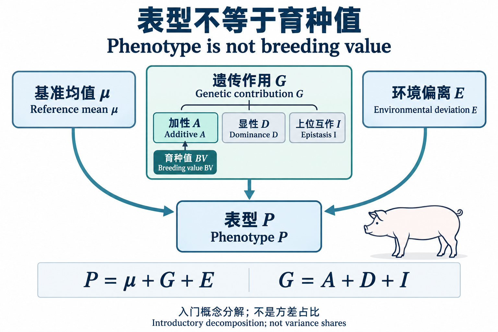
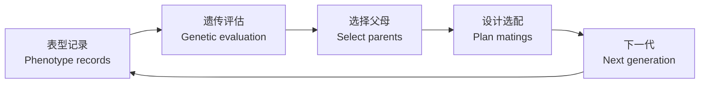

# 01-0｜育种与遗传基础 / Breeding and inheritance

[目录 / Contents](00-目录.md) · [下一章 / Next](02-0-性状与类型.md)

一头猪吃得更好，当期增重就可能变快，我想先弄清楚这件事跟育种改良差在哪里。  
A pig may grow faster this period because it is fed better, and I want to understand how that differs from genetic improvement.

我会把能直接量到的表型、背后的遗传作用、以及选父母之后下一代会发生什么，分成三个问题。  
I separate three questions: what phenotype we can measure, what genetic effects underlie it, and what may change in the next generation after selecting parents.

> **我的笔记｜表现优秀，不一定意味着遗传能力优秀。**  
> **My note | Excellent performance does not necessarily mean excellent genetic merit.**

例如甲猪日增重 900 g/day，乙猪 850 g/day，若甲用了更好的饲料，现有记录还不足以判断甲的估计育种值更高。  
For example, pig A gains 900 g/day and pig B 850 g/day, but if A received better feed, these records alone cannot establish that A has the higher estimated breeding value.

我会把这 50 g/day 先记作观察差，再查比较条件和遗传评估，这样后面每次看到报表变化都能追到同样的起点。  
I would record the 50 g/day as an observed difference, then check comparison conditions and genetic evaluation so changes in later reports can be traced from the same starting point.

## 01 · 育种在改变什么 / What breeding changes

- **饲养管理**改善当前动物的环境，例如营养和温度。  
  **Management** improves the environment of current animals, including nutrition and temperature.

- **繁殖**让动物产生后代。  
  **Reproduction** produces offspring.

- **育种**通过选择和配对，改变后代群体的遗传组成。  
  **Breeding** changes the genetic composition of future populations through selection and mating.

新饲料能让这批猪长得更快，但这项改善本身不能证明发生了遗传进步。  
A new diet may make current pigs grow faster, but that improvement alone does not demonstrate genetic progress.

---

## 02 · 先认四个生物学词 / Four biological terms

- **DNA**是存储遗传信息的分子。  
  **DNA** is the molecule that stores inherited information.

- **染色体**是 DNA 的组织载体。  
  **Chromosomes** organize and carry DNA.

- **基因**是具有生物学功能的 DNA 区段。  
  **Genes** are DNA regions with biological functions.

- **等位基因**是某个位点的不同版本。  
  **Alleles** are alternative versions at a locus.

可以把它们粗略类比为存储、文件组织、功能模块和模块版本。  
A rough computing analogy is storage, file organization, functional modules, and module versions.

这个类比有限，因为基因并不是功能一一独立的软件函数。  
The analogy is limited because genes are not independent software functions with one-to-one outputs.

对常染色体位点，动物通常从父母各获得一个拷贝。  
At an autosomal locus, an animal normally receives one copy from each parent.

- 两个拷贝相同，叫**纯合**。  
  Identical copies are **homozygous**.

- 两个拷贝不同，叫**杂合**。  
  Different copies are **heterozygous**.

大多数生产性状受到许多位点共同影响，不能用一个“优秀基因”解释全部表现。  
Most production traits involve many loci, so one “good gene” cannot explain overall performance.

---

## 03 · 表型是观测结果 / Phenotype is the observed result

**表型**是观察或测量到的表现，例如日增重 850 g/day。  
A **phenotype** is an observed or measured outcome, such as daily gain of 850 g/day.

**基因型**是动物的遗传构成。  
A **genotype** is an animal's genetic constitution.

最简单的概念式是“表现 = 群体均值 + 遗传作用 + 环境作用”。  
The simplest conceptual model is “performance = population mean + genetic contribution + environmental contribution.”

$$
P=\mu+G+E,\qquad G=A+D+I
$$

- $P$ 是表型，$\mu$ 是群体均值。  
  $P$ is phenotype, and $\mu$ is the population mean.

- $G$ 是总遗传作用，$E$ 是环境偏离。  
  $G$ is the total genetic contribution, and $E$ is the environmental deviation.

- $A$ 是加性作用，描述等位基因替换的平均效应。  
  $A$ denotes additive effects, which describe average allele-substitution effects.

- $D$ 是显性偏离，涉及同一位点两个拷贝的组合。  
  $D$ denotes dominance deviations involving combinations of copies at one locus.

- $I$ 是上位互作，涉及不同位点之间的组合。  
  $I$ denotes epistasis, involving interactions across loci.

加性作用适合用于预测跨代传递，而显性与互作组合可能在下一代重排。  
Additive effects support prediction across generations, while dominance and interaction combinations may be rearranged in offspring.

这个式子是入门分解，实际模型还可能需要基因型与环境互作。  
This introductory decomposition may need genotype-by-environment interaction in practice.

**图 01-0A｜**表型由参考均值、遗传作用和环境偏离共同构成，育种值对应这里的加性部分 A。  
**Figure 01-0A |** Phenotype combines the reference mean, genetic contributions, and environmental deviation, with breeding value corresponding to the additive part A here.

框的面积和颜色不表示方差比例，各效应可有正负，实际模型可能还需基因型与环境互作。  
Box areas and colors do not represent variance shares, effects can be positive or negative, and actual models may also require genotype-by-environment interaction.

---

## 04 · 同胞为什么不一样 / Why siblings differ

生成精子和卵子时会发生分离与重组，因此同一对父母的后代得到的遗传组合不同。  
Segregation and recombination during gamete formation give offspring of the same parents different genetic combinations.

即使是同胞，经历的环境也可能不同。  
Even siblings can experience different environments.

用计算机类比，相同的抽样来源不代表每次得到相同的输出。  
In computing terms, the same source distributions do not produce identical sampled outputs every time.

---

## 05 · 把全流程连起来 / Connect the workflow

表型记录用于评估，EBV 用于选择，选配产生下一代，下一代记录再进入新一轮。  
Phenotype records support evaluation, EBVs inform selection, matings produce the next generation, and new records feed the next cycle.

生产管理贯穿这个流程，同时影响记录和实际收益。  
Management affects both records and production outcomes throughout this cycle.

### 饲料变化后，回查哪些记录 / What to Check After a Feed Change

新饲料让平均增重上升时，我会先看记录能否区分管理改善与遗传改变。  
When new feed raises mean daily gain, I first check whether the records can distinguish management improvement from genetic change.

---

## 我的核对笔记 / My Verification Notes

如果只看到前后两批猪的平均增重，我会先查饲料、测定条件和比较对象，再追问有没有支持遗传变化的评估结果。  
If all I see are the average gains of two batches, I first check feed, testing conditions, and the animals being compared, then look for evaluation evidence of genetic change.

记录、评估、选择、选配是一条完整链路，父母选得再准，后续也还要靠新一代记录来检验改良方向。  
Recording, evaluation, selection, and mating form one process, and records from the next generation are needed to check the direction of improvement even when parent selection is accurate.

## 延伸阅读 / Further reading

下面按原始阅读列表顺序提供本地详读，重复来源复用同一篇笔记以保持解释一致。  
Local readings follow the original source-list order, reusing a single note for repeated sources to keep explanations consistent.

- **[数量遗传学与遗传作用](01-1-数量遗传学与遗传作用详读.md)**。  
  **[Quantitative genetics and genetic effects](01-1-数量遗传学与遗传作用详读.md)**.

- **[遗传改良与杂交体系](01-2-遗传改良与杂交体系详读.md)**。  
  **[Genetic improvement and crossbreeding systems](01-2-遗传改良与杂交体系详读.md)**.

原始来源链接保留如下，无法直接读取的来源及实际使用的替代材料已在对应详读中说明。  
Original source links follow, with unavailable sources and the alternatives actually used identified in the corresponding notes.

- [UNE 数量遗传学课程](https://jvanderw.une.edu.au/325TT)。  
  [UNE quantitative-genetics course](https://jvanderw.une.edu.au/325TT).

- [Purdue：猪育种基础与杂交](https://www.extension.purdue.edu/extmedia/NSIF/NSIF-1/NSIF-FS1.html)。  
  [Purdue: swine improvement and crossbreeding](https://www.extension.purdue.edu/extmedia/NSIF/NSIF-1/NSIF-FS1.html).
