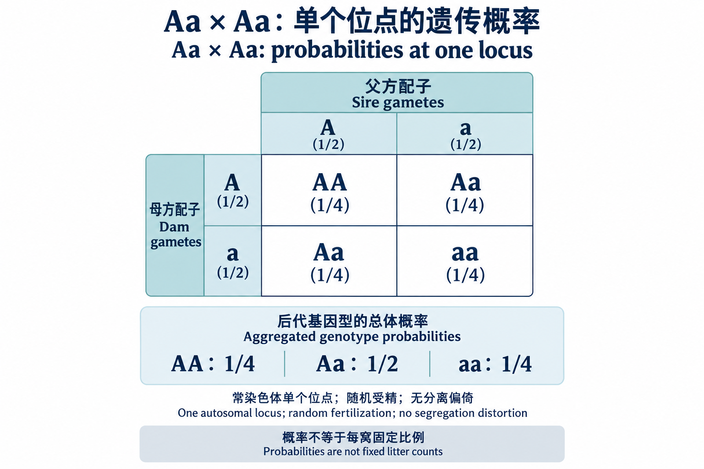
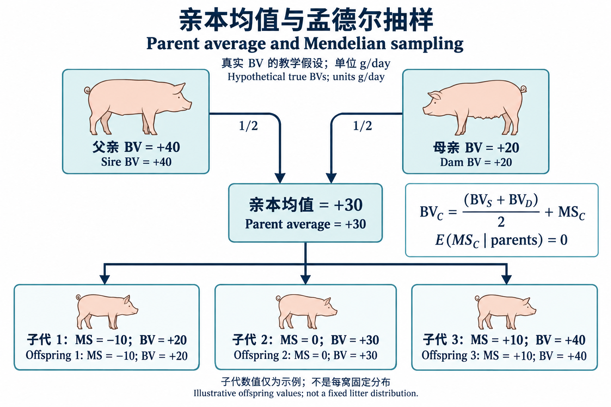

# 01-1｜数量遗传学与遗传作用 / Quantitative genetics and genetic effects

[目录 / Contents](00-目录.md) · [返回主文 / Main chapter](01-0-育种与遗传基础.md)

我想把同父同母的猪为什么长得不同拆成三行来看，哪一项来自亲本均值，哪一项来自遗传抽样，哪一项要回头查环境。  
To understand why full siblings grow differently, I track three possible sources: their parent average, genetic sampling, and the environment I need to check.

原阅读是 [UNE 数量遗传学提纲](https://jvanderw.une.edu.au/325TT)，本次直接读取失败，仅检索缓存可见部分主题。  
The original reading is the [UNE quantitative-genetics outline](https://jvanderw.une.edu.au/325TT), whose direct retrieval failed, with only some topics visible in search cache.

以下讲解另依据已读取的 [MU 遗传术语](https://extension.missouri.edu/publications/g2030)与 [Purdue 遗传参数](https://www.extension.purdue.edu/extmedia/NSIF/NSIF-FS3-W.html)，不冒充未读提纲的全文摘要。  
The explanation instead draws on the readable [MU glossary](https://extension.missouri.edu/publications/g2030) and [Purdue genetic parameters](https://www.extension.purdue.edu/extmedia/NSIF/NSIF-FS3-W.html), without claiming a full summary of the unavailable outline.

本篇于 **2026-10-18** 核对来源，来源要点采用概括，教学数据与演算均为自拟。  
Sources were checked on **2026-10-18**, source points are summarized, and teaching data and calculations are original.

> **我想弄懂的事｜一个性状受许多基因影响时，怎样预测它在下一代的变化？**  
> **What I want to understand | How can next-generation change be predicted when many genes affect a trait?**

## 01 · 来源要点 / Source points

MU 原文术语“Additive genetic effects”对应加性遗传效应，Purdue 参数页把育种值与可传递优势联系起来。  
The MU term “Additive genetic effects” corresponds to additive genetic effects, while the Purdue parameter page connects breeding value with transmissible advantage.

这些来源支持把表型、遗传值和育种值分开，下面用简化例子解释其差别。  
These sources support distinguishing phenotype, genetic value, and breeding value, illustrated below with simplified examples.

## 02 · 从一个位点开始 / Start with one locus

**位点**是基因组上的一个位置，**等位基因**是这个位置可出现的不同版本。  
A **locus** is a genomic position, and **alleles** are alternative versions at that position.

假设某常染色体位点只有 A、a 两个版本，父母都是 Aa，各自产生 A、a 配子的概率各为一半。  
Suppose an autosomal locus has alleles A and a, both parents are Aa, and each produces A and a gametes with equal probability.

**配子**是精子或卵子，在这个简化情形中每个位点只携带一个拷贝。  
A **gamete** is a sperm or egg carrying one copy at each locus in this simplified setting.

$$
Aa\times Aa\ \Rightarrow\
P(AA)=\tfrac14,\quad P(Aa)=\tfrac12,\quad P(aa)=\tfrac14
$$

Aa 占一半，是因为父 A 母 a 与父 a 母 A 两条路径都产生 Aa。  
Aa has probability one-half because both paternal A with maternal a and paternal a with maternal A produce Aa.

概率描述重复产生许多后代时的比例，不保证一窝四头恰好按 1∶2∶1 分配。  
These probabilities describe proportions across many offspring and do not guarantee a 1:2:1 split in a litter of four.

**图 01-1A｜**父母都是 Aa 时，每个配子组合的概率为 1/4，汇总后 AA、Aa、aa 的概率为 1/4、1/2、1/4。  
**Figure 01-1A |** With two Aa parents, each gamete combination has probability 1/4, giving aggregate AA, Aa, and aa probabilities of 1/4, 1/2, and 1/4.

图中 A、a 仅表示同一常染色体位点的两个版本，没有指定哪个更有利，也未由此规定显隐性表现。  
A and a denote two versions at one autosomal locus without specifying which is favorable or assigning dominant and recessive phenotypes.

## 03 · 加性、显性与互作 / Additivity, dominance, and interaction

先人为规定 AA、Aa、aa 的某项遗传贡献为 2、1、0 个教学单位，此时杂合子恰好在两个纯合子的中间。  
First assign hypothetical genetic contributions of 2, 1, and 0 units to AA, Aa, and aa, placing the heterozygote midway between the homozygotes.

这是一个纯加性示例，每多一个 A 拷贝，贡献就增加 1 个单位。  
This is a purely additive example, with each additional A copy adding one unit.

若把 Aa 的贡献改为 1.8，它比纯合子中点 1 高出 0.8，体现这个位点的非加性组合。  
Changing the Aa contribution to 1.8 places it 0.8 above the homozygote midpoint of 1, illustrating a nonadditive within-locus combination.

一般群体中的**显性偏离**还依赖所用加性基准，不能总把这个中点差直接当作动物模型里的 D。  
**Dominance deviations** in a general population also depend on the additive reference, so this midpoint departure is not automatically the model's D term.

**上位互作**讨论不同位点组合的影响，区别于同一位点两个拷贝之间的显性。  
**Epistasis** concerns combinations across loci, unlike dominance between two copies at the same locus.

## 04 · 从一个位点到数量性状 / From one locus to a quantitative trait

**数量性状**通常由许多位点和环境共同影响，表现为体重、增重等有数值差异的记录。  
A **quantitative trait** commonly reflects many loci and environmental influences, producing numerical variation such as weight or gain.

可以用下面的概念式提醒自己：测量结果还含有环境，并不是基因型的直接读数。  
The following conceptual equation reminds us that measurement includes environment rather than directly reading genotype.

$$
P_i=\mu+A_i+D_i+I_i+E_i
$$

这里 $P_i$ 是观测表现，$\mu$ 是参考均值，$A_i$ 是加性遗传贡献，$D_i$ 与 $I_i$ 是非加性部分，$E_i$ 是环境偏离。  
Here $P_i$ is observed performance, $\mu$ the reference mean, $A_i$ the additive contribution, $D_i$ and $I_i$ nonadditive components, and $E_i$ environmental deviation.

若还存在基因型与环境互作，就要扩展这个简式，而不是默认所有影响彼此独立。  
Genotype-by-environment interaction requires extending this simplified equation rather than assuming all influences are independent.

## 05 · 为什么主要预测加性育种值 / Why predict additive breeding value?

在加性模型中，子代真实育种值可以拆成父母真实育种值的平均与孟德尔抽样偏离。  
In an additive model, an offspring's true breeding value separates into the average parental true values and a Mendelian-sampling deviation.

$$
BV_C=\tfrac12 BV_S+\tfrac12 BV_D+MS_C
$$

假设父母真实 BV 为 +40 与 +20 g/day，则子代条件均值为 +30 g/day，但某个子代仍可高于或低于 30。  
If parental true BVs are +40 and +20 g/day, the conditional offspring mean is +30 g/day, while an individual offspring can lie above or below 30.

**孟德尔抽样**是同一对父母产生不同遗传组合带来的加性偏离，不是技术员抽血取样。  
**Mendelian sampling** is additive deviation caused by different inherited combinations from the same parents, not laboratory sampling of blood.

**图 01-1B｜**假设父母真实 BV 为 +40 与 +20 g/day，则亲本均值为 +30，三个示例子代通过不同 MS 偏离得到 +20、+30、+40。  
**Figure 01-1B |** Hypothetical parental true BVs of +40 and +20 g/day give a parent average of +30, with three illustrative offspring reaching +20, +30, and +40 through different MS deviations.

图中只画加性遗传值，不含环境，三个子代值不由前面的单个位点计算，也不代表每窝固定分布。  
The diagram shows additive genetic values only, excludes environment, and neither derives the offspring values from the earlier single locus nor prescribes a fixed litter distribution.

父母具有的显性与互作组合不保证完整传给每个子代，所以“亲本自身表现”与“作为父母的平均遗传价值”要分开。  
Parental dominance and epistatic combinations are not guaranteed intact in every offspring, so own performance must be distinguished from average genetic value as a parent.

## 06 · 同胞的亲本均值相同，接着看什么 / What Follows a Shared Parent Average

同父同母的两头猪有相同亲本均值，但孟德尔抽样偏离不同会让它们的真实育种值不同。  
Two full siblings have the same parent average, but Mendelian-sampling deviations can give them different true breeding values.

环境也可能不同，我会把它记在表型差异这一栏，跟影响真实育种值的孟德尔抽样分开。  
Their environments can also differ, so I record environment under phenotypic differences, separately from the Mendelian sampling that affects true breeding values.

继续阅读 [猪性状与 EBV](02-1-猪性状EBV与后代差异详读.md)，把遗传概念连接到实际字段。  
Continue with [pig traits and EBVs](02-1-猪性状EBV与后代差异详读.md) to connect genetic concepts with data fields.
