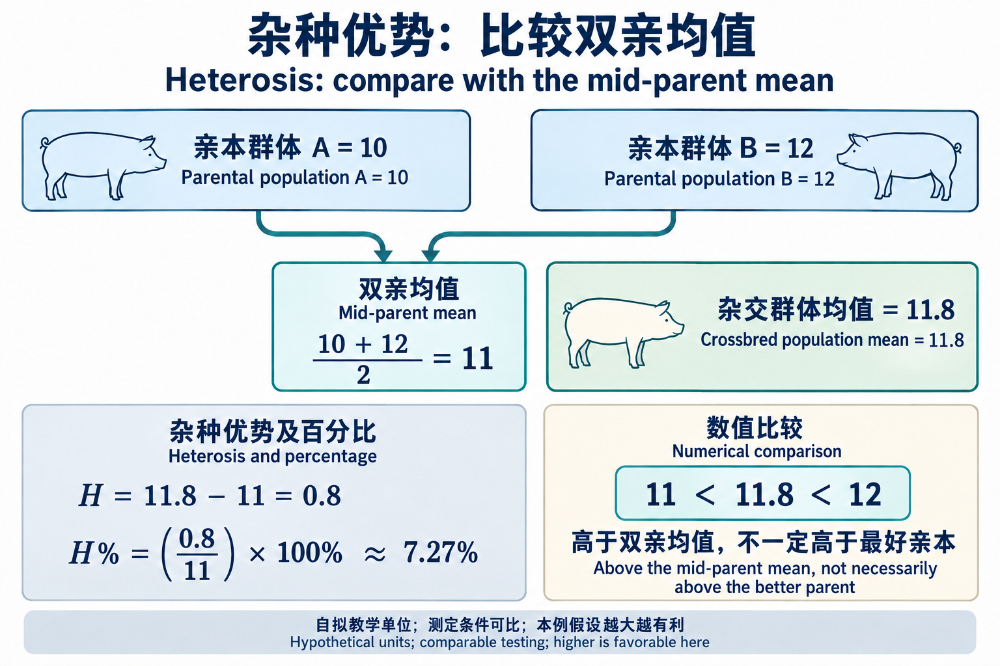
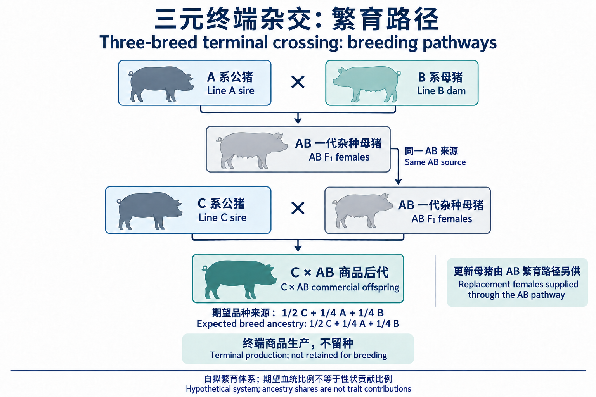

# 01-2｜遗传改良与杂交体系 / Genetic improvement and crossbreeding systems

[目录 / Contents](00-目录.md) · [返回主文 / Main chapter](01-0-育种与遗传基础.md)

我把纯系选育和杂交放到两张表上，一张记录亲本群体如何改良，另一张记录不同亲本组合的表现。  
I keep separate records for pure-line selection and crossbreeding, one for changes in the parent populations and another for performance across crosses.

原始来源是 [Purdue／NSIF-FS1](https://www.extension.purdue.edu/extmedia/NSIF/NSIF-1/NSIF-FS1.html)，实际题名为遗传改良的经济影响，网页标有 1999 年版本信息。  
The original source is [Purdue / NSIF-FS1](https://www.extension.purdue.edu/extmedia/NSIF/NSIF-1/NSIF-FS1.html), titled The Economic Impact of Genetic Improvement, with a 1999 edition notation.

本篇于 **2026-10-18** 核对来源，来源要点采用概括，教学数据与演算均为自拟。  
Sources were checked on **2026-10-18**, source points are summarized, and teaching data and calculations are original.

> **我想弄懂的事｜选得更好与杂交得更好，分别改变了什么？**  
> **What I want to understand | What is changed by better selection versus better crossbreeding?**

## 01 · 原文重点 / Source focus

原文短语“heterosis”与“breed complementarity”分别对应杂种优势和品种互补。  
The source terms “heterosis” and “breed complementarity” mean hybrid vigor and complementarity among breeds.

文章把核心群持续选择与商品群表现联系起来，并区分杂交带来的优势和可累积的选择进展。  
The article connects sustained seedstock selection with commercial performance and distinguishes crossbreeding advantages from cumulative selection progress.

历史收益估计与杂种优势百分比依赖当时情境，不能直接当作今天某猪场的收益承诺。  
Historical profit estimates and heterosis percentages depend on their original setting and cannot become profit guarantees for a current farm.

## 02 · 四个词先分开 / Separate four terms

- **纯种繁育**在定义的品种或品系内产生后代，并不表示个体每个位点都纯合。  
  **Purebred breeding** produces offspring within a defined breed or line and does not mean every locus is homozygous.

- **杂交**让不同品种或品系的动物交配，改变后代的遗传组合。  
  **Crossbreeding** mates animals from different breeds or lines to change offspring genetic combinations.

- **品种互补**利用父母不同方面的长处，例如母系繁殖能力与终端父系生长、胴体表现。  
  **Breed complementarity** combines different strengths, such as maternal reproduction with terminal-sire growth and carcass performance.

- **杂种优势**比较杂交后代与相应亲本品种均值，不能只与较差亲本比较。  
  **Heterosis** compares crossbred offspring with the relevant parental-breed average rather than only the poorer parent.

## 03 · 手算杂种优势 / Calculate heterosis

假设同一测定环境下，两个亲本群体的某项均值为 10 和 12，杂交群体为 11.8。  
Suppose two parental populations average 10 and 12 for a trait under comparable conditions, while the crossbred population averages 11.8.

$$
\bar P_{\mathrm{parents}}=(10+12)/2=11
$$

$$
H=11.8-11=0.8,\qquad H\%=\frac{0.8}{11}\times100\%\approx7.27\%
$$

虽然 11.8 小于较好亲本的 12，它仍高于双亲均值，所以该例存在正的杂种优势。  
Although 11.8 is below the better parent at 12, it exceeds the parental average and therefore shows positive heterosis in this example.

这里假设数值越大越有利，若性状是越低越好的死亡率或达重日龄，还要另外解释改良方向。  
This example assumes higher values are favorable, while lower-is-better traits such as mortality or days to target weight require interpreting the improvement direction separately.

**图 01-2A｜**教学杂交群体均值 11.8 高于双亲均值 11，却仍低于较好亲本的 12，杂种优势为 0.8 或约 7.27%。  
**Figure 01-2A |** The hypothetical crossbred mean of 11.8 exceeds the mid-parent mean of 11 but remains below the better parent at 12, giving heterosis of 0.8 or about 7.27%.

所有数值使用相同教学单位并假设测定条件可比，不能把图中的优势百分比当作真实猪群预期。  
All values share hypothetical units and assume comparable testing conditions, so the displayed heterosis percentage is not an expectation for an actual herd.

## 04 · F1 与终端杂交 / F1 and terminal crossing

**F1**是两个指定亲本群体杂交的第一代，必须说明所指的是哪两个群体。  
**F1** is the first filial generation from two specified parental populations, which must be identified.

一种教学体系是 A、B 产生 AB 母猪，再由 C 系公猪与 AB 母猪产生商品猪。  
One teaching system produces AB sows from A and B, then mates C-line boars to AB sows for commercial pigs.

**图 01-2B｜**A 系公猪与 B 系母猪先产生 AB 母猪，再由 C 系公猪与 AB 母猪产生终端商品后代。  
**Figure 01-2B |** Line A sires and Line B dams first produce AB females, which mate with Line C sires to produce terminal commercial offspring.

两处 AB 框是同一来源的重复展示，1/2 C、1/4 A、1/4 B 是期望常染色体品种来源，不是性状贡献比例。  
The two AB boxes repeat the same source, and 1/2 C, 1/4 A, and 1/4 B are expected autosomal breed ancestry rather than trait-contribution shares.

**终端**表示这一路后代用于商品生产，更新母猪通常由另外的繁育路径提供。  
**Terminal** means offspring on this path serve commercial production, with replacement females usually supplied through a separate breeding path.

不能只看商品猪长得快，就倒推纯系的每个加性 EBV 都同样优秀。  
Fast-growing commercial pigs do not establish that every additive EBV of the contributing pure lines is equally favorable.

## 05 · 为什么核心群持续进展很重要 / Why sustained seedstock progress matters

用一个自拟简式表示商品群遗传均值 $C_t$ 每代有一半来自当代父系来源 $S_t$，另一半来自上一代商品群。  
In an original simplified model, commercial genetic mean $C_t$ receives half its value from the current sire source $S_t$ and half from the previous commercial generation.

$$
C_{t+1}=0.5S_t+0.5C_t
$$

若父系来源固定为 20、起点为 0，则商品群依次为 10、15、17.5，逐步接近 20，而非每代永远增加 10。  
With a constant sire source of 20 and a starting value of 0, the commercial mean progresses through 10, 15, and 17.5 toward 20 rather than gaining 10 indefinitely each generation.

这个简式忽略母系选择、杂种优势与多路径流动，只用于解释持续供种水平与群体滞后的关系。  
This simplification ignores dam selection, heterosis, and multiple genetic pathways and only illustrates source merit and population lag.

## 06 · 从一次杂交看到持续改良需要什么 / What Sustained Improvement Requires

一次杂交可以表现很好，持续改良亲本群体还要有明确目标、连续记录、可比评估和跨世代的选择。  
A cross can perform well, and sustained improvement of the parents’ populations also requires clear objectives, continuous recording, comparable evaluations, and selection across generations.

我会把「这次杂交的表现」和「亲本群体的遗传趋势」分开记录，分别找相应的数据核对。  
I would record this cross’s performance separately from the parents’ genetic trend and check each against its own data.
