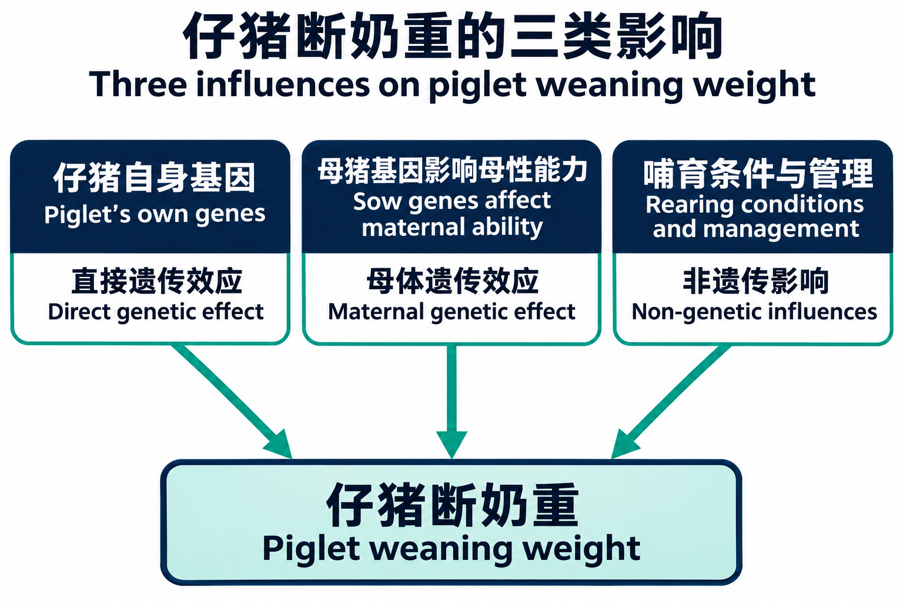
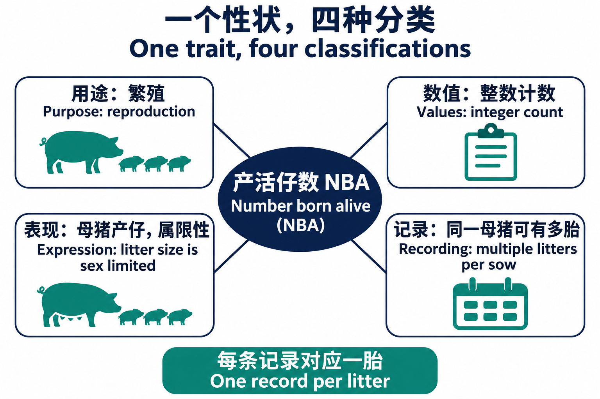

# 02-0｜性状与类型 / Traits and their types

[目录 / Contents](00-目录.md) · [上一章 / Previous](01-0-育种与遗传基础.md) · [下一章 / Next](03-0-统计基础.md)

同一张猪场表里，日增重、产活仔数和成活看上去都是列，我先看每列怎么测、每行代表谁。  
Daily gain, number born alive, and survival all look like columns in a farm table, so I first check how each column was measured and what each row represents.

我把性状定义当数据字典来读，它还须写清哪些动物会表现这个性状、同一个体是否会出现多条记录。  
I read trait definitions like a data dictionary, with the added requirements of stating which animals express a trait and whether one animal can contribute several records.

> **我的笔记｜性状像一个数据字段，但必须带完整的业务定义。**  
> **My note | A trait resembles a data field, but it needs a complete biological definition.**

## 01 · 一个性状如何定义 / Defining a trait

**性状**是可描述或测量的生物特征。  
A **trait** is a biological characteristic that can be described or measured.

每项性状都应写清测量对象、单位、时点和方法。  
Each trait definition should specify the subject, units, measurement time, and method.

“体重”定义不够，“校正到指定日龄的体重，kg”更适合比较。  
“Weight” is incomplete, while “weight adjusted to a specified age, in kg” is more comparable.

---

## 02 · 按业务用途分类 / Classification by purpose

### 生长 / Growth

- **平均日增重 ADG**是一段时间内的增重除以天数。  
  **Average daily gain (ADG)** is weight gained over a period divided by its duration.

- **达重日龄**是达到指定体重时的年龄。  
  **Age at target weight** is the age when an animal reaches a specified weight.

在测定条件和健康要求一致时，通常希望日增重提高、达重日龄降低。  
Under comparable testing conditions and health requirements, higher ADG and fewer days to target are usually desired.

### 采食与效率 / Intake and efficiency

- **平均日采食量 ADFI**描述每天吃多少。  
  **Average daily feed intake (ADFI)** describes daily feed consumption.

- **料重比 FCR = 采食量 / 增重**，通常越低越好。  
  **Feed conversion ratio (FCR) = feed consumed / weight gained**, and lower values are usually preferred.

- **剩余采食量 RFI**是实际采食量减去模型根据维持和生产等需要预测的采食量。  
  **Residual feed intake (RFI)** is observed intake minus intake predicted from maintenance and production requirements.

采食少不自动等于效率高，因为动物可能也长得慢。  
Low feed intake does not automatically mean high efficiency because the animal may also grow slowly.

### 繁殖 / Reproduction

- **TNB**是总产仔数。  
  **TNB** means total number born.

- **NBA**是产活仔数。  
  **NBA** means number born alive.

- **NW**是断奶仔猪数，还会受到寄养、成活与管理影响。  
  **NW** means number weaned and also reflects fostering, survival, and management.

初产日龄和分娩间隔也属于繁殖性状。  
Age at first farrowing and farrowing interval are also reproductive traits.

TNB、NBA、NW 的统计口径不同，不能混用。  
TNB, NBA, and NW use different definitions and are not interchangeable.

### 胴体、肉质与功能 / Carcass, meat quality, and function

常见例子包括背膘厚 BF、眼肌面积、瘦肉率、肌内脂肪 IMF、肉色、肢蹄、寿命和抗病能力。  
Common examples include backfat (BF), loin muscle area, lean percentage, intramuscular fat (IMF), meat color, leg soundness, longevity, and disease resistance.

最优方向依育种目标而定，某些性状需要合理范围而不是无限增加或降低。  
The desired direction depends on the breeding objective, and some traits need a target range rather than unlimited change.

---

## 03 · 按数据形态分类 / Classification by data type

- **连续数量性状**可以在范围内取许多数值，如体重和背膘。  
  **Continuous quantitative traits** take many values within a range, such as weight and backfat.

- **计数性状**取整数，如产仔数。  
  **Count traits** take integer values, such as litter size.

- **二元性状**只有两种结果，如是否存活。  
  **Binary traits** have two outcomes, such as survival or death.

- **等级性状**有顺序，如肢蹄评分。  
  **Ordinal traits** have ordered categories, such as leg scores.

- **类别性状**表示分类，如毛色类别。  
  **Categorical traits** describe classes, such as coat-color categories.

把类别编码成 1、2、3，不代表类别之间的间隔相等。  
Coding categories as 1, 2, and 3 does not establish equal spacing between them.

**质量性状**常以离散类别描述，**数量性状**常受许多基因和环境共同影响。  
**Qualitative traits** are often described by distinct classes, while **quantitative traits** commonly involve many genes and environmental effects.

离散记录不一定对应单基因遗传，例如存活虽然记为 0/1，遗传基础仍可能很复杂。  
Discrete records do not imply single-gene inheritance, since binary survival can still have complex genetic architecture.

**阈值模型**用潜在的连续易感性跨过阈值，解释观察到的类别结果。  
A **threshold model** explains observed categories through an underlying continuous liability crossing thresholds.

---

## 04 · 按记录方式与作用来源分类 / Recording and sources of effects

### 重复记录 / Repeated records

同一母猪的多胎产仔数属于**重复记录**。  
Litter sizes across successive parities of one sow are **repeated records**.

多胎记录不是多头独立母猪，因为稳定的非遗传影响也可能反复出现。  
Several litters are not independent sows because persistent non-genetic influences can recur across records.

### 限性与伴性 / Sex-limited and sex-linked

**限性性状**只在某一性别表现，如产仔数。  
A **sex-limited trait** is expressed in one sex, such as litter size.

相关遗传信息可以由两性携带和传递，所以公猪也能有产仔数 EBV。  
Both sexes can carry and transmit relevant genetic information, so a boar can have a litter-size EBV.

**伴性遗传**指相关位点在性染色体上，讨论的是基因位置与传递方式。  
**Sex-linked inheritance** concerns loci on sex chromosomes and their transmission.

限性和伴性是两个不同概念。  
Sex-limited expression and sex-linked inheritance are different concepts.

### 直接与母体遗传 / Direct and maternal genetics

**直接遗传效应**来自被测动物自身的遗传作用。  
**Direct genetic effects** come from the measured animal's own genetics.

**母体遗传效应**来自母亲的遗传组成对后代表现的影响，例如母性能力影响仔猪断奶重。  
**Maternal genetic effects** arise when a mother's genetics affect offspring performance, such as maternal ability influencing weaning weight.

寄养、子宫条件与母体管理也能产生非遗传母体影响，不能全部归入母体育种值。  
Fostering, uterine conditions, and maternal management can create non-genetic maternal effects that do not all belong in maternal breeding value.

**图 02-0A**　仔猪自身的基因可直接影响断奶重，母猪的基因可通过母性能力间接影响仔猪断奶重，哺育条件与管理也会影响结果。  
**Figure 02-0A**　A piglet’s genes can affect its weaning weight directly, a sow’s genes can affect it through her maternal ability, and rearing conditions and management can also affect the outcome.

母体遗传路径表示母猪的遗传差异如何通过母性表现影响仔猪，三条箭头仅表示影响来源。  
The maternal genetic path shows how a sow’s genetic differences affect piglets through her maternal performance, and the arrows indicate sources of influence.

---

## 05 · 分类可以重叠 / Categories can overlap

产活仔数同时是**繁殖、计数、限性、重复记录**性状。  
Number born alive is simultaneously a **reproductive, count, sex-limited, repeated-record** trait.

这些分类分别描述用途、数值形态、表现性别和记录结构。  
These classifications describe purpose, numerical form, sex of expression, and recording structure.

**图 02-0B**　产活仔数（NBA）可同时按用途归为繁殖性状、按取值归为计数性状、按表现归为限性性状，并在同一头母猪的多胎记录中重复测量。  
**Figure 02-0B**　Number born alive (NBA) is a reproductive, count, and sex-limited trait that can be recorded repeatedly across litters of the same sow.

四条线连接的是同一个性状的四种分类角度，观测单位是一胎。  
The four lines connect different ways of classifying the same trait, and each observation represents one litter.

缩写和具体口径以实际数据字典为准。  
Confirm abbreviations and definitions in the actual data dictionary.

---

## 我的核对笔记 / My Verification Notes

例如母猪每胎产活仔数同时是繁殖、计数、限性和重复记录性状，这四个标签分别回答不同问题。  
For example, number born alive per sow litter is a reproductive, count, sex-limited, and repeated-record trait, with each label answering a different question.

公猪可以携带并传递相关遗传信息，因此也可以有产活仔数的估计育种值。  
A boar can carry and transmit relevant genetic information, so it can also have an estimated breeding value for number born alive.

拿到新数据时，我会先确认一行对应一头猪还是一胎，再核对单位、时点、缺失值以及负责表型表达的动物。  
With a new dataset, I first check whether a row represents a pig or a litter, then verify units, timing, missing values, and which animal expresses the phenotype.

## 延伸阅读 / Further reading

下面按原始阅读列表顺序提供本地详读，重复来源复用同一篇笔记以保持解释一致。  
Local readings follow the original source-list order, reusing a single note for repeated sources to keep explanations consistent.

- **[猪性状、EBV 与后代差异](02-1-猪性状EBV与后代差异详读.md)**。  
  **[Pig traits, EBVs, and progeny differences](02-1-猪性状EBV与后代差异详读.md)**.

- **[多性状选择方法与目标](09-1-多性状选择方法详读.md)**。  
  **[Multi-trait selection methods and objectives](09-1-多性状选择方法详读.md)**.

- **[阈值模型与分类性状](02-3-阈值模型与分类性状详读.md)**。  
  **[Threshold models and categorical traits](02-3-阈值模型与分类性状详读.md)**.

- **[重复记录与永久环境](02-4-重复记录与永久环境详读.md)**。  
  **[Repeated records and permanent environment](02-4-重复记录与永久环境详读.md)**.

原始来源链接保留如下，无法直接读取的来源及实际使用的替代材料已在对应详读中说明。  
Original source links follow, with unavailable sources and the alternatives actually used identified in the corresponding notes.

- [AGBU：PIGBLUP 性状与 EBV](https://agbu.une.edu.au/pig_genetics/ebv.html)。  
  [AGBU: PIGBLUP traits and EBVs](https://agbu.une.edu.au/pig_genetics/ebv.html).

- [Purdue：多性状选择与限性性状](https://www.extension.purdue.edu/extmedia/NSIF/NSIF-10/NSIF-FS10.html)。  
  [Purdue: multi-trait selection and sex-limited traits](https://www.extension.purdue.edu/extmedia/NSIF/NSIF-10/NSIF-FS10.html).

- [BLUPF90：阈值模型](https://masuday.github.io/blupf90_tutorial/mrode_c15ex151_threshold.html)。  
  [BLUPF90: threshold models](https://masuday.github.io/blupf90_tutorial/mrode_c15ex151_threshold.html).

- [重复力模型](https://masuday.github.io/blupf90_tutorial/mrode_c05ex051_repeatability_model.html)。  
  [repeatability models](https://masuday.github.io/blupf90_tutorial/mrode_c05ex051_repeatability_model.html).
