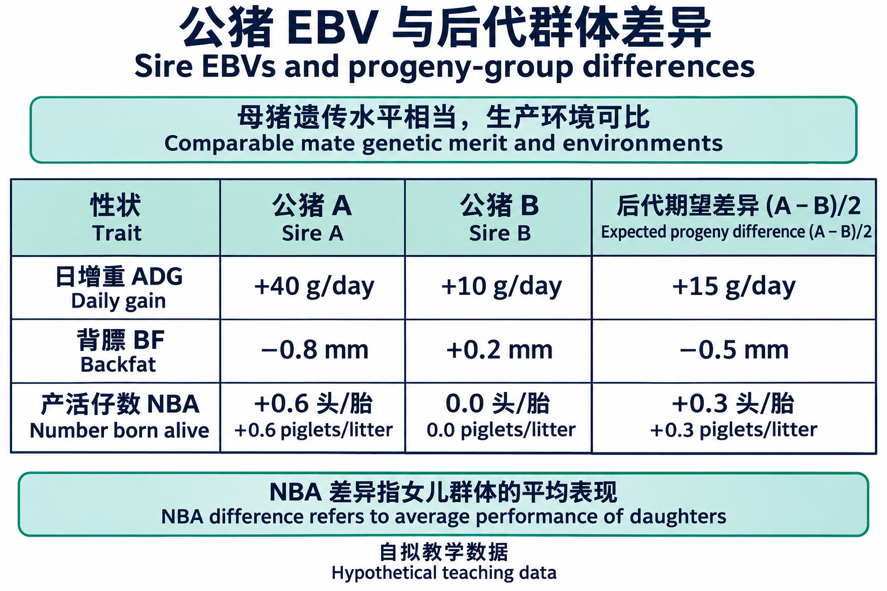

# 02-1｜猪性状、EBV 与后代差异 / Pig traits, EBVs, and progeny differences

[目录 / Contents](00-目录.md) · [返回主文 / Main chapter](02-0-性状与类型.md)

拿到一行带正负号的 EBV，我会先把每一列和性状定义、单位、评估基准对起来，再解释数字能告诉后代什么。  
Given a row of signed EBVs, I first match each column to its trait definition, unit, and evaluation base, then interpret what it says about progeny.

原始来源是 [AGBU：Estimated Breeding Values](https://agbu.une.edu.au/pig_genetics/ebv.html)，本篇同时对应第 02 章的性状条目与第 06 章的后代差异条目。  
The original source is [AGBU: Estimated Breeding Values](https://agbu.une.edu.au/pig_genetics/ebv.html), serving both the Chapter 02 trait entry and the Chapter 06 progeny-difference entry.

本篇于 **2026-10-18** 核对来源，来源要点采用概括，教学数据与演算均为自拟。  
Sources were checked on **2026-10-18**, source points are summarized, and teaching data and calculations are original.

> **我想弄懂的事｜同一行里的 +30、−0.4 和 +0.6，为什么不能直接相加？**  
> **What I want to understand | Why cannot +30, −0.4, and +0.6 in one row simply be added?**

## 01 · 来源要点 / Source points

原文短摘“relative to other animals in the same population”提醒 EBV 有明确比较群体。  
The excerpt “relative to other animals in the same population” emphasizes an EBV's comparison population.

原页列出猪的生长、采食效率、脂肪和繁殖 EBV，并用公猪比较说明后代群体期望差异的折半关系。  
The page lists pig growth, feed-efficiency, fat, and reproduction EBVs and illustrates half-scale expected progeny differences between sires.

本篇不复制原动物编号和数值，以下使用另一组自拟公猪。  
This note uses different hypothetical boars rather than copying the original animal IDs and values.

## 02 · 为每个性状补一张定义卡 / Give each trait a definition card

**日增重 ADG**是指定时期的增重量除以天数，必须说明起止时间与体重。  
**Average daily gain (ADG)** is weight gained over a specified period divided by days, requiring defined start and end times and weights.

若 50 天内从 30 kg 增至 70 kg，则 ADG 为 $(70-30)/50=0.8$ kg/day，即 800 g/day。  
Growing from 30 to 70 kg in 50 days gives ADG $(70-30)/50=0.8$ kg/day, or 800 g/day.

**料重比 FCR**是同一时期饲料消耗量除以增重量，例如 100 kg 饲料换来 40 kg 增重时 FCR 为 2.5。  
**Feed conversion ratio (FCR)** divides feed consumed by weight gained over the same period, giving 2.5 when 100 kg of feed produces 40 kg of gain.

饲料按干物质还是鲜料统计、死亡和转群如何处理，都会改变 FCR 的可比性。  
Feed recorded as dry matter or as-fed, and handling of deaths and transfers, affect FCR comparability.

**背膘 BF**通常以 mm 记录，但测点、仪器和校正体重必须一致。  
**Backfat (BF)** is commonly recorded in mm, but measurement site, instrument, and adjusted weight must match.

**产活仔数 NBA**的观测单位通常是一头母猪的一胎，不能把胎记录直接当作仔猪个体性状。  
**Number born alive (NBA)** usually has one sow-litter as its observation unit and must not be treated as a piglet-level trait.

不同系统的胎次、寄养和存活口径必须查清，名称相同不保证定义相同。  
Check parity, fostering, and survival definitions across systems because identical names do not guarantee identical traits.

## 03 · 两头公猪的三项 EBV / Three EBVs for two boars

假设公猪 A、B 在同一评估中的 ADG EBV 分别为 +40、+10 g/day。  
Suppose Boars A and B have ADG EBVs of +40 and +10 g/day in the same evaluation.

再假设 A、B 的 BF EBV 为 −0.8、+0.2 mm，NBA EBV 为 +0.6、0.0 头/胎。  
Also suppose their BF EBVs are −0.8 and +0.2 mm and NBA EBVs are +0.6 and 0.0 piglets per litter.

这些数值的单位不同，不能计算 $40-0.8+0.6$ 来判断综合价值。  
These quantities have different units, so $40-0.8+0.6$ cannot measure overall merit.

综合价值需要明确生产目标和经济权重，见 [综合选择指数](09-2-综合选择指数详读.md)。  
Overall merit requires a production objective and economic weights, as explained in [selection indexes](09-2-综合选择指数详读.md).

## 04 · 为什么后代差异折半 / Why progeny differences are halved

假设两组母猪遗传水平相当，且模型与生产环境具有可比性，则 A 相对 B 的后代群体期望差异如下。  
Assuming equivalent mate genetic merit and comparable model and production conditions, expected progeny-group differences for A versus B are as follows.

$$
\Delta ADG=(40-10)/2=15\ \mathrm{g/day}
$$

$$
\Delta BF=(-0.8-0.2)/2=-0.5\ \mathrm{mm}
$$

$$
\Delta NBA=(0.6-0.0)/2=0.3\ \mathrm{piglets/litter}
$$

NBA 的 0.3 解释为未来女儿群体产活仔数的平均差异，不表示公猪自身产仔，也不表示每胎出现小数头仔猪。  
The NBA difference of 0.3 describes average litter-size differences among future daughters, not boars giving birth or individual litters containing fractional piglets.

如果报表已经提供 **EPD**，它通常就在后代差异尺度上，不能再除以 2。  
If the report provides **EPD**, it is usually already on the progeny-difference scale and must not be halved again.

**图 02-1A**　在同一评估、配种母猪遗传水平相当且生产环境可比的教学例子中，公猪 A 相对 B 的后代群体期望差异分别为日增重 +15 g/day、背膘 −0.5 mm、女儿平均产活仔数 +0.3 头/胎。  
**Figure 02-1A**　In this teaching example with a shared evaluation and comparable mate genetic merit and environments, the expected group differences for Sire A relative to Sire B are +15 g/day in gain, −0.5 mm in backfat, and +0.3 piglets per litter in daughters’ mean number born alive.

每项差异都由对应性状的父本 EBV 之差除以 2 得到，比较方向始终为 A 减 B。  
Each difference is half the corresponding sire EBV difference, consistently calculated as A minus B.

## 05 · 比较前的六项检查 / Six checks before comparison

- **同一性状**要求定义、阶段和测定方式可比。  
  **Same trait** requires comparable definitions, stages, and measurement methods.

- **同一单位**避免把 kg/day 和 g/day 直接比较。  
  **Same units** avoids direct comparison between kg/day and g/day.

- **同一基准**说明零点相对于哪个参考群体。  
  **Same base** identifies the reference population defining zero.

- **同一评估版本**避免把不同时间点的估计混为同时排名。  
  **Same evaluation version** avoids combining estimates from different dates as one ranking.

- **可比遗传联系**要求跨场差异能与管理差异区分。  
  **Comparable genetic links** require separating across-farm genetics from management differences.

- **准确度口径**区分 ACC、REL 和百分数显示方式。  
  **Accuracy conventions** distinguish ACC, REL, and percentage display scales.

## 06 · 怎么读公猪的产活仔数 EBV / Reading a Boar’s EBV for Number Born Alive

公猪的 NBA EBV 为 +0.6 时，我先确认它是亲本加性遗传尺度，然后按目标后代群的比较口径处理。  
For a boar with an NBA EBV of +0.6, I first establish that it is on the parental additive scale and then use the comparison convention for the target progeny groups.

在可比配对和环境下，相对零基准的父方预期贡献约为 +0.3 头，单个女儿的每胎结果还受另一亲本、孟德尔抽样和环境影响。  
With comparable mates and environments, the expected sire contribution relative to a zero base is about +0.3 piglets, and each daughter’s litter also reflects the other parent, Mendelian sampling, and environment.
