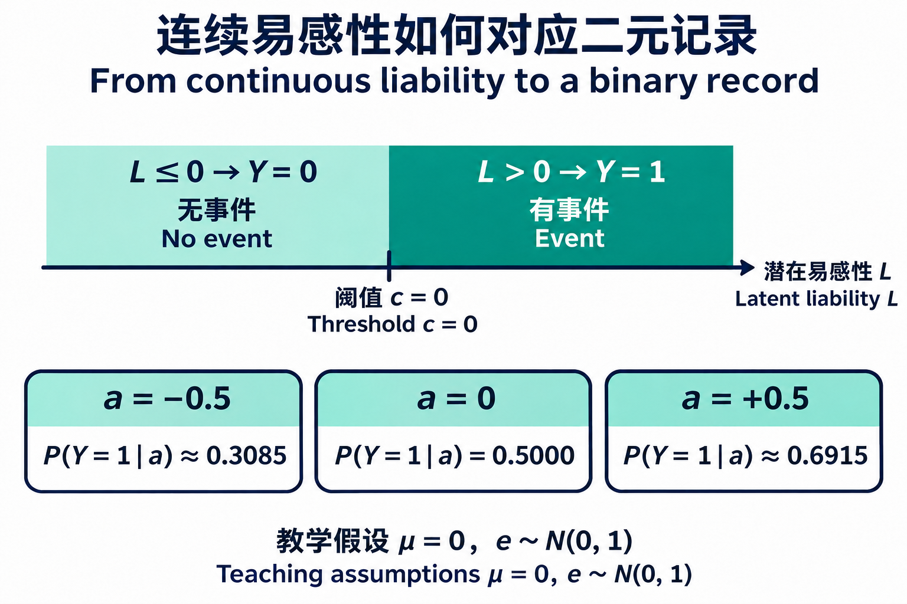

# 02-3｜阈值模型与分类性状 / Threshold models and categorical traits

[目录 / Contents](00-目录.md) · [返回主文 / Main chapter](02-0-性状与类型.md)

我先把 0 和 1 当作记录结果，再用一张阈值图看看模型里那个看不见的量怎样变成分类。  
I start with 0 and 1 as recorded outcomes, then use a threshold diagram to see how an unobserved quantity becomes a category in the model.

参考来源为作者现行的 [Masuda：阈值模型](https://masuday.github.io/blupf90_tutorial/mrode_c15ex151_threshold.html)，原例为牛分娩难易度，以下改用自拟的猪二元记录解释。  
The current author reference is [Masuda: the threshold model](https://masuday.github.io/blupf90_tutorial/mrode_c15ex151_threshold.html), illustrated there with cattle calving ease and here with original binary pig records.

本篇于 **2026-10-18** 核对来源，来源要点采用概括，教学数据与演算均为自拟。  
Sources were checked on **2026-10-18**, source points are summarized, and teaching data and calculations are original.

> **我想弄懂的事｜结果只有 0 和 1，为什么还能包含复杂遗传作用？**  
> **What I want to understand | How can a trait recorded only as 0 or 1 still involve complex genetics?**

## 01 · 来源要点 / Source points

原文称潜在连续量为“liability”，其跨过“threshold”后形成观察类别。  
The source calls the latent continuous variable “liability,” which generates observed categories by crossing a “threshold.”

文章特别说明阈值、位置和方差尺度必须协调，不能从不同参数化方案中随意摘数字拼接。  
The article particularly explains that thresholds, location, and variance scales must be coordinated rather than combined arbitrarily across parameterizations.

## 02 · 数据编码不等于遗传机制 / Coding is not a genetic mechanism

假设记录某时期是否出现某种不良事件，未出现为 0、出现为 1，且统一观察窗口和事件定义。  
Suppose a specified adverse event is recorded as 0 when absent and 1 when present, using a consistent observation window and event definition.

**二元**描述记录格式，而**单基因**描述遗传机制，两者不是一回事。  
**Binary** describes the record format, while **single-gene** describes inheritance, and the two are different.

若腿部评分为轻、中、重，则属于有顺序的类别，但把它们编码为 1、2、3 并不保证间距相等。  
Leg scores of mild, moderate, and severe are ordered categories, but coding them 1, 2, and 3 does not establish equal spacing.

## 03 · 潜在易感性如何生成记录 / How latent liability generates records

设潜在易感性 $L$ 包含固定条件 $\mu$、加性效应 $a$ 和残差 $e$，但实际只记录它是否高于阈值 $c$。  
Let latent liability $L$ contain a fixed component $\mu$, an additive effect $a$, and residual $e$, while only its position above or below threshold $c$ is observed.

$$
L=\mu+a+e,\qquad
Y=\begin{cases}0,&L\leq c\\1,&L>c\end{cases}
$$

$L$ 不是一项已经测量到的血液指标，而是解释类别概率的模型变量。  
$L$ is a model variable explaining category probabilities, not an already measured blood marker.

为了手算，设 $e$ 为均值 0、标准差 1 的正态变量，且固定 $\mu=0$、$c=0$。  
For calculation, assume $e$ is normal with mean 0 and standard deviation 1, fixing $\mu=0$ and $c=0$.

$$
P(Y=1\mid a)=1-\Phi(-a)
$$

$\Phi(z)$ 表示标准正态变量不超过 $z$ 的概率，下面代码能直接计算，无需另查表。  
$\Phi(z)$ is the probability that a standard normal variable does not exceed $z$, calculated directly by the following code without tables.

```python
from statistics import NormalDist

normal = NormalDist()
for a in [-0.5, 0.0, 0.5]:
    risk = 1 - normal.cdf(-a)
    print(f"a={a:+.1f}; event_probability={risk:.4f}")
```

基础 R 用 `pnorm(-a, lower.tail = FALSE)` 直接算标准正态分布的右尾概率，对应上面的 $1-\Phi(-a)$。  
In base R, `pnorm(-a, lower.tail = FALSE)` gives the standard normal upper-tail probability $1-\Phi(-a)$.

```r
a <- c(-0.5, 0, 0.5)
risk <- pnorm(-a, lower.tail = FALSE)

cat(sprintf("a=%+.1f; event_probability=%.4f\n", a, risk), sep = "")
```

```text
a=-0.5; event_probability=0.3085
a=+0.0; event_probability=0.5000
a=+0.5; event_probability=0.6915
```

这些是给定其他模型项和假设参数时的事件概率，不是当前猪群测得的发生率。  
These are event probabilities conditional on the other model terms and assumed parameters, not measured incidence in a current herd.



**图 02-3A**　在阈值为 0 的教学例子中，潜在易感性 $L\leq0$ 记作 $Y=0$，$L>0$ 记作 $Y=1$。  
**Figure 02-3A**　In this teaching example with threshold zero, latent liability $L\leq0$ is recorded as $Y=0$ and $L>0$ as $Y=1$.

固定 $\mu=0$ 且 $e$ 服从标准正态分布时，$a$ 为 −0.5、0、+0.5 对应的条件事件概率依次约为 0.3085、0.5000、0.6915。  
With $\mu=0$ and standard-normal $e$, the conditional event probabilities at $a=-0.5$, $0$, and $+0.5$ are approximately 0.3085, 0.5000, and 0.6915.


## 04 · 为什么潜在尺度 EBV 不能当百分数 / Why a liability EBV is not a percentage

$a$ 从 0 变为 0.5 时，概率从 0.5 变到约 0.6915，增加约 19.15 个百分点，而不是增加 50 个百分点。  
Increasing $a$ from 0 to 0.5 moves probability from 0.5 to about 0.6915, an increase of about 19.15 percentage points rather than 50.

同样大小的易感性变化，在不同基础风险处可能产生不同概率变化，因此转换关系不是固定直线。  
The same liability change can produce different probability changes at different baseline risks, so the conversion is not a fixed straight line.

**百分点**是两个百分数直接相减的单位，区别于相对增加百分比。  
A **percentage point** is the unit for subtracting two percentages and differs from relative percentage increase.

若还要对未知残差之外的随机项取平均，预测概率需要对应地积分，不能一律把一个 EBV 填入本例公式。  
Averaging over additional random terms requires corresponding integration, so an arbitrary EBV cannot always be inserted into this example's equation.

## 05 · 三个类别需要两个阈值 / Three categories need two thresholds

对低、中、高三个有序类别，使用 $c_1<c_2$ 两个阈值划分三个区间。  
Three ordered categories of low, medium, and high use two thresholds $c_1<c_2$ to define three intervals.

$$
P(Y=1)=\Phi(c_1-m),\quad
P(Y=2)=\Phi(c_2-m)-\Phi(c_1-m),\quad
P(Y=3)=1-\Phi(c_2-m)
$$

上式仍假设残差标准差为 1，$m$ 是给定固定与遗传效应后的潜在均值。  
These equations still assume residual standard deviation 1, with $m$ the latent mean conditional on fixed and genetic effects.

取 $m=0$、$c_1=0$、$c_2=1$，三个概率约为 0.5000、0.3413、0.1587，相加为 1。  
With $m=0$, $c_1=0$, and $c_2=1$, the probabilities are approximately 0.5000, 0.3413, and 0.1587 and sum to 1.

如果残差标准差改为 $\sigma_e$，每个正态函数的输入都要除以 $\sigma_e$。  
If residual standard deviation becomes $\sigma_e$, each normal-function argument must be divided by $\sigma_e$.

## 06 · 从潜在尺度走到事件概率 / From the Latent Scale to Event Probability

看到潜在尺度 EBV 为 +0.2，我会先找该模型的阈值、基础水平、残差尺度和事件方向，再看其他模型项。  
When the latent-scale EBV is +0.2, I first look for the model’s thresholds, baseline, residual scale, and event direction, then check the other model terms.

潜在尺度上的 +0.2 是模型单位里的偏移量，事件概率要用这些条件另行换算。  
A latent-scale value of +0.2 is a shift in model units, and conversion to an event probability uses those additional conditions.

要描述事件概率增加多少，我会记录换算前后的两个概率，再算差值或相对变化。  
To report how much event probability changes, I record the original and revised probabilities, then compute an absolute or relative change.

软件示例中的采样轮数、阈值固定方式和输出均属于原例，不是已经在本地猪群验证的运行方案。  
Sampling lengths, threshold constraints, and outputs in the software example belong to that example and are not a locally validated pig-herd workflow.
