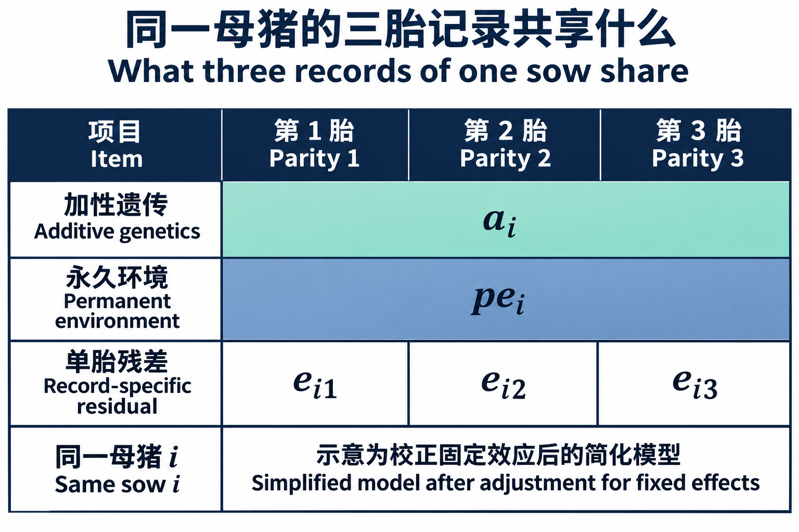

# 02-4｜重复记录与永久环境 / Repeated records and permanent environment

[目录 / Contents](00-目录.md) · [返回主文 / Main chapter](02-0-性状与类型.md)

面对一头母猪的几胎记录，我把母猪号保留下来，再追哪些因素在各胎之间共享、哪些只影响一胎。  
With several litters from one sow, I keep the sow ID so I can track which influences are shared across litters and which affect only one.

原阅读的旧地址返回 404，本次实际读取了[作者新版重复力模型](https://masuday.github.io/blupf90_tutorial/mrode_c05ex051_repeatability_model.html)。  
The old reading URL returns 404, and this note uses the [author's updated repeatability model](https://masuday.github.io/blupf90_tutorial/mrode_c05ex051_repeatability_model.html).

新版于 2026 年 8 月更新并使用奶牛产脂量示例，下面改用自拟母猪多胎数据讲解，同时服务第 04 章重复力条目。  
The updated page is dated August 2026 and uses dairy fat yield, while this note uses original sow-litter examples and also serves the Chapter 04 repeatability entry.

本篇于 **2026-10-18** 核对来源，来源要点采用概括，教学数据与演算均为自拟。  
Sources were checked on **2026-10-18**, source points are summarized, and teaching data and calculations are original.

> **我想弄懂的事｜一头母猪连续三胎表现好，其中多少信息可以传给女儿？**  
> **What I want to understand | How much information from a sow performing well for three litters is transmissible to her daughters?**

## 01 · 来源要点 / Source points

原文区分“permanent environmental”与暂时环境，模型把遗传和永久环境设为不同随机效应。  
The source distinguishes “permanent environmental” effects from temporary environment and models genetics and permanent environment as separate random effects.

两种效应都按动物编号连接记录，但遗传效应用系谱联系动物，永久环境在简化模型中不随亲缘共享。  
Both effects connect records by animal ID, but genetics links animals through pedigree while permanent environment is not shared through relatedness in the simplified model.

## 02 · 写清一行代表一胎 / Define a row as a litter

假设数据记录如下，`parity` 表示胎次，`nba` 表示产活仔数。  
Suppose the data below use `parity` for litter order and `nba` for number born alive.

```csv
sow_id,parity,nba
S1,1,11
S1,2,13
S1,3,12
S2,1,10
S2,2,11
```

这里有 5 条观测、2 头母猪，不能称为 5 头独立母猪。  
These are five observations from two sows, not five independent sows.

胎次和批次效应应先在模型中考虑，否则初产与经产的差异可能混入个体效应。  
Parity and batch effects need modeling, or differences between first and later litters can enter animal effects.

## 03 · 将记录拆成三种随机来源 / Separate three random components

$$
y_{ij}=\mu+b_{ij}+a_i+pe_i+e_{ij}
$$

- $y_{ij}$ 是母猪 $i$ 第 $j$ 次记录，$b_{ij}$ 汇总已定义的固定条件。  
  $y_{ij}$ is sow $i$'s record $j$, and $b_{ij}$ represents defined fixed conditions.

- $a_i$ 是可通过亲缘传递信息的加性遗传作用。  
  $a_i$ is the additive genetic effect linked through relationships.

- $pe_i$ 是持续影响同一母猪的非遗传作用，不应当作遗传传递给女儿。  
  $pe_i$ is a persistent non-genetic influence on the same sow and must not be transmitted to daughters as genetics.

- $e_{ij}$ 是该次记录的剩余偏离，不同次之间在此简化模型中独立。  
  $e_{ij}$ is the remaining record-specific deviation, independent across records in this simplified model.

“永久”指跨这些记录持续存在，不表示生物学上永远不变。  
“Permanent” means persistent across these records, not biologically immutable forever.



**图 02-4A**　在这个简化重复力模型里，同一头母猪三胎共享加性遗传效应 $a_i$ 和永久环境效应 $pe_i$，三胎分别有自己的残差 $e_{i1}$、$e_{i2}$、$e_{i3}$。  
**Figure 02-4A**　In this simplified repeatability model, three litters from one sow share additive genetic effect $a_i$ and permanent environmental effect $pe_i$, and each litter has its own residual $e_{i1}$, $e_{i2}$, or $e_{i3}$.

色带表示效应覆盖哪些记录，残差在本例中假设相互独立。  
The bands show which records share an effect, and the example assumes independent residuals.


## 04 · 手算重复力 / Calculate repeatability

假设三个方差分别为 $\sigma_A^2=1$、$\sigma_{PE}^2=2$、$\sigma_e^2=7$，且这些分量互不相关。  
Assume mutually uncorrelated components with variances $\sigma_A^2=1$, $\sigma_{PE}^2=2$, and $\sigma_e^2=7$.

单次记录方差为 $1+2+7=10$，同一动物两次记录共有的协方差为 $1+2=3$。  
A single record has variance $1+2+7=10$, and two records of the same animal share covariance $1+2=3$.

$$
h^2=1/10=0.10,\qquad t=(1+2)/10=0.30
$$

重复力 $t$ 高于遗传力 $h^2$，因为它还包含稳定的非遗传影响。  
Repeatability $t$ exceeds heritability $h^2$ because it includes persistent non-genetic influences.

## 05 · 三胎平均能提供多少信息 / How informative is a three-litter mean?

在固定条件已校正的假设下，同一母猪三胎均值的方差为共同部分加上平均后的暂时部分。  
Assuming fixed conditions have been adjusted, the variance of one sow's three-litter mean is the shared component plus the averaged temporary component.

$$
\operatorname{Var}(\bar y_i)=1+2+7/3=16/3\approx5.3333
$$

若错误地把三胎当作独立记录，会算成 $10/3\approx3.3333$，低估均值的不确定性。  
Incorrectly treating the three litters as independent gives $10/3\approx3.3333$, understating uncertainty in the mean.

在等方差、共同相关为 $t$ 的这种模型下，$m$ 条记录估计均值的等效独立条数为 $m/[1+(m-1)t]$。  
In this equal-variance, common-correlation model, the effective independent count for estimating a mean from $m$ records is $m/[1+(m-1)t]$.

取 $m=3$、$t=0.3$ 时等效条数为 $3/1.6=1.875$，不是 3，也不是“1.875 头真实母猪”。  
With $m=3$ and $t=0.3$, the effective count is $3/1.6=1.875$, not 3 or literally 1.875 sows.

## 06 · 简化预测仍只提取遗传部分 / Simplified prediction extracts genetics only

进一步假设总体均值和方差已知、没有其他亲属信息，则由三胎均值预测 $a_i$ 的系数为 $1/(16/3)=0.1875$。  
Further assuming known population mean and variances and no other relative information, the coefficient predicting $a_i$ from the three-litter mean is $1/(16/3)=0.1875$.

若校正后的三胎均值高于总体 2 头，则该简化遗传预测为 $0.1875\times2=0.375$ 头。  
If the adjusted three-litter mean exceeds the population mean by two piglets, this simplified genetic prediction is $0.1875\times2=0.375$ piglets.

不能把重复力 0.3 直接当遗传力乘上偏差，否则会把永久环境也视为可遗传优势。  
Multiplying the deviation by repeatability 0.3 as if it were heritability would incorrectly treat permanent environment as transmissible advantage.

## 07 · 一百份副本与一百条后代记录 / A Hundred Copies and a Hundred Progeny Records

把某头母猪的一条记录复制一百遍，只会增加行数，独立信息仍然来自原来那一次观测。  
Copying one sow’s record a hundred times adds rows, and the independent information still comes from the original observation.

一百个女儿的记录提供了不同观测，放进模型时仍要核对父母身份、饲养环境和亲缘结构。  
Records from a hundred daughters provide different observations, and the model still needs their parentage, environments, and relationships checked.
