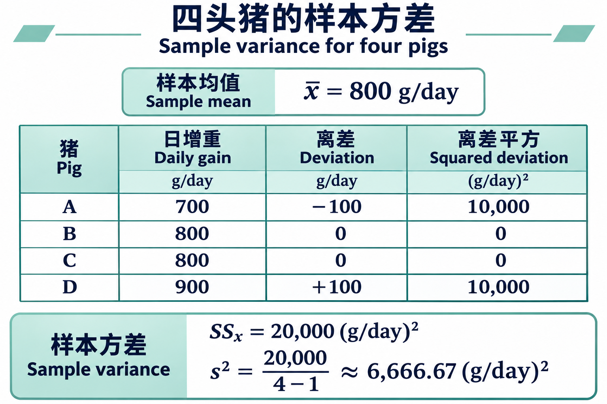
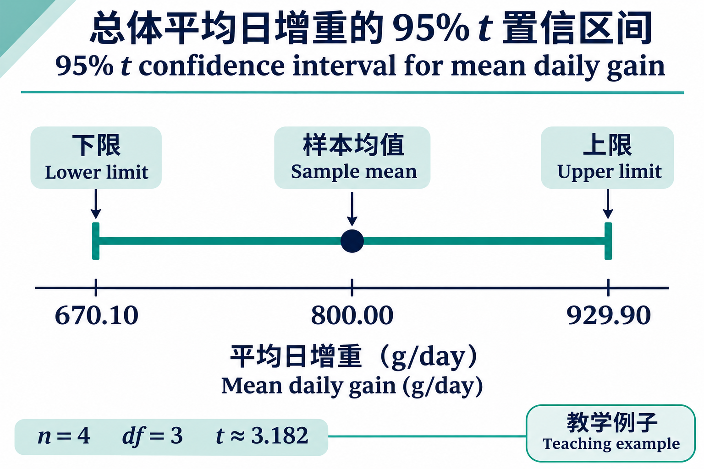

# 03-0｜统计基础：从一行数据到一个结论 / Statistics: from a data row to a conclusion

[目录 / Contents](00-目录.md) · [上一章 / Previous](02-0-性状与类型.md) · [下一章 / Next](04-0-遗传参数与相关性.md)

我想弄清楚方差是怎么来的，就把四条日增重记录写成 700、800、800、900 g/day，先不用软件。  
To understand where variance comes from, I start with four daily-gain records of 700, 800, 800, and 900 g/day and work without software first.

用这四个数，我可以先看均值，再看每头偏离多少，最后把自己的手算和 Python 的输出对一遍。  
With these four numbers I can find the mean, work out how far each pig deviates, and check the hand calculation against Python.

数据行长得一样，背后却可能是不同的观测单位，所以我也会把统计计算和抽样条件一起记录下来。  
Rows can look identical while representing different observation units, so I record sampling conditions together with the calculations.

> **先确认数据代表什么，再计算数字，最后判断这个数字能说明什么。**  
> **Identify what the data represent, calculate the numbers, and then decide what they can support.**

本章使用自拟的四头猪数据，把主要公式展开到可以手算的程度。  
This chapter uses an original four-pig dataset and expands the main equations into calculations you can do by hand.

第一次阅读可先学 01—07 节，再学两个性状的关系，最后学均值的不确定性。  
On your first pass, read Sections 01–07, then relationships between two traits, and finally uncertainty in a mean.

## 01 · 总体、样本与一行数据 / Population, sample, and a data row

**统计学**研究如何收集、整理和分析数据，以及如何在信息不完整时作出有依据的判断。  
**Statistics** studies how to collect, organize, and analyze data and make justified judgments with incomplete information.

**描述统计**总结已经看到的数据，**统计推断**尝试从样本了解更大的总体。  
**Descriptive statistics** summarize observed data, while **statistical inference** uses a sample to learn about a larger population.

- **总体**是你希望了解的全部对象，例如某猪场某批次全部测定猪。  
  A **population** contains all units you want to understand, such as all tested pigs in a specified farm batch.

- **样本**是实际取得并用于分析的对象，例如从这批猪中随机抽取的 40 头。  
  A **sample** contains the units actually observed and analyzed, such as 40 pigs randomly selected from that batch.

- **变量**是记录的属性，例如日增重、采食量、性别或场区。  
  A **variable** is a recorded attribute, such as daily gain, feed intake, sex, or farm site.

- **观测值**是变量在某个对象上的具体取值，例如 A 猪日增重 700 g/day。  
  An **observation value** is a variable's value for a unit, such as Pig A gaining 700 g/day.

- **观测单位**是一条记录所对应的对象或事件，例如一头猪、一次称重或一窝产仔。  
  An **observation unit** is the unit or event represented by a record, such as a pig, a weighing, or a litter.

- **参数**描述总体，例如总体均值 $\mu$；**统计量**由样本算出，例如样本均值 $\bar{x}$。  
  A **parameter** describes a population, such as its mean $\mu$, whereas a **statistic** is calculated from a sample, such as its mean $\bar{x}$.

**估计量**是计算未知参数的规则，**估计值**是把具体样本代入后得到的数字。  
An **estimator** is a rule for estimating an unknown parameter, and an **estimate** is the number obtained from a particular sample.

100 头母猪各记录 5 胎得到 500 条记录，但仍然只有 100 头母猪。  
Recording five litters from each of 100 sows produces 500 records but still only 100 sows.

**独立**表示知道一条观测的信息不会改变另一条观测的概率分布，同一母猪的多胎记录通常不满足这一条件。  
**Independence** means information about one observation does not change another observation's probability distribution, a condition usually violated by repeated litters from one sow.

**同分布**表示观测来自相同的概率分布，不表示它们的数值必须相同。  
**Identically distributed** means observations share the same probability distribution, not that their values must be identical.

随机抽样让入样机制可解释，但只记录优秀猪会让样本偏离你原本想了解的总体。  
Random sampling makes sample inclusion interpretable, whereas recording only outstanding pigs can make the sample unrepresentative of the intended population.

## 02 · 先认符号 / Read the notation first

- $n$ 是样本条数，$x_i$ 是第 $i$ 条记录，$i=1,\ldots,n$ 是记录编号。  
  $n$ is the sample size, $x_i$ is record $i$, and $i=1,\ldots,n$ indexes the records.

- $\sum$ 表示逐项相加，例如 $\sum_{i=1}^{4}x_i=x_1+x_2+x_3+x_4$。  
  $\sum$ means adding terms, for example $\sum_{i=1}^{4}x_i=x_1+x_2+x_3+x_4$.

- $\bar{x}$ 读作“x 的均值”，$x_i-\bar{x}$ 表示第 $i$ 条记录与均值的差。  
  $\bar{x}$ is read as “x bar,” and $x_i-\bar{x}$ is the difference between record $i$ and the mean.

- $a^2$ 是 $a\times a$，$\sqrt{a}$ 是平方根，计算时先处理括号再做平方。  
  $a^2$ means $a\times a$, $\sqrt{a}$ is a square root, and parentheses are evaluated before squaring.

- $s^2$ 和 $s$ 通常表示样本方差和样本标准差，$\sigma^2$ 和 $\sigma$ 通常表示总体对应量。  
  $s^2$ and $s$ usually denote sample variance and sample standard deviation, while $\sigma^2$ and $\sigma$ denote their population counterparts.

- $\hat{y}$ 读作“y 的预测值”，帽子符号提醒你它是估计或预测的结果。  
  $\hat{y}$ is read as “y hat,” with the hat indicating an estimate or prediction.

## 03 · 均值、中位数与众数 / Mean, median, and mode

假设四头猪的日增重为 $x=[700,800,800,900]$，单位统一为 g/day。  
Suppose four pigs have daily gains $x=[700,800,800,900]$, all measured in g/day.

**算术均值**把总量平均分给每条记录，用来描述数据中心。  
The **arithmetic mean** divides the total equally among records to describe the center.

$$
\bar{x}=\frac{\sum x_i}{n}
=\frac{700+800+800+900}{4}
=\frac{3200}{4}=800\ \mathrm{g/day}
$$

**中位数**是排序后的中间位置，奇数条取中间一条，偶数条取中间两条的均值。  
The **median** is the center of the sorted values, using the middle value for an odd count and the mean of the two middle values for an even count.

本例中间两条都是 800，所以中位数为 $(800+800)/2=800$。  
Both middle values are 800, so the median is $(800+800)/2=800$.

**众数**是出现次数最多的值，本例为 800，数据也可能有多个众数。  
The **mode** is the most frequent value, which is 800 here, and a dataset may have multiple modes.

若最后一条从 900 改为 1700，均值变成 1000，而中位数仍为 800。  
If the last value changes from 900 to 1700, the mean becomes 1000 while the median remains 800.

这说明均值容易受极端值影响，中位数对这种改动更稳健。  
This shows that the mean is sensitive to extreme values, whereas the median is more robust to this change.

**加权均值**让不同数值按其代表的数量参与平均，权重之和作为分母。  
A **weighted mean** averages values according to the quantities they represent, using the sum of weights as its denominator.

若 A 组 2 头猪均值为 700，B 组 8 头猪均值为 900，合并均值为 860，而不是两个组均值直接平均所得的 800。  
If Group A has two pigs averaging 700 and Group B has eight averaging 900, their combined mean is 860 rather than the unweighted average of group means, 800.

$$
\bar{x}_{\mathrm{combined}}=\frac{2\times700+8\times900}{2+8}=860
$$

[NIST 位置统计量](https://www.itl.nist.gov/div898/handbook/eda/section3/eda351.htm)支持本节定义，猪群数值为本教程自拟。  
[NIST's measures of location](https://www.itl.nist.gov/div898/handbook/eda/section3/eda351.htm) supports these definitions, while the pig examples are original to this tutorial.

## 04 · 样本方差：五步手算 / Sample variance in five steps

**方差**用记录偏离均值的平方来描述分散程度，偏离越大时贡献越大。  
**Variance** describes spread using squared deviations from the mean, giving larger deviations more weight.

### 第一步：先求均值 / Step 1: calculate the mean

沿用四头猪的数据，均值已经算得 $\bar{x}=800$。  
Using the same four pigs, we already have $\bar{x}=800$.

### 第二步：每条记录减去均值 / Step 2: subtract the mean

**离差**就是观测值减去均值，保留正负号以表示方向。  
A **deviation** is an observed value minus the mean, retaining its sign to show direction.

- A 猪：$700-800=-100$。  
  Pig A: $700-800=-100$.

- B 猪：$800-800=0$。  
  Pig B: $800-800=0$.

- C 猪：$800-800=0$。  
  Pig C: $800-800=0$.

- D 猪：$900-800=100$。  
  Pig D: $900-800=100$.

离差之和是 $-100+0+0+100=0$，直接相加会让正负抵消，不能衡量分散。  
The deviations sum to $-100+0+0+100=0$, so adding them directly cancels their signs and fails to measure spread.

### 第三步：把每个离差平方 / Step 3: square each deviation

四个平方分别为 $(-100)^2=10{,}000$、$0^2=0$、$0^2=0$、$100^2=10{,}000$。  
The four squares are $(-100)^2=10{,}000$, $0^2=0$, $0^2=0$, and $100^2=10{,}000$.

平方让正负离差都成为非负贡献，单位同时变成 $(g/day)^2$。  
Squaring makes both positive and negative deviations contribute nonnegative amounts and changes the units to $(g/day)^2$.

### 第四步：加总得到离差平方和 / Step 4: sum the squared deviations

**离差平方和 SS**只是平方偏离的总量，此时还不是方差。  
The **sum of squared deviations (SS)** is the total squared departure and is not yet a variance.

$$
SS_x=\sum_{i=1}^{4}(x_i-\bar{x})^2
=10{,}000+0+0+10{,}000=20{,}000
$$

### 第五步：除以 n−1 / Step 5: divide by n−1

用样本均值估计总体均值时，通常用 $n-1$ 修正平方和的平均方式。  
When the sample mean estimates the population mean, the usual variance estimator divides the squared deviations by $n-1$.

$$
s^2=\frac{SS_x}{n-1}
=\frac{20{,}000}{4-1}
=\frac{20{,}000}{3}
\approx6{,}666.67\ (\mathrm{g/day})^2
$$

这个数字描述原始日增重记录的分散，不能直接当作加性遗传方差。  
This number describes variation in the raw daily-gain records and cannot directly be treated as additive genetic variance.



**图 03-0A**　四头猪的平均日增重为 800 g/day，四个离差的平方加总得到 $SS_x=20{,}000$，样本方差为 $20{,}000/(4-1)\approx6{,}666.67\,(\mathrm{g/day})^2$。  
**Figure 03-0A**　The four pigs have a mean daily gain of 800 g/day and squared deviations summing to $SS_x=20{,}000$, which gives sample variance $20{,}000/(4-1)\approx6{,}666.67\,(\mathrm{g/day})^2$.

### 用 Python 和 R 对一次手算 / Check the Hand Calculation in Python and R

我会用 Python 标准库把四个输入和输出一起留底，这样再看到其他程序的结果时，就能用同一组数对照。  
I use the Python standard library to keep the four inputs and their outputs together, so I can compare other programs on the same data.

这组数据的均值与标准差以 g/day 计量，样本方差的单位是 $(\mathrm{g/day})^2$。  
In this dataset, the mean and standard deviation are in g/day, and sample variance is in $(\mathrm{g/day})^2$.

```python
from statistics import mean, variance, stdev

records = [700, 800, 800, 900]
print(f'mean={mean(records):.2f}, variance={variance(records):.2f}, sd={stdev(records):.2f}')
```

同一组记录在基础 R 里可以用 `mean()`、`var()` 和 `sd()` 复算，三个结果可对照下方的共同输出。  
In base R, `mean()`, `var()`, and `sd()` reproduce the three numbers in the shared output below.

这里 `var()` 用 $n-1$ 作分母，`sd()` 是这个样本方差的平方根。  
Here `var()` uses $n-1$ in the denominator, and `sd()` takes the square root of that sample variance.

```r
records <- c(700, 800, 800, 900)

cat(sprintf(
  "mean=%.2f, variance=%.2f, sd=%.2f\n",
  mean(records), var(records), sd(records)
))
```

复算输出如下，两个小数位是显示格式。  
The reproduced output is shown below, with two decimals used for display.

```text
mean=800.00, variance=6666.67, sd=81.65
```

同一输入若改用总体方差函数，分母就从 3 变为 4，结果是 5,000。  
Using a population-variance function on the same inputs changes the denominator from 3 to 4 and yields 5,000.

## 05 · 为什么除以 n−1 / Why divide by n−1?

**自由度**是满足已有约束后还能独立变化的数量，本例约束是所有离差之和必须为 0。  
**Degrees of freedom** count how many quantities can vary independently after constraints, with deviations here constrained to sum to zero.

四个离差中只要前三个已确定，最后一个就必须等于前三个之和的相反数。  
Once the first three of four deviations are fixed, the last must be the negative of their sum.

因此剩下 $4-1=3$ 个自由度，这不表示删掉一头猪或忽略一条记录。  
This leaves $4-1=3$ degrees of freedom and does not mean deleting a pig or ignoring a record.

样本均值根据当前样本调整位置，通常比真实总体均值更贴近这批数据，因此用它算出的平方偏离会偏小。  
The sample mean adapts to the current sample and is typically closer to its values than the true population mean, making the resulting squared deviations too small on average.

### 用四种抽样结果看修正 / See the correction across four samples

另设一个只有数值 0 和 2、两者概率各为一半的教学总体，它的均值为 1、总体方差为 1。  
Consider a separate teaching population taking values 0 and 2 with equal probability, with mean 1 and population variance 1.

独立有放回抽取两个值时，下面四种有序样本概率相同。  
Two independent draws with replacement produce the following four equally likely ordered samples.

- 样本 $(0,0)$ 的均值为 0，离差平方和为 0。  
  Sample $(0,0)$ has mean 0 and squared-deviation sum 0.

- 样本 $(0,2)$ 的均值为 1，离差平方和为 2。  
  Sample $(0,2)$ has mean 1 and squared-deviation sum 2.

- 样本 $(2,0)$ 的均值为 1，离差平方和为 2。  
  Sample $(2,0)$ has mean 1 and squared-deviation sum 2.

- 样本 $(2,2)$ 的均值为 2，离差平方和为 0。  
  Sample $(2,2)$ has mean 2 and squared-deviation sum 0.

若都除以 $n=2$，四个方差结果为 $0,1,1,0$，长期平均为 0.5，小于真实方差 1。  
Dividing by $n=2$ gives variance results $0,1,1,0$, whose long-run average is 0.5, below the true variance of 1.

若都除以 $n-1=1$，结果为 $0,2,2,0$，长期平均恰好等于真实方差 1。  
Dividing by $n-1=1$ gives $0,2,2,0$, whose long-run average equals the true variance of 1.

**无偏**表示按同一机制反复抽样时估计值的平均等于真实参数，不表示每次估计都准确。  
**Unbiased** means estimates average to the true parameter under repeated sampling by the same mechanism, not that every estimate is accurate.

对独立同分布且具有有限方差的样本，$s^2$ 的这一无偏性质不要求总体服从正态分布。  
For independent, identically distributed observations with finite variance, this unbiasedness of $s^2$ does not require a normal population.

### 什么情况用 n / When is n appropriate?

若四头猪就是你要描述的完整总体，计算该总体的平均平方偏离时用 $n=4$，结果为 $20{,}000/4=5{,}000$。  
If the four pigs are the entire population being described, their population mean squared deviation uses $n=4$, giving $20{,}000/4=5{,}000$.

若真实总体均值已经由外部准确给定，围绕这个已知均值估计方差也有使用 $n$ 的情况，所以应先明确估计问题。  
If the true population mean is known exactly from outside the sample, estimating variance around that known mean can also use $n$, so define the estimation problem first.

只有一个观测时，样本方差的分母为 0，因此无法估计，而不是“方差一定为 0”。  
With one observation, the sample-variance denominator is zero, so variance cannot be estimated rather than being necessarily zero.

[Python 官方统计文档](https://docs.python.org/3/library/statistics.html)分别提供 `variance` 与 `pvariance`，对应样本方差与总体方差的常见计算约定。  
The [official Python statistics documentation](https://docs.python.org/3/library/statistics.html) distinguishes `variance` from `pvariance`, reflecting the usual sample and population variance conventions.

## 06 · 标准差：把单位还原 / Standard deviation: restore the units

**标准差 SD**是方差的平方根，用原始单位表达分散程度。  
**Standard deviation (SD)** is the square root of variance and expresses spread in the original units.

$$
s=\sqrt{s^2}=\sqrt{20{,}000/3}\approx81.65\ \mathrm{g/day}
$$

81.65 g/day 是对分散程度的概括，不表示每头猪恰好偏离均值 81.65，也不是 81.65%。  
The 81.65 g/day summarizes spread and does not mean every pig differs from the mean by exactly 81.65 or by 81.65%.

所有记录相同时标准差为 0，记录越分散时标准差通常越大。  
Standard deviation is zero when all records are identical and generally increases as records spread out.

标准差本身不要求正态分布，但用“均值加减一个标准差”推算固定覆盖比例需要额外分布条件。  
Standard deviation itself does not require normality, but assigning a fixed coverage proportion to one standard deviation around a mean requires distributional assumptions.

虽然 $s^2$ 在上述抽样条件下无偏，开平方后的 $s$ 通常不是总体标准差的无偏估计。  
Although $s^2$ is unbiased under the stated sampling conditions, its square root $s$ is generally not unbiased for the population standard deviation.

[NIST 离散程度](https://www.itl.nist.gov/div898/handbook/eda/section3/eda356.htm)进一步区分方差、标准差及其他分散指标。  
[NIST's measures of scale](https://www.itl.nist.gov/div898/handbook/eda/section3/eda356.htm) distinguishes variance, standard deviation, and other measures of spread.

## 07 · 分布、极差与异常值 / Distribution, range, and outliers

**分布**描述不同取值出现得有多频繁，包括中心、分散和形状。  
A **distribution** describes how frequently different values occur, including its center, spread, and shape.

**直方图**把数值划入区间并统计各区间频数，区间宽度会影响看到的形状。  
A **histogram** groups values into bins and counts their frequencies, with bin width affecting the visible shape.

**正态分布**是左右对称的钟形概率分布，不能因为数据有均值和标准差就认定它是正态的。  
A **normal distribution** is a symmetric, bell-shaped probability distribution, and having a mean and standard deviation does not establish normality.

**偏态**表示分布不对称，向高值延伸较长尾部称为右偏。  
**Skewness** describes distributional asymmetry, with a longer tail toward high values called right skew.

**极差**等于最大值减最小值，本例为 $900-700=200$ g/day，但它只使用两个端点。  
The **range** is the maximum minus the minimum, here $900-700=200$ g/day, but uses only the two endpoints.

**异常值**是相对其他记录显得特别不同的值，它可能来自录入错误，也可能是真实个体差异。  
An **outlier** is unusually different from other records and may reflect an entry error or real individual variation.

先核对单位、身份和测定条件，再决定如何处理异常值，不能仅因它“不好看”就删除。  
Check units, identity, and measurement conditions before handling an outlier, rather than deleting it merely because it looks inconvenient.

[NIST 分布概念](https://www.itl.nist.gov/div898/handbook/ppc/section1/ppc131.htm)提供位置、分散和形状的基本框架。  
[NIST's distribution overview](https://www.itl.nist.gov/div898/handbook/ppc/section1/ppc131.htm) provides the framework of location, spread, and shape.

## 08 · 协方差：两个性状一起偏离 / Covariance: two traits deviating together

给四头猪增加日采食量 $y$，每一对数值都必须来自同一头猪。  
Add daily feed intake $y$ for each pig, keeping each pair of values matched to the same animal.

- A 猪：$x=700$ g/day，$y=2$ kg/day。  
  Pig A: $x=700$ g/day and $y=2$ kg/day.

- B 猪：$x=800$ g/day，$y=3$ kg/day。  
  Pig B: $x=800$ g/day and $y=3$ kg/day.

- C 猪：$x=800$ g/day，$y=4$ kg/day。  
  Pig C: $x=800$ g/day and $y=4$ kg/day.

- D 猪：$x=900$ g/day，$y=3$ kg/day。  
  Pig D: $x=900$ g/day and $y=3$ kg/day.

**协方差**把同一头猪两个性状的离差相乘，再汇总这些乘积。  
**Covariance** multiplies deviations of two traits within each pig and summarizes those products.

同向离差产生正乘积，反向离差产生负乘积，任一离差为 0 时乘积为 0。  
Deviations in the same direction produce a positive product, opposite directions a negative product, and any zero deviation a zero product.

$$
\bar{x}=800,\qquad \bar{y}=3
$$

$$
x_i-\bar{x}=[-100,0,0,100],\qquad
y_i-\bar{y}=[-1,0,1,0]
$$

$$
SS_{xy}=(-100)(-1)+0\times0+0\times1+100\times0=100
$$

$$
s_{xy}=\frac{SS_{xy}}{n-1}=\frac{100}{3}\approx33.33\ (\mathrm{g/day})(\mathrm{kg/day})
$$

正协方差表示这批记录总体上倾向于同向偏离，但数值大小受到计量单位影响。  
Positive covariance indicates an overall tendency toward deviations in the same direction in these records, but its magnitude depends on units.

不能分别排序两列再计算，因为那会破坏猪只之间的原始配对。  
Do not sort the columns independently before calculation, because this destroys the original animal pairing.

把多个性状的方差和协方差排成方阵，就得到后文育种模型会使用的协方差矩阵。  
Arranging variances and covariances of multiple traits in a square array produces a covariance matrix used in later breeding models.

[03-1 详读](03-1-均值向量与协方差矩阵详读.md)从本例推导矩阵，并对应解释 [NIST 原始页面](https://www.itl.nist.gov/div898/handbook/pmc/section5/pmc541.htm)。  
[Reading 03-1](03-1-均值向量与协方差矩阵详读.md) builds the matrix from this example and explains the [original NIST page](https://www.itl.nist.gov/div898/handbook/pmc/section5/pmc541.htm).

## 09 · 相关系数：消除单位再比较 / Correlation: compare without units

**皮尔逊相关系数 $r$**用两个标准差的乘积缩放协方差，得到无单位的线性关系指标。  
**Pearson's correlation coefficient $r$** divides covariance by the product of two standard deviations to give a unitless measure of linear association.

**线性关系**表示用一条直线描述两个变量的变化趋势，$r$ 的取值只能在 $-1$ 到 $1$ 之间。  
A **linear relationship** describes how two variables vary along a straight-line trend, and $r$ must lie between $-1$ and $1$.

采食量的离差平方和为 $1+0+1+0=2$，所以 $s_y^2=2/3$、$s_y\approx0.8165$ kg/day。  
Feed intake has squared-deviation sum $1+0+1+0=2$, giving $s_y^2=2/3$ and $s_y\approx0.8165$ kg/day.

$$
r=\frac{s_{xy}}{s_xs_y}
=\frac{SS_{xy}}{\sqrt{SS_xSS_y}}
=\frac{100}{\sqrt{20{,}000\times2}}=0.5
$$

- $r>0$ 表示正向线性关系，$r<0$ 表示反向线性关系。  
  $r>0$ indicates a positive linear relationship, and $r<0$ a negative one.

- $r=1$ 或 $r=-1$ 表示所有点精确落在一条非水平直线上，前提是两个变量都有变化。  
  $r=1$ or $r=-1$ means all points lie exactly on a nonhorizontal straight line, provided both variables vary.

- $r=0$ 表示没有样本线性相关，不表示完全没有关系。  
  $r=0$ means no sample linear correlation, not necessarily no relationship.

例如 $x=[-2,-1,0,1,2]$、$y=x^2=[4,1,0,1,4]$ 的相关为 0，却存在完全确定的曲线关系。  
For example, $x=[-2,-1,0,1,2]$ and $y=x^2=[4,1,0,1,4]$ have zero correlation despite a fully deterministic curved relationship.

把 g 换成 kg 不会改变本例的相关系数，但会改变协方差数值。  
Converting g to kg leaves this example's correlation unchanged but changes its covariance.

如果某个变量完全不变，其标准差为 0，相关公式无法计算。  
If either variable is constant, its standard deviation is zero and correlation is undefined.

相关 0.5 不表示解释了 50% 的原因，也不能把原始表型相关直接称为遗传相关。  
A correlation of 0.5 does not mean explaining 50% of the cause, and raw phenotypic correlation cannot directly be called genetic correlation.

[03-2 详读](03-2-相关系数与回归辨析详读.md)进一步解释平方后的 $r^2$ 和显著性，对应 [NIST 相关系数页面](https://www.itl.nist.gov/div898/software/dataplot/refman2/auxillar/correlat.htm)。  
[Reading 03-2](03-2-相关系数与回归辨析详读.md) explains $r^2$ and significance using the [NIST correlation page](https://www.itl.nist.gov/div898/software/dataplot/refman2/auxillar/correlat.htm).

## 10 · 回归、预测与残差 / Regression, prediction, and residuals

**回归**用一个或多个变量描述结果的条件变化，本节用日增重 $x$ 拟合日采食量 $y$。  
**Regression** describes how an outcome varies conditionally on one or more variables, here fitting daily feed intake $y$ from daily gain $x$.

简单直线写作 $\hat{y}=a+bx$，其中 **截距 $a$** 是 $x=0$ 时直线的预测值，**斜率 $b$** 是 $x$ 每增加一个单位时预测值的变化量。  
A simple line is $\hat{y}=a+bx$, where the **intercept $a$** is its prediction at $x=0$ and the **slope $b$** is the predicted change per unit increase in $x$.

**普通最小二乘 OLS**选择使残差平方和最小的截距和斜率，单变量且含截距时可按下式手算。  
**Ordinary least squares (OLS)** selects the intercept and slope minimizing squared residuals, with the following hand calculation for one predictor and an intercept.

$$
b=\frac{SS_{xy}}{SS_x}=\frac{100}{20{,}000}=0.005,
\qquad a=\bar{y}-b\bar{x}=3-0.005\times800=-1
$$

$$
\hat{y}=-1+0.005x
$$

斜率表示日增重每增加 100 g/day，直线预测的采食量增加 0.5 kg/day，这是关联拟合而非因果结论。  
The slope means each additional 100 g/day of gain corresponds to 0.5 kg/day more predicted intake, an association rather than a causal conclusion.

**残差 $e_i$**等于观测值减去模型预测值，正值表示实际值高于预测。  
A **residual $e_i$** is the observed value minus the fitted value, with a positive value indicating an observation above its prediction.

$$
\hat{y}=[2.5,3,3,3.5],\qquad
e_i=y_i-\hat{y}_i=[-0.5,0,1,-0.5]
$$

$$
SSE=\sum e_i^2=0.25+0+1+0.25=1.5
$$

在独立、同方差且直线均值模型正确的通常条件下，误差方差估计为 $SSE/(n-p)$，这里估计了截距和斜率两个参数，所以 $p=2$。  
Under the usual independent, equal-variance errors and correct linear mean model, error variance is estimated by $SSE/(n-p)$, with $p=2$ because an intercept and a slope were fitted.

$$
\hat{\sigma}_e^2=\frac{1.5}{4-2}=0.75\ (\mathrm{kg/day})^2
$$

这个残差方差不同于原始采食量的样本方差 $2/3$，因为描述对象和分母都不同。  
This residual variance differs from the raw intake sample variance $2/3$ because both the target and denominator differ.

截距为负不表示猪会负采食，因为 $x=0$ 远超本例 700—900 g/day 的数据范围。  
A negative intercept does not imply negative feed intake, because $x=0$ is far outside the observed range of 700–900 g/day.

**外推**是把模型用于观测范围之外，计算得到数字不等于这种预测有依据。  
**Extrapolation** applies a model outside its observed range, and obtaining a number does not establish a justified prediction.

**混杂**是多个影响来源纠缠在一起，例如某公猪的后代全部获得更好的饲料，使父系与饲料作用难以分开。  
**Confounding** occurs when influences are entangled, such as all offspring of one sire receiving better feed, making sire and diet effects hard to separate.

残差可能包含未建模的环境、遗传作用与测量误差，因此不能直接当作育种值。  
Residuals can contain unmodeled environment, genetics, and measurement error, so they are not automatically breeding values.

[NIST 最小二乘](https://www.itl.nist.gov/div898/handbook/pmd/section4/pmd431.htm)解释平方残差准则及参数数量与残差自由度的关系。  
[NIST's least-squares reference](https://www.itl.nist.gov/div898/handbook/pmd/section4/pmd431.htm) explains the squared-residual criterion and the relationship between parameter count and residual degrees of freedom.

## 11 · 标准误：均值有多不稳定 / Standard error: how variable is the mean?

**抽样分布**是按同样方法反复抽样并计算同一个统计量时，该统计量形成的分布。  
A **sampling distribution** is the distribution of a statistic obtained by repeatedly sampling and calculating it in the same way.

**标准误 SE**是估计量抽样分布的标准差，反映重复抽样时估计结果有多大波动。  
A **standard error (SE)** is the standard deviation of an estimator's sampling distribution and reflects how estimates vary across repeated samples.

对独立同分布且方差有限的样本，均值的真实标准误为 $\sigma/\sqrt{n}$，通常用 $s/\sqrt{n}$ 估计。  
For independent, identically distributed observations with finite variance, the mean's true standard error is $\sigma/\sqrt{n}$, usually estimated by $s/\sqrt{n}$.

$$
\widehat{SE}(\bar{x})=\frac{s}{\sqrt{n}}
=\frac{81.649658\ldots}{\sqrt{4}}
\approx40.82\ \mathrm{g/day}
$$

**SD 描述猪与猪之间的分散，SE 描述估计出来的均值在重复抽样中的波动。**  
**SD describes spread among pigs, whereas SE describes how the estimated mean varies across repeated samples.**

在总体分散程度和抽样条件相同时，样本量从 4 增到 16 会让真实均值标准误减半，但不会让猪之间的真实标准差减半。  
With the same population spread and sampling conditions, increasing sample size from 4 to 16 halves the mean's true standard error without halving the true standard deviation among pigs.

同窝关系和同一动物的重复记录可能产生相关性，不能把记录总条数直接当作独立样本量。  
Litter relationships and repeated animal records can create dependence, so the total record count cannot simply be treated as an independent sample size.

## 12 · 置信区间：给均值一个区间 / Confidence interval: a range for the mean

**置信区间**是用样本构造的参数区间，其置信水平描述该构造方法在重复抽样中的覆盖比例。  
A **confidence interval** is a sample-based interval for a parameter, with its confidence level describing the procedure's coverage under repeated sampling.

为了演示计算，额外假设四条记录来自独立同分布的正态总体且总体标准差未知。  
For this calculation, additionally assume four independent observations from the same normal population with an unknown population standard deviation.

这些条件是教学假设，不能由四条自拟数据本身证明。  
These are teaching assumptions and cannot be established by four invented observations.

总体均值的双侧 95% t 置信区间使用下面的公式。  
A two-sided 95% t confidence interval for the population mean uses the following equation.

$$
\bar{x}\pm t_{0.975,n-1}\frac{s}{\sqrt{n}}
$$

**t 分布**用于这类标准差未知的正态均值推断，样本较小时比标准正态分布保留更厚的尾部。  
The **t distribution** supports this normal-mean inference with unknown standard deviation and has heavier tails than the standard normal for small samples.

双侧 95% 留下两端各 2.5%，所以累计概率取 $1-0.025=0.975$，自由度为 $4-1=3$。  
A two-sided 95% interval leaves 2.5% in each tail, so the cumulative probability is $1-0.025=0.975$, with $4-1=3$ degrees of freedom.

[NIST t 表](https://www.itl.nist.gov/div898/handbook/eda/section3/eda3672.htm)给出此处临界值约为 3.182，以下统一使用这个舍入值。  
The [NIST t table](https://www.itl.nist.gov/div898/handbook/eda/section3/eda3672.htm) gives a critical value of approximately 3.182, and the calculations below consistently use that rounded value.

$$
\mathrm{margin}=3.182\times40.824829\ldots\approx129.90\ \mathrm{g/day}
$$

$$
\mathrm{CI}=800\pm129.90\approx[670.10,929.90]\ \mathrm{g/day}
$$

95% 指长期反复按此方法构造的区间约有 95% 覆盖真实总体均值，不是 95% 的猪落在这个区间。  
The 95% means approximately 95% of intervals constructed this way cover the true population mean over repeated sampling, not that 95% of pigs lie in this interval.

在这里的频率学派解释中，已算出的区间与固定的真实均值之间只有覆盖或不覆盖，不能把 95% 直接说成真实均值落入本次区间的概率。  
In this frequentist interpretation, the calculated interval either covers the fixed true mean or does not, so 95% is not directly a probability that the true mean lies in this particular interval.

[NIST 均值置信区间](https://itl.nist.gov/div898/handbook/eda/section3/eda352.htm)是公式与覆盖解释的核对来源。  
[NIST's confidence interval for the mean](https://itl.nist.gov/div898/handbook/eda/section3/eda352.htm) supports the equation and coverage interpretation.



**图 03-0B**　中点是样本均值 800 g/day，线段两端 670.10 和 929.90 g/day 来自正文按 $t\approx3.182$ 计算的双侧 95% t 置信区间。  
**Figure 03-0B**　The center marks the sample mean of 800 g/day, and the endpoints at 670.10 and 929.90 g/day use the chapter’s rounded $t\approx3.182$ for the two-sided 95% t confidence interval.

这个区间用来估计总体均值，并采用正文的独立正态抽样假设。  
The interval estimates the population mean under the independent normal sampling assumptions described in the chapter.

## 13 · 数据质量与三种误差 / Data quality and three kinds of error

- **缺失值**表示没有可用记录，不能一律填成真实观测值 0。  
  A **missing value** means no observation is available and must not automatically be replaced by a genuine observed zero.

- **重复导入**是把同一次测量算了多次，区别于同一动物在不同日期产生的合法重复测量。  
  **Duplicate import** counts one measurement multiple times and differs from legitimate repeated measurements of an animal on different dates.

- **随机误差**使结果围绕目标波动，**系统偏差**使结果持续偏向某个方向。  
  **Random error** makes results fluctuate around a target, whereas **systematic bias** pushes results persistently in one direction.

- **浮点误差**来自计算机有限位数表示数字，区别于抽到哪些动物造成的抽样误差。  
  **Floating-point error** comes from finite numerical representation and differs from sampling error caused by which animals are observed.

统一单位、保留淘汰与缺失原因，并核对动物编号和测定批次，通常比盲目增加数据更先影响结果是否可信。  
Consistent units, recorded exclusion and missingness reasons, and verified animal IDs and batches often affect credibility before simply adding more data does.

更多数据能减少部分随机误差，但不会自动修正只留优秀猪造成的选择偏差。  
More data can reduce some random error without automatically correcting selection bias from retaining only outstanding pigs.

[03-3 详读](03-3-均值方差标准差与数值校验详读.md)提供可直接运行的标准库代码，并解释 [NIST 数值认证原文](https://www.itl.nist.gov/div898/strd/univ/certmethdef/lew.html)中的精度概念。  
[Reading 03-3](03-3-均值方差标准差与数值校验详读.md) provides runnable standard-library code and explains precision in the [original NIST certification page](https://www.itl.nist.gov/div898/strd/univ/certmethdef/lew.html).

## 14 · 一页复盘 / One-page recap

- **中心位置**：日增重均值为 800 g/day，中位数和众数也都是 800 g/day。  
  **Center:** daily gain has mean 800 g/day, with median and mode also 800 g/day.

- **单性状分散**：样本方差约为 6666.67 $(g/day)^2$，样本标准差约为 81.65 g/day。  
  **Single-trait spread:** sample variance is approximately 6666.67 $(g/day)^2$ and sample standard deviation is approximately 81.65 g/day.

- **均值不确定性**：满足独立抽样等条件时，估计的均值标准误约为 40.82 g/day。  
  **Uncertainty in the mean:** under conditions including independent sampling, the estimated standard error is approximately 40.82 g/day.

- **两个性状关系**：样本协方差约为 33.33 $(g/day)(kg/day)$，相关系数为 0.5。  
  **Two-trait association:** sample covariance is approximately 33.33 $(g/day)(kg/day)$ and correlation is 0.5.

- **模型剩余差异**：直线拟合后的残差平方和为 1.5 $(kg/day)^2$，不能与原始日增重方差混用。  
  **Remaining model variation:** the fitted line has residual squared sum 1.5 $(kg/day)^2$, which must not be confused with raw daily-gain variance.

## 15 · 用四个变化核对统计量 / Four Changes That Check the Statistics

给四条日增重各加 100 g/day，均值从 800 变为 900 g/day，离差保持原样，样本方差仍为 $20{,}000/3$。  
Adding 100 g/day to each record moves the mean from 800 to 900 g/day, leaves deviations unchanged, and keeps sample variance at $20{,}000/3$.

单位从 g/day 改成 kg/day 时，标准差除以 1000，约为 0.08165 kg/day，方差除以 $1000^2$，约为 0.006667 $(\mathrm{kg/day})^2$。  
Converting g/day to kg/day divides the standard deviation by 1,000 to about 0.08165 kg/day and the variance by $1000^2$ to about 0.006667 $(\mathrm{kg/day})^2$.

四条记录来自本例假设的独立正态样本且总体标准差未知，因此均值区间用自由度 3、临界值约 3.182 的 t 分布。  
The mean interval uses the t distribution with three degrees of freedom and a critical value near 3.182, because the four observations are assumed to be an independent normal sample with unknown population standard deviation.

1.96 是标准正态分布的双侧 95% 临界值，在此处对应总体标准差已知的正态均值区间。  
The value 1.96 is the two-sided 95% standard normal critical value, applicable here to the normal mean interval with known population standard deviation.

若拿到 20 胎记录，我会查它们来自多少头母猪，再区分同一母猪重复记录和动物间亲缘带来的依赖。  
With 20 litter records, I would check how many sows produced them, then distinguish dependence due to repeated records from dependence due to relationships among animals.

## 我的核对笔记 / My Verification Notes

遇到两套程序算出的方差不同，我先核对分母和输入单位，再用这组四条记录比较结果。  
When two programs give different variances, I first check the denominator and input units, then compare their results on these four records.

做完描述统计以后，我会另查抽样和依赖关系，因为数字算对了，结论仍取决于数据是怎么来的。  
After calculating descriptive statistics, I separately check sampling and dependence, because the conclusion still depends on how the data were collected.

## 延伸阅读：本地详解 / Further reading: local explanations

下面三篇按原有三个网页分别扩写，先摘取少量原文，再用自拟数据补足解释和演算。  
The following three notes expand the three original webpages individually, using brief excerpts followed by original explanations and worked examples.

- **[03-1｜均值向量与协方差矩阵详读](03-1-均值向量与协方差矩阵详读.md)**把表格、均值向量、协方差矩阵和相关矩阵连起来。  
  **[03-1 | Mean vectors and covariance matrices](03-1-均值向量与协方差矩阵详读.md)** connects data tables, mean vectors, covariance matrices, and correlation matrices.

- **[03-2｜相关系数与回归辨析详读](03-2-相关系数与回归辨析详读.md)**解释相关、回归、$r^2$、显著性和因果误读。  
  **[03-2 | Correlation versus regression](03-2-相关系数与回归辨析详读.md)** explains correlation, regression, $r^2$, significance, and causal misinterpretation.

- **[03-3｜均值方差标准差与数值校验详读](03-3-均值方差标准差与数值校验详读.md)**区分统计不确定性与数值精度，并提供代码和预期输出。  
  **[03-3 | Mean, variance, standard deviation, and numerical checks](03-3-均值方差标准差与数值校验详读.md)** separates statistical uncertainty from numerical precision and supplies code with expected output.

三项原始网页分别为 [NIST 均值与协方差矩阵](https://www.itl.nist.gov/div898/handbook/pmc/section5/pmc541.htm)、[NIST 相关系数](https://www.itl.nist.gov/div898/software/dataplot/refman2/auxillar/correlat.htm)和 [NIST Lew 认证方法与定义](https://www.itl.nist.gov/div898/strd/univ/certmethdef/lew.html)。  
The three original pages are [NIST mean and covariance matrices](https://www.itl.nist.gov/div898/handbook/pmc/section5/pmc541.htm), [NIST correlation](https://www.itl.nist.gov/div898/software/dataplot/refman2/auxillar/correlat.htm), and [NIST Lew certification methods and definitions](https://www.itl.nist.gov/div898/strd/univ/certmethdef/lew.html).

本次来源核对日期为 **2026-10-17**，主要计算均已独立复算。  
Sources were checked on **2026-10-17**, and the main calculations were independently recomputed.
