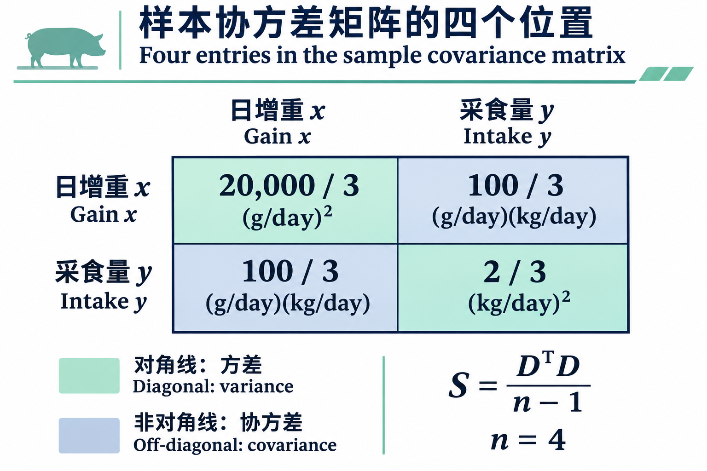

# 03-1｜均值向量与协方差矩阵详读 / Mean vectors and covariance matrices

[目录 / Contents](00-目录.md) · [返回第03章 / Chapter 03](03-0-统计基础.md) · [下一篇 / Next](03-2-相关系数与回归辨析详读.md)

我把协方差矩阵当作从明细表生成的统计表来读，每个格子都要能追到两列数据、各自离差、行列标签和单位。  
I read the covariance matrix as a summary derived from records, with each entry traceable to two data columns, deviations, labels, and units.

> **均值向量描述多个性状的中心，协方差矩阵描述它们如何分散和共同变化。**  
> **A mean vector describes the centers of several traits, and a covariance matrix describes their spread and joint variation.**

## 01 · 原始网页讲什么 / What the source covers

原始来源是 [NIST：均值向量与协方差矩阵](https://www.itl.nist.gov/div898/handbook/pmc/section5/pmc541.htm)，本次核对日期为 **2026-10-17**。  
The original source is [NIST: mean vectors and covariance matrices](https://www.itl.nist.gov/div898/handbook/pmc/section5/pmc541.htm), checked on **2026-10-17**.

原文短摘中的“variance-covariance matrix”就是把方差与协方差统一存放的矩阵。  
The source term “variance-covariance matrix” means a matrix that stores variances and covariances together.

原页从多列测量数据出发，把各列均值组成向量，再把各对变量的共同偏离组成矩阵。  
The page starts with multivariable measurements, collects column means into a vector, and organizes pairwise joint deviations into a matrix.

以下四头猪的数据和全部演算是本教程自拟，用于把原页公式逐项展开。  
The following four-pig data and calculations are original teaching examples that unpack the source equations.

## 02 · 行是猪，列是性状 / Rows are pigs, columns are traits

**矩阵**是按行列排列的数字表，$4\times2$ 表示四行两列。  
A **matrix** is a rectangular array of numbers, with $4\times2$ indicating four rows and two columns.

这里第一列是日增重 $x$，单位为 g/day，第二列是日采食量 $y$，单位为 kg/day。  
Here the first column is daily gain $x$ in g/day, and the second is daily feed intake $y$ in kg/day.

$$
X=\begin{bmatrix}
700&2\\
800&3\\
800&4\\
900&3
\end{bmatrix}
$$

第一行的 700 与 2 必须属于同一头猪，否则后续协方差不再描述真实配对。  
The 700 and 2 in the first row must belong to the same pig, or the covariance no longer describes the actual pairings.

**转置**把行列互换，用上标 $T$ 表示，例如行向量 $[700,2]$ 转置后成为列向量。  
A **transpose**, denoted by superscript $T$, swaps rows and columns, turning a row such as $[700,2]$ into a column.

## 03 · 均值向量与中心化 / Mean vector and centering

**向量**是一组按固定顺序排列的数，均值向量必须与性状列保持相同顺序。  
A **vector** is an ordered collection of numbers, and the mean vector must retain the trait-column order.

$$
\bar{\boldsymbol{x}}=
\begin{bmatrix}\bar{x}\\\bar{y}\end{bmatrix}
=\begin{bmatrix}800\\3\end{bmatrix}
$$

**中心化**就是每列减去自己的均值，得到各头猪相对该列中心的偏离。  
**Centering** subtracts each column's own mean to obtain each pig's deviation from that column's center.

$$
D=\begin{bmatrix}
-100&-1\\
0&0\\
0&1\\
100&0
\end{bmatrix}
$$

每列中心化后的和为 0，但两列中心化后的尺度并不相同。  
Each centered column sums to zero, but the two centered columns do not share the same scale.

## 04 · 先算三个平方和与乘积和 / Calculate the three sums

第一列与自身相乘再相加，得到日增重离差平方和 $SS_x=20{,}000$。  
Multiplying the first column by itself and summing gives the daily-gain squared-deviation sum $SS_x=20{,}000$.

第二列与自身相乘再相加，得到采食量离差平方和 $SS_y=2$。  
Multiplying the second column by itself and summing gives the intake squared-deviation sum $SS_y=2$.

两列按行相乘再相加，得到交叉乘积和 $SS_{xy}=100$。  
Multiplying the two columns within rows and summing gives the cross-product sum $SS_{xy}=100$.

$$
SS_x=(-100)^2+0^2+0^2+100^2=20{,}000
$$

$$
SS_y=(-1)^2+0^2+1^2+0^2=2
$$

$$
SS_{xy}=(-100)(-1)+0\times0+0\times1+100\times0=100
$$

矩阵乘法 $D^TD$ 正好一次完成“每一列与每一列相乘再求和”的操作。  
Matrix multiplication $D^TD$ performs every column-by-column product sum at once.

$$
D^TD=\begin{bmatrix}20{,}000&100\\100&2\end{bmatrix}
$$

这里的矩阵乘法不是把相同位置的数字分别相乘，而是用一行与一列逐项相乘后求和。  
Matrix multiplication here is not elementwise multiplication but the sum of products between a row and a column.

## 05 · 协方差矩阵的四个位置 / The four positions in a covariance matrix

所有记录都完整且采用同一批四头猪时，样本协方差矩阵统一除以 $n-1=3$。  
With complete records for the same four pigs, the sample covariance matrix divides every entry by $n-1=3$.

$$
S=\frac{D^TD}{n-1}
=\begin{bmatrix}
20{,}000/3&100/3\\
100/3&2/3
\end{bmatrix}
\approx\begin{bmatrix}
6666.6667&33.3333\\
33.3333&0.6667
\end{bmatrix}
$$

- **左上角 $S_{11}$**是日增重的样本方差，单位为 $(g/day)^2$。  
  **The upper-left entry $S_{11}$** is sample daily-gain variance, with units $(g/day)^2$.

- **右下角 $S_{22}$**是采食量的样本方差，单位为 $(kg/day)^2$。  
  **The lower-right entry $S_{22}$** is sample intake variance, with units $(kg/day)^2$.

- **两个非对角位置 $S_{12}$ 和 $S_{21}$**都是两性状的协方差，单位为 $(g/day)(kg/day)$。  
  **The off-diagonal entries $S_{12}$ and $S_{21}$** are the same trait covariance, with units $(g/day)(kg/day)$.

**对角线**从左上延伸到右下，**对称矩阵**表示交换行列后数值不变。  
The **diagonal** runs from upper left to lower right, and a **symmetric matrix** is unchanged by swapping rows and columns.

因为乘法 $uv=vu$，所以协方差满足 $s_{xy}=s_{yx}$，矩阵必须对称。  
Since multiplication satisfies $uv=vu$, covariance satisfies $s_{xy}=s_{yx}$ and the matrix must be symmetric.

**图 03-1A**　行列同时按日增重、日采食量排列，两个对角元素是各性状的样本方差，两个非对角元素都是 $100/3\,(\mathrm{g/day})(\mathrm{kg/day})$。  
**Figure 03-1A**　Both dimensions list daily gain followed by daily feed intake, with sample variances on the diagonal and $100/3\,(\mathrm{g/day})(\mathrm{kg/day})$ in both off-diagonal cells.

颜色用于识别元素类型，所有元素均使用同一批四头猪并除以 $n-1=3$。  
The colors identify entry types, and all entries use the same four pigs and the denominator $n-1=3$.

## 06 · 相关矩阵把单位消掉 / Correlation matrix removes units

**标准化分数 $z$**把中心化后的值再除以对应标准差，表示它偏离均值多少个标准差。  
A **standardized score $z$** divides a centered value by its standard deviation, expressing its distance from the mean in standard-deviation units.

$$
z_{xi}=\frac{x_i-800}{\sqrt{20{,}000/3}},\qquad
z_{yi}=\frac{y_i-3}{\sqrt{2/3}}
$$

标准化后的样本方差都是 1，样本协方差就是原始两性状的相关系数。  
The standardized sample variances are both 1, and their sample covariance is the original trait correlation.

$$
r=\frac{100/3}{\sqrt{20{,}000/3}\sqrt{2/3}}=0.5,
\qquad R=\begin{bmatrix}1&0.5\\0.5&1\end{bmatrix}
$$

相关矩阵的对角线为 1，因为一个有变化的变量与自身完全相关。  
A correlation matrix has diagonal entries of 1 because a varying variable is perfectly correlated with itself.

将日增重从 g/day 改为 kg/day 后，日增重方差除以 $1000^2$，交叉协方差除以 1000，相关仍是 0.5。  
Converting daily gain from g/day to kg/day divides its variance by $1000^2$ and the cross-covariance by 1000 while leaving correlation at 0.5.

## 07 · 矩阵不能随便填写 / Matrix entries must be compatible

**半正定**表示任意线性组合的方差都不为负，这是合法协方差矩阵必须满足的条件。  
**Positive semidefinite** means every linear combination has nonnegative variance, a requirement for a valid covariance matrix.

对于两个性状，一个直接检查是协方差绝对值不能超过两个标准差的乘积。  
For two traits, a direct check is that the covariance magnitude cannot exceed the product of the standard deviations.

$$
|s_{xy}|\leq s_xs_y=\sqrt{(20{,}000/3)(2/3)}=66.6667\ldots
$$

若保留本例两个方差，却把协方差填成 80，就会算出相关 1.2，证明这些数值不能共同构成合法协方差矩阵。  
Keeping these variances but setting covariance to 80 would give correlation 1.2, proving that these entries cannot form a valid covariance matrix.

存在缺失值时，分别用不同猪群计算每一对协方差，拼出的矩阵可能不再半正定。  
With missing data, computing each covariance from a different animal subset can produce a matrix that is not positive semidefinite.

应明确缺失处理和样本范围，不能把不同来源的数字拼好后就默认能输入多性状模型。  
Specify missing-data handling and sample scope rather than assuming that assembled numbers are valid inputs to a multi-trait model.

## 08 · 两种容易混淆的关系 / Two different kinds of relationship

这里的 $S$ 描述**性状与性状**的关系，行列分别是日增重和采食量。  
Here $S$ describes **relationships among traits**, with rows and columns representing daily gain and intake.

后文的系谱关系矩阵 $A$ 描述**动物与动物**的加性遗传亲缘，行列分别是不同动物。  
The later pedigree relationship matrix $A$ describes **additive genetic relationships among animals**, with rows and columns representing animals.

同样叫矩阵不代表它们的索引对象、单位或含义相同。  
Sharing the name matrix does not make their indexed units, measurement units, or meanings identical.

本例直接计算的是表型记录的样本协方差，分离加性遗传协方差还需要亲缘信息、环境信息和相应模型。  
This example directly calculates sample covariance of phenotypic records, while separating additive genetic covariance requires relationship information, environmental information, and an appropriate model.

## 09 · 为什么相关记录影响标准误 / Why dependent records affect standard errors

对具有相同有限方差 $\sigma^2$ 的 $n$ 条记录，均值方差的一般公式包含记录间协方差。  
For $n$ observations with the same finite variance $\sigma^2$, the general variance of their mean includes between-record covariances.

$$
\operatorname{Var}(\bar{X})=
\frac{1}{n^2}\left[n\sigma^2+2\sum_{i<j}\operatorname{Cov}(X_i,X_j)\right]
$$

$\operatorname{Var}$ 表示方差运算，$\operatorname{Cov}$ 表示协方差运算，$i<j$ 表示每对不同记录只数一次。  
$\operatorname{Var}$ denotes variance, $\operatorname{Cov}$ denotes covariance, and $i<j$ counts each distinct pair once.

独立记录的交叉协方差为 0，公式才简化为 $\sigma^2/n$，再开平方得到 $\sigma/\sqrt{n}$。  
Independent observations have zero cross-covariances, reducing the formula to $\sigma^2/n$, whose square root is $\sigma/\sqrt{n}$.

正相关的同窝或重复记录会增加交叉项，因此相同记录条数不保证相同信息量。  
Positively correlated littermate or repeated records increase the cross terms, so the same record count does not guarantee the same information.

## 10 · 换列时，矩阵要怎样跟着换 / How a Matrix Follows a Column Swap

把两个性状整体交换时，我会同时换矩阵的行列标签、各自方差以及单位，两个非对角协方差仍为 $100/3$。  
If the two traits are swapped, I swap both matrix labels, their variances, and units, while both off-diagonal covariance entries stay at $100/3$.

左上角的 6666.67 要连同日增重的平方单位一起读，换单位会改变方差的数值，因此不同尺度的两个方差大小无法直接说明哪个性状更稳定。  
The upper-left value 6666.67 must be read in squared daily-gain units, because changing measurement scales changes variance values and makes direct comparisons of trait stability misleading.

本篇把原页的矩阵框架用于原创例题，半正定检查、亲缘辨析和相关记录解释属于教学补充。  
This note applies the source's matrix framework to an original example, with matrix-validity checks, relationship distinctions, and dependent-record explanations added for teaching.
