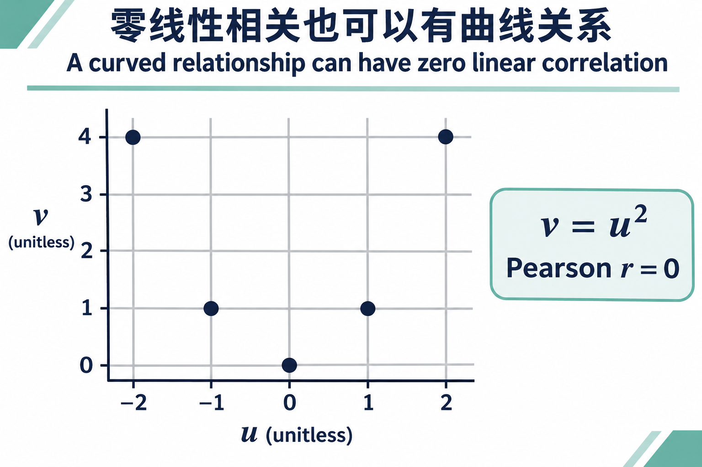
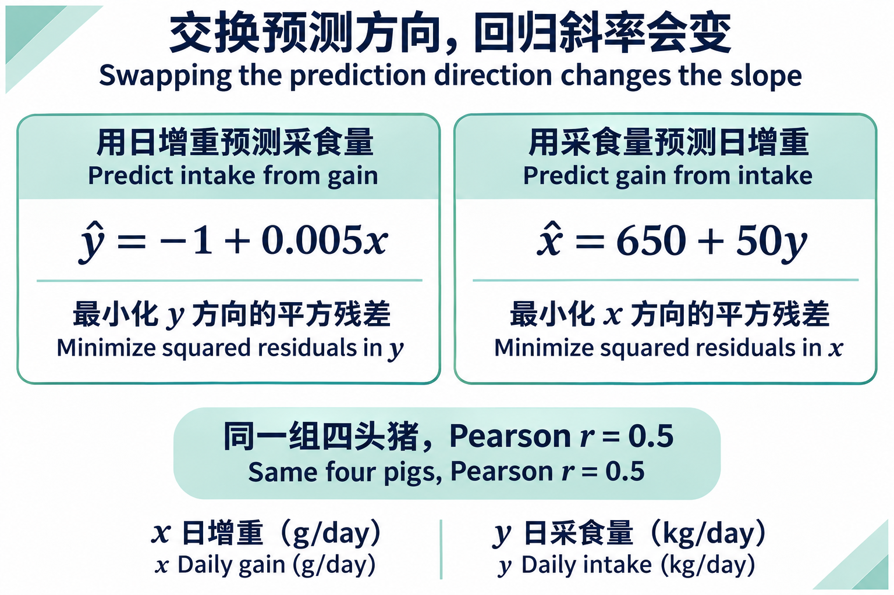

# 03-2｜相关系数与回归辨析详读 / Correlation versus regression

[目录 / Contents](00-目录.md) · [返回第03章 / Chapter 03](03-0-统计基础.md) · [上一篇 / Previous](03-1-均值向量与协方差矩阵详读.md) · [下一篇 / Next](03-3-均值方差标准差与数值校验详读.md)

我会用同一组点分别算相关和回归，再交换横纵变量，看看哪些量保持原样、哪些量跟着预测方向变。  
I use the same points for correlation and regression, then swap the variables to see which quantities stay fixed and which follow the prediction direction.

> **相关描述一起变化的程度，回归拟合有方向的预测关系，两者都不能自动证明因果。**  
> **Correlation describes joint variation, while regression fits a directional prediction relationship, and neither automatically establishes causation.**

## 01 · 原文重点与短摘 / Source focus and short excerpt

原始来源是 [NIST Dataplot：CORRELATION](https://www.itl.nist.gov/div898/software/dataplot/refman2/auxillar/correlat.htm)，本次核对日期为 **2026-10-17**。  
The original source is [NIST Dataplot: CORRELATION](https://www.itl.nist.gov/div898/software/dataplot/refman2/auxillar/correlat.htm), checked on **2026-10-17**.

原文短摘“linear relationship between two variables”强调这里衡量的是两个变量之间的线性关系。  
The source excerpt “linear relationship between two variables” emphasizes that this measure concerns linear association.

原页提供计算式、取值范围、零相关检验和软件用法，本篇主要解释公式和统计含义。  
The page provides the equation, range, zero-correlation test, and software usage, while this note focuses on the equation and interpretation.

下面的猪群数据、手算过程和反例均为自拟教学材料，回归解释另外核对了 [NIST 最小二乘资料](https://www.itl.nist.gov/div898/handbook/pmd/section4/pmd431.htm)。  
The pig data, calculations, and counterexamples below are original teaching material, with regression checked against [NIST's least-squares reference](https://www.itl.nist.gov/div898/handbook/pmd/section4/pmd431.htm).

## 02 · 配对比公式更早决定答案 / Pairing determines what is being measured

沿用同一顺序的日增重 $x=[700,800,800,900]$ 和日采食量 $y=[2,3,4,3]$。  
Use the same ordered daily gains $x=[700,800,800,900]$ and daily feed intakes $y=[2,3,4,3]$.

每一对 $(x_i,y_i)$ 对应同一头猪在对应测定条件下的两项记录，而不是任意两组同样长度的数字。  
Each pair $(x_i,y_i)$ represents two records for the same pig under corresponding measurement conditions, not arbitrary equal-length lists.

**散点图**把每头猪画成一个横坐标为 $x$、纵坐标为 $y$ 的点，能先发现弯曲、分组和极端值。  
A **scatterplot** represents each pig as a point with horizontal coordinate $x$ and vertical coordinate $y$, helping reveal curvature, groups, and extremes.

## 03 · 从中心化到相关系数 / From centering to correlation

先逐列减去均值，得到 $d_x=[-100,0,0,100]$ 与 $d_y=[-1,0,1,0]$。  
Subtract the column means to obtain $d_x=[-100,0,0,100]$ and $d_y=[-1,0,1,0]$.

再计算三个总量：$SS_x=20{,}000$、$SS_y=2$、$SS_{xy}=100$。  
Calculate the three totals: $SS_x=20{,}000$, $SS_y=2$, and $SS_{xy}=100$.

$$
r=\frac{SS_{xy}}{\sqrt{SS_xSS_y}}
=\frac{100}{\sqrt{20{,}000\times2}}=\frac{100}{200}=0.5
$$

分子记录共同偏离，分母按两列自身的分散程度缩放，因此结果没有单位。  
The numerator records joint deviations and the denominator scales by each column's own spread, leaving a unitless result.

### 用标准化分数再算一次 / Recalculate with standardized scores

两列分别除以样本标准差后，得到下面的标准化分数，显示值保留六位小数。  
Dividing each centered column by its sample standard deviation gives the following standardized scores, displayed to six decimals.

$$
z_x=[-1.224745,0,0,1.224745],\qquad
z_y=[-1.224745,0,1.224745,0]
$$

使用未舍入值相乘求和为 1.5，再除以 $n-1=3$，仍然得到 $r=0.5$。  
Using unrounded values gives a product sum of 1.5, which divided by $n-1=3$ again yields $r=0.5$.

$$
r=\frac{\sum z_{xi}z_{yi}}{n-1}=\frac{1.5}{3}=0.5
$$

## 04 · 正负、强弱与零 / Sign, strength, and zero

将 $y$ 换成 $2x+1$ 会得到 $r=1$，换成 $-2x+1$ 会得到 $r=-1$。  
Replacing $y$ with $2x+1$ gives $r=1$, while replacing it with $-2x+1$ gives $r=-1$.

绝对值接近 1 表示更贴近一条直线，但“多大算强”取决于性状、用途和数据条件，没有跨情境统一门槛。  
Magnitudes closer to 1 indicate a closer straight-line fit, but what counts as strong depends on traits, purpose, and data conditions rather than a universal cutoff.

零相关不能排除曲线关系，例如 $u=[-2,-1,0,1,2]$ 与 $v=u^2$。  
Zero correlation does not exclude a curved relationship, as shown by $u=[-2,-1,0,1,2]$ and $v=u^2$.

这个反例中 $\bar{u}=0$、$\bar{v}=2$，交叉乘积和为 $-4+1+0-1+4=0$，所以 $r=0$。  
In this example, $\bar{u}=0$ and $\bar{v}=2$, giving cross-product sum $-4+1+0-1+4=0$ and therefore $r=0$.

**图 03-2A**　五个点沿 $v=u^2$ 分布，左右对称的离差乘积抵消，因此这组点的皮尔逊相关为 $r=0$。  
**Figure 03-2A**　The five points follow $v=u^2$, and the centered cross-products cancel by symmetry, giving Pearson correlation $r=0$.

两个变量独立且二阶矩存在时协方差为 0，但反过来“协方差为 0 就独立”一般不成立。  
Independence implies zero covariance when second moments exist, but zero covariance does not generally imply independence.

任何一列都相同时，其平方偏离和为 0，分母变成 0，因此结果应标为未定义。  
If either column is constant, its squared-deviation sum is zero and the denominator vanishes, so the result should be marked undefined.

## 05 · 相关与回归为什么不同 / Why correlation and regression differ

相关交换 $x$ 与 $y$ 后不变，而回归必须指定哪个变量用于预测哪个结果。  
Correlation is unchanged when $x$ and $y$ are swapped, whereas regression specifies which variable predicts which outcome.

拟合采食量对日增重的直线时，斜率为 $b_{y|x}=100/20{,}000=0.005$。  
Fitting intake from gain gives slope $b_{y|x}=100/20{,}000=0.005$.

反过来拟合日增重对采食量时，斜率为 $b_{x|y}=100/2=50$，并不是 $0.005$ 的倒数 200。  
Reversing the regression to fit gain from intake gives $b_{x|y}=100/2=50$, not the reciprocal of $0.005$, which is 200.

$$
\hat{y}=-1+0.005x,\qquad
\hat{x}=650+50y
$$

原因是两次拟合分别最小化不同方向的残差，普通最小二乘不会自动把两列都当作无误差的因果量。  
The fits minimize residuals in different directions, and ordinary least squares does not automatically treat both columns as error-free causal quantities.

**图 03-2B**　同一组四头猪的数据在交换变量后仍有 $r=0.5$，两次普通最小二乘拟合分别最小化采食量方向与日增重方向的残差平方和。  
**Figure 03-2B**　The same four pigs give $r=0.5$ in either order, while the two ordinary least-squares fits minimize the sum of squared residuals along feed intake and daily gain, respectively.

## 06 · r 平方到底表示什么 / What does r squared mean?

**总平方和 SST**是结果 $y$ 相对自身均值的平方偏离，本例为 2。  
The **total sum of squares (SST)** measures squared deviations of outcome $y$ from its own mean and equals 2 here.

**残差平方和 SSE**是 $y$ 相对拟合值的平方偏离，本例为 1.5。  
The **residual sum of squares (SSE)** measures squared deviations of $y$ from fitted values and equals 1.5 here.

**决定系数 $R^2$**在这里衡量加入直线预测后，相对只用均值预测减少了多少比例的平方偏离。  
The **coefficient of determination $R^2$** here measures the proportional reduction in squared deviation from fitting the line rather than predicting only the mean.

$$
R^2=1-\frac{SSE}{SST}=1-\frac{1.5}{2}=0.25
$$

在使用同一批数据、一个解释变量、含截距的普通最小二乘回归中，$R^2=r^2=0.25$。  
For ordinary least squares on the same data with one predictor and an intercept, $R^2=r^2=0.25$.

这表示本次样本内平方偏离减少了 25%，不表示发现了 25% 的生物学原因或 25% 的遗传力。  
This means a 25% reduction in within-sample squared deviation, not discovery of 25% of biological causes or 25% heritability.

换成无截距回归、多变量模型或新样本预测时，不能直接照搬这个等式与解释。  
This equality and interpretation cannot simply be carried over to regression without an intercept, multiple predictors, or prediction on new data.

## 07 · 显著性和 p 值 / Significance and p-values

样本相关 $r$ 是当前数据的统计量，总体相关 $\rho$ 是想了解的未知参数。  
Sample correlation $r$ is a statistic of the current data, whereas population correlation $\rho$ is the unknown parameter of interest.

**零假设 $H_0$**是检验暂时作为基准的命题，这里设为总体线性相关 $\rho=0$。  
A **null hypothesis $H_0$** is the proposition used as a test benchmark, here population linear correlation $\rho=0$.

**p 值**是在零假设及检验条件成立时，得到至少与当前一样极端的检验统计量的概率。  
A **p-value** is the probability of a test statistic at least as extreme as observed, assuming the null hypothesis and test conditions hold.

为演示经典双侧检验，额外假设各猪的数据对独立且来自同一二元正态分布。  
To illustrate the classical two-sided test, additionally assume independent pig pairs from the same bivariate normal distribution.

**二元正态**描述两个变量联合的特定正态分布条件，不能只看两列各自像钟形就认定成立。  
**Bivariate normality** is a specific joint normal condition and is not established merely because each column looks bell-shaped.

$$
t=r\sqrt{\frac{n-2}{1-r^2}}
=0.5\sqrt{\frac{2}{0.75}}
\approx0.816497,\qquad df=n-2=2
$$

这里 **df** 是自由度缩写，使用自由度为 2 的 t 分布得到双侧 $p=0.5$。  
Here **df** abbreviates degrees of freedom, and a t distribution with two degrees of freedom gives two-sided $p=0.5$.

这个特例可用正数 $t$ 下的尾概率公式 $p=1-t/\sqrt{t^2+2}$ 直接验证，无需另查统计表。  
This special case can be verified directly for positive $t$ using $p=1-t/\sqrt{t^2+2}$ without consulting a statistical table.

NIST 原页使用等价的 $F=t^2$ 检验，分子自由度为 1、分母自由度为 $n-2$。  
The NIST page uses the equivalent $F=t^2$ test with numerator degrees of freedom 1 and denominator degrees of freedom $n-2$.

**统计显著**通常指 p 值小于事先选定的显著性水平，后者是在零假设成立时控制错误拒绝概率的检验规则。  
**Statistical significance** usually means a p-value below a prespecified significance level, a test rule controlling the chance of falsely rejecting a true null hypothesis.

显著性水平 0.05 不是当前结论有 5% 概率出错，也不保证效应具有生产价值。  
A significance level of 0.05 does not mean the current conclusion has a 5% probability of being wrong or guarantee a practically valuable effect.

若事先采用 0.05 的阈值，本例不能拒绝零相关假设，但这不证明总体相关一定为 0。  
With a prespecified threshold of 0.05, this example does not reject zero correlation, but that does not prove the population correlation is zero.

p 值不是“零假设为真的概率”，也不是效应大小，更不是育种价值大小。  
A p-value is not the probability that the null hypothesis is true, an effect size, or a measure of breeding merit.

四个自拟点只用于演示算法，不构成任何猪群关系的实证证据。  
These four invented points only demonstrate the calculation and provide no empirical evidence about a pig population.

## 08 · 回到育种：三个常见误读 / Three common breeding misinterpretations

- **共同环境被当作遗传关系**：同一饲料同时改变采食量和日增重，也能产生表型相关。  
  **Shared environment mistaken for genetics:** feed affecting both intake and gain can create phenotypic correlation.

- **动物亲缘被当作性状相关**：同胞亲缘讨论动物之间的关系，本篇相关讨论性状之间的变化。  
  **Animal relatedness mistaken for trait correlation:** sibling relatedness concerns animals, while this correlation concerns variation between traits.

- **筛选后的相关被当作全群相关**：只保留高增重猪会改变数据范围，计算结果未必代表筛选前总体。  
  **Selected-sample correlation mistaken for whole-population correlation:** retaining only high-gain pigs changes the data range and may change what the result represents.

相关也可能受到极端值、测量误差和群体混合影响，所以应先看原始配对与分组再解释单个系数。  
Correlation can also be affected by extremes, measurement error, and mixed groups, so inspect original pairs and groups before interpreting one coefficient.

## 09 · 用单位和样本量读 r、斜率和 p 值 / Reading r, Slope, and p with Units and Sample Size

把所有采食量乘以 1000 后，相关仍是 0.5，采食量对日增重的回归斜率由 0.005 变为 5，斜率随响应量单位而变。  
Multiplying all intake values by 1,000 leaves correlation at 0.5 and changes the intake-on-gain slope from 0.005 to 5 because the slope follows the response unit.

同一小样本可以同时给出 $r=0.5$ 和 $p=0.5$，前者描述样本线性关系，后者还取决于样本量和检验假设。  
The same small sample can give both $r=0.5$, a description of sample linear association, and $p=0.5$, which also depends on sample size and test assumptions.
