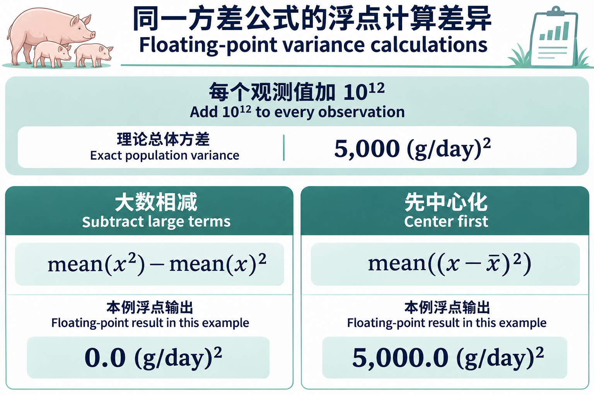

# 03-3｜均值方差标准差与数值校验详读 / Mean, variance, standard deviation, and numerical checks

[目录 / Contents](00-目录.md) · [返回第03章 / Chapter 03](03-0-统计基础.md) · [上一篇 / Previous](03-2-相关系数与回归辨析详读.md)

同一组日增重交给两个函数，我会把输入、分母、运算顺序和显示精度拆开核对。  
When two functions receive the same daily gains, I compare the input, denominator, operation order, and display precision separately.

> **先分清要算哪个统计量，再检查公式、分母和计算机精度。**  
> **Identify the statistic first, then check its equation, denominator, and numerical precision.**

## 01 · 原网页是数值认证说明 / The source explains numerical certification

原始来源是 [NIST：Lew 认证方法与定义](https://www.itl.nist.gov/div898/strd/univ/certmethdef/lew.html)，本次核对日期为 **2026-10-17**。  
The original source is [NIST: Lew certification methods and definitions](https://www.itl.nist.gov/div898/strd/univ/certmethdef/lew.html), checked on **2026-10-17**.

原文短摘“accurate to 500 digits”说明认证数值先经过极高精度计算，而不是说样本能把真实总体参数测准到 500 位。  
The excerpt “accurate to 500 digits” concerns high-precision computation of certified values, not estimating a true population parameter to 500 digits from a sample.

原页说明参考值经高精度计算后报告为 15 位有效数字，并列出均值、标准差和一阶自相关等定义。  
The page explains that reference values are computed at high precision and reported to 15 significant digits, and lists definitions including mean, standard deviation, and lag-one autocorrelation.

本篇不转载其认证数据表，而用自拟数据说明这些统计量的用途和代码核验方法。  
This note uses original data rather than reproducing its certification tables to explain these statistics and their computational verification.

## 02 · 有效数字不等于小数位 / Significant digits versus decimal places

**小数位**从小数点后开始计数，**有效数字**从第一个非零数字开始计数并保留反映精度的数字。  
**Decimal places** count positions after the decimal point, while **significant digits** begin at the first nonzero digit and retain digits expressing precision.

例如 0.008165 有六位小数、四位有效数字，而 81.65 有两位小数、同样四位有效数字。  
For example, 0.008165 has six decimal places and four significant digits, whereas 81.65 has two decimal places and also four significant digits.

**舍入**是按指定精度缩短数字，本教程通常在计算末尾才舍入，避免中间误差累积。  
**Rounding** shortens a number to a specified precision, and this tutorial usually rounds only final results to avoid accumulating intermediate error.

## 03 · 同一数据为什么会有两个方差 / Why the same data can have two variances

设 $x=[700,800,800,900]$，其均值为 800，离差平方和为 $20{,}000$。  
Let $x=[700,800,800,900]$, with mean 800 and squared-deviation sum $20{,}000$.

若将这些记录视为来自更大总体的样本，并由同一样本估计均值，则通常计算样本方差。  
Treating these observations as a sample from a larger population and estimating the mean from that sample gives the usual sample variance.

$$
s^2=\frac{20{,}000}{4-1}=6666.666666\ldots,
\qquad s=81.649658\ldots
$$

若只想描述这四个数构成的完整总体，则计算总体平均平方偏离。  
Describing these four values as the complete population instead gives their population mean squared deviation.

$$
\sigma_{\mathrm{four}}^2=\frac{20{,}000}{4}=5000,
\qquad\sigma_{\mathrm{four}}=70.710678\ldots
$$

两者回答不同问题，并不是某个软件算错了，也不能根据哪个数“看起来合理”选择分母。  
The two calculations answer different questions rather than indicating a software error, and the denominator must not be chosen by which result looks preferable.

[Python 官方文档](https://docs.python.org/3/library/statistics.html)的 `variance` 和 `stdev` 使用样本约定，`pvariance` 和 `pstdev` 使用总体约定。  
In the [official Python documentation](https://docs.python.org/3/library/statistics.html), `variance` and `stdev` use sample conventions, while `pvariance` and `pstdev` use population conventions.

主文第 05 节用四种等概率样本解释 $n-1$ 的无偏修正，本篇代码同时输出两种约定以便对照。  
Section 05 of the chapter explains the $n-1$ correction using four equally likely samples, and the code here prints both conventions for comparison.

## 04 · 用标准库完整复算 / Recompute everything with the standard library

下面代码只使用 Python 3 标准库，无需安装第三方包，复制到本地运行即可得到随后列出的输出。  
The following code uses only the Python 3 standard library, requires no third-party packages, and produces the output listed below when run locally.

输入是自拟的完整数值记录，真实数据中的缺失、非数值和配对问题应先处理。  
The inputs are complete, original teaching records, and real missing values, nonnumeric entries, and pairing issues require prior handling.

```python
import math
import statistics as st

x = [700, 800, 800, 900]
y = [2, 3, 4, 3]
assert len(x) == len(y) == 4, "This worked example uses n=4"

n = len(x)
mx, my = st.mean(x), st.mean(y)
dx = [v - mx for v in x]
dy = [v - my for v in y]
ssx = math.fsum(v * v for v in dx)
ssy = math.fsum(v * v for v in dy)
ssxy = math.fsum(a * b for a, b in zip(dx, dy))
if ssx == 0 or ssy == 0:
    raise ValueError("Correlation requires two varying variables")

sample_var = ssx / (n - 1)
population_var = ssx / n
sd = math.sqrt(sample_var)
se = sd / math.sqrt(n)
covariance = ssxy / (n - 1)
r = ssxy / math.sqrt(ssx * ssy)

slope = ssxy / ssx
intercept = my - slope * mx
predicted = [intercept + slope * v for v in x]
residuals = [v - fitted for v, fitted in zip(y, predicted)]
sse = math.fsum(v * v for v in residuals)
r_squared = 1 - sse / ssy
residual_var = sse / (n - 2)

# For n=4, under the normal-sampling assumptions in Chapter 03.
t_critical = 3.182
margin = t_critical * se
ci = (mx - margin, mx + margin)

# This p-value shortcut is specific to two-sided t inference with df=2.
t_value = r * math.sqrt((n - 2) / (1 - r * r))
p_two_sided_df2 = 1 - abs(t_value) / math.sqrt(t_value**2 + 2)

assert math.isclose(sample_var, st.variance(x))
assert math.isclose(population_var, st.pvariance(x))
assert math.isclose(sd, st.stdev(x))
assert math.isclose(r_squared, r * r)

print(f"n={n}; mean_x={mx:.2f}; mean_y={my:.2f}")
print(f"deviations_x={dx}")
print(f"squared_deviations_x={[v*v for v in dx]}")
print(f"SS_x={ssx:.2f}; SS_y={ssy:.2f}; SS_xy={ssxy:.2f}")
print(f"sample_variance_x={sample_var:.6f}")
print(f"population_variance_of_four={population_var:.6f}")
print(f"sample_SD_x={sd:.6f}; estimated_SE_mean_x={se:.6f}")
print(f"sample_covariance={covariance:.6f}; r={r:.6f}")
print(f"intercept={intercept:.6f}; slope={slope:.6f}")
print(f"predicted_y={predicted}; residuals_y={residuals}")
print(f"SSE={sse:.6f}; residual_variance={residual_var:.6f}")
print(f"R_squared={r_squared:.6f}")
print(f"t_critical={t_critical:.3f}; CI95=[{ci[0]:.2f}, {ci[1]:.2f}]")
print(f"t_statistic={t_value:.6f}; df=2; p_two_sided={p_two_sided_df2:.6f}")
```

基础 R 版沿用四对记录，用 `var()`、`cov()` 和 `cor()` 计算统计量，再用 `lm()` 拟合同一条回归线。  
The base R version uses the same four pairs, computes statistics with `var()`, `cov()`, and `cor()`, and fits the same regression with `lm()`.

均值区间用 $n-1$ 个自由度并沿用手算的临界值 3.182，相关检验用 $n-2$ 个自由度计算双侧 p 值。  
The mean interval uses $n-1$ degrees of freedom and the hand calculation’s critical value of 3.182, and the correlation test uses $n-2$ degrees of freedom for its two-sided p-value.

```r
x <- c(700, 800, 800, 900)
y <- c(2, 3, 4, 3)
n <- length(x)
stopifnot(n == 4, length(y) == n, all(is.finite(c(x, y))))

mx <- mean(x)
my <- mean(y)
dx <- x - mx
dy <- y - my
ssx <- sum(dx^2)
ssy <- sum(dy^2)
ssxy <- sum(dx * dy)
stopifnot(ssx > 0, ssy > 0)

sample_var <- var(x)
population_var <- mean(dx^2)
sample_sd <- sd(x)
se <- sample_sd / sqrt(n)
sample_cov <- cov(x, y)
r <- cor(x, y)

fit <- lm(y ~ x)
intercept <- unname(coef(fit)[1])
slope <- unname(coef(fit)[2])
predicted <- fitted(fit)
residuals_y <- residuals(fit)
sse <- sum(residuals_y^2)
r_squared <- 1 - sse / ssy
residual_var <- sse / (n - 2)

# Use the same rounded critical value as the hand calculation.
t_critical <- round(qt(0.975, df = n - 1), 3)
ci <- mx + c(-1, 1) * t_critical * se

df <- n - 2
t_value <- r * sqrt(df / (1 - r^2))
p_two_sided <- 2 * pt(-abs(t_value), df = df)

stopifnot(
  isTRUE(all.equal(sample_var, ssx / (n - 1))),
  isTRUE(all.equal(sample_cov, ssxy / (n - 1))),
  isTRUE(all.equal(r, ssxy / sqrt(ssx * ssy))),
  isTRUE(all.equal(r_squared, r^2))
)

# Remove signed zero introduced by the numerical fit before printing.
residuals_for_output <- round(residuals_y, 10) + 0
join <- function(values) paste(values, collapse = ", ")

cat(
  sprintf("n=%d; mean_x=%.2f; mean_y=%.2f", n, mx, my),
  sprintf("deviations_x=[%s]", join(dx)),
  sprintf("squared_deviations_x=[%s]", join(dx^2)),
  sprintf("SS_x=%.2f; SS_y=%.2f; SS_xy=%.2f", ssx, ssy, ssxy),
  sprintf("sample_variance_x=%.6f", sample_var),
  sprintf("population_variance_of_four=%.6f", population_var),
  sprintf("sample_SD_x=%.6f; estimated_SE_mean_x=%.6f", sample_sd, se),
  sprintf("sample_covariance=%.6f; r=%.6f", sample_cov, r),
  sprintf("intercept=%.6f; slope=%.6f", intercept, slope),
  sprintf(
    "predicted_y=[%s]; residuals_y=[%s]",
    join(sprintf("%.1f", predicted)),
    join(sprintf("%.1f", residuals_for_output))
  ),
  sprintf("SSE=%.6f; residual_variance=%.6f", sse, residual_var),
  sprintf("R_squared=%.6f", r_squared),
  sprintf("t_critical=%.3f; CI95=[%.2f, %.2f]", t_critical, ci[1], ci[2]),
  sprintf("t_statistic=%.6f; df=%d; p_two_sided=%.6f", t_value, df, p_two_sided),
  sep = "\n"
)
```

预期输出如下，单位沿用主文的日增重 g/day 和采食量 kg/day。  
Expected output follows, using the chapter's daily-gain units of g/day and intake units of kg/day.

```text
n=4; mean_x=800.00; mean_y=3.00
deviations_x=[-100, 0, 0, 100]
squared_deviations_x=[10000, 0, 0, 10000]
SS_x=20000.00; SS_y=2.00; SS_xy=100.00
sample_variance_x=6666.666667
population_variance_of_four=5000.000000
sample_SD_x=81.649658; estimated_SE_mean_x=40.824829
sample_covariance=33.333333; r=0.500000
intercept=-1.000000; slope=0.005000
predicted_y=[2.5, 3.0, 3.0, 3.5]; residuals_y=[-0.5, 0.0, 1.0, -0.5]
SSE=1.500000; residual_variance=0.750000
R_squared=0.250000
t_critical=3.182; CI95=[670.10, 929.90]
t_statistic=0.816497; df=2; p_two_sided=0.500000
```

如果在 R 里保留 `qt(0.975, df = 3)` 的完整精度，临界值约为 3.182446，95% 区间变为 [670.08, 929.92] g/day。  
Keeping full precision from `qt(0.975, df = 3)` gives a critical value of about 3.182446 and a 95% interval of [670.08, 929.92] g/day.

两组端点的差别来自临界值的舍入，输入数据和模型假设都相同。  
The endpoints differ because of rounding the critical value, with the same data and model assumptions.

代码中的 `assert` 会在两种计算结果不一致时停止，`isclose` 则允许浮点数最后几位存在微小差异。  
The `assert` statements stop execution if results disagree, while `isclose` permits tiny differences in the final floating-point digits.

这个检验只能说明公式与代码在该例上一致，不能证明真实猪场数据满足独立性或模型假设。  
This check establishes agreement between equations and code for this example, not that real farm data satisfy independence or model assumptions.

## 05 · 数值稳定性：不要用大数相减丢掉小差异 / Numerical stability and cancellation

[NIST 单变量统计背景说明](https://www.nist.gov/itl/sed/statistical-reference-datasets/strd-background-information/univariate-summary-statistics)强调计算稳定性，这与原页的高精度认证目标相呼应。  
[NIST's univariate-statistics background](https://www.nist.gov/itl/sed/statistical-reference-datasets/strd-background-information/univariate-summary-statistics) emphasizes computational stability, complementing the source page's high-precision certification goal.

在精确算术中，下面两种总体方差表达式等价，但在有限精度浮点计算中可能表现不同。  
In exact arithmetic, the following two population-variance expressions are equivalent but can behave differently in finite-precision floating-point computation.

$$
\frac{1}{n}\sum(x_i-\bar{x})^2
=\frac{1}{n}\sum x_i^2-\bar{x}^{\,2}
$$

右式可能把两个很接近的大数相减，丢掉用于表示较小方差的有效数字，这称为**消减误差**。  
The right side can subtract two nearly equal large numbers and lose digits needed to represent a smaller variance, an effect called **cancellation**.

下面的自拟例子给每个数都加上 $10^{12}$，理论方差应保持 5000 不变。  
The following original example adds $10^{12}$ to every value, which should theoretically leave the population variance unchanged at 5000.

```python
import math
import statistics as st

values = [10**12 + v for v in [700, 800, 800, 900]]
values = [float(v) for v in values]
m = st.mean(values)

naive = sum(v * v for v in values) / len(values) - m * m
centered = math.fsum((v - m)**2 for v in values) / len(values)
library = st.pvariance(values)

print(f"naive={naive:.1f}")
print(f"centered={centered:.1f}; library={library:.1f}")
assert math.isclose(centered, 5000.0)
assert math.isclose(library, 5000.0)
```

原 Python 示例的朴素公式给出 0.0，中心化计算与标准库都给出 5000.0。  
In the original Python run, the naive formula gives 0.0, and both centering and the standard library give 5000.0.

在基础 R 中，我用同一组平移后的数据复算，再把 `var()` 乘 $(n-1)/n$，换成总体方差的分母口径。  
In base R, I reuse the shifted data and multiply `var()` by $(n-1)/n$ to put it on the population-variance denominator.

```r
values <- 10^12 + c(700, 800, 800, 900)
n <- length(values)
m <- mean(values)

naive <- mean(values^2) - m^2
centered <- mean((values - m)^2)

# var() divides by n - 1; rescale it to a denominator of n.
library_value <- var(values) * (n - 1) / n

cat(sprintf("naive=%.1f\n", naive))
cat(sprintf("centered=%.1f; library=%.1f\n", centered, library_value))

stopifnot(
  isTRUE(all.equal(centered, 5000)),
  isTRUE(all.equal(library_value, 5000))
)
```

用基础 R 4.5.3 实跑得到以下输出，朴素公式的结果可能随运行环境变化。  
A run in base R 4.5.3 gave the output below, and the naive result can vary by environment.

```text
naive=0.0
centered=5000.0; library=5000.0
```



**图 03-3A**　每条记录加 $10^{12}$ 后，精确总体方差仍为 $5{,}000\,(\mathrm{g/day})^2$，在本例环境中先平方再相减得到 0.0，先中心化得到 5,000.0。  
**Figure 03-3A**　Adding $10^{12}$ to each record leaves the exact population variance at $5{,}000\,(\mathrm{g/day})^2$, and in the example environment subtracting the squared terms returned 0.0 while centering first returned 5,000.0.

图中两种公式的均值运算都除以 $n$，不同浮点实现的大数相减结果可能不同。  
The means in both formulas divide by $n$, and the subtraction of large terms can produce different results across floating-point implementations.

不同数值实现可能得到不同的错误结果，所以验收条件应是与正确结果一致，而不是必须复现某个错误值。  
Different numerical implementations may produce different wrong results, so acceptance should mean agreement with the correct value rather than reproduction of one particular error.

标准库能改善运算过程，但如果输入时已经把重要的小数差异舍掉，也无法凭空恢复原始信息。  
The standard library can improve computation but cannot recover original information already lost when inputs were rounded.

## 06 · 一阶自相关不是两个性状的相关 / Lag-one autocorrelation versus two-trait correlation

原页还涉及**一阶自相关**，它衡量同一个有顺序的序列与其相邻时点之间的关联。  
The source also includes **lag-one autocorrelation**, measuring association between neighboring points in an ordered sequence of one variable.

这里的“阶”表示间隔一个记录位置，并不自动表示间隔一天，实际时间间隔必须由数据定义。  
Here “lag one” means one record position apart and does not automatically mean one day, so actual time spacing must be defined from the data.

采用全序列均值与平方和的一种常用样本定义如下，其中分子从第 2 条开始计算相邻乘积。  
One common sample definition uses the full-series mean and squared sum as follows, with adjacent products starting at observation 2.

$$
r_1=\frac{\sum_{t=2}^{n}(q_t-\bar{q})(q_{t-1}-\bar{q})}
{\sum_{t=1}^{n}(q_t-\bar{q})^2}
$$

对自拟序列 $q=[1,2,3,4]$，均值为 2.5，四个离差为 $[-1.5,-0.5,0.5,1.5]$。  
For the original series $q=[1,2,3,4]$, the mean is 2.5 and the deviations are $[-1.5,-0.5,0.5,1.5]$.

$$
r_1=\frac{(-0.5)(-1.5)+(0.5)(-0.5)+(1.5)(0.5)}
{2.25+0.25+0.25+2.25}
=\frac{1.25}{5}=0.25
$$

若改为直接对 $[1,2,3]$ 和 $[2,3,4]$ 算皮尔逊相关，会得到 1，因为两列分别中心化且使用的端点不同。  
Directly calculating Pearson correlation between $[1,2,3]$ and $[2,3,4]$ instead gives 1 because the columns are centered separately and use different endpoints.

因此同样标成“lag-1”时也要核对实际公式、端点处理和均值约定，不能只凭名称比较软件输出。  
Thus, even outputs labeled “lag-1” require checking the equation, endpoint handling, and mean convention rather than comparing names alone.

这个四点序列仅用于展示定义差异，不能据此判断真实过程是否平稳或估计可靠的时间依赖。  
This four-point series only demonstrates definition differences and cannot establish stationarity or reliable time dependence in a real process.

**平稳性**在这里指均值、方差及同一间隔的协方差不随时间位置改变，是时间序列分析中需要另外检查的性质。  
**Stationarity** here means that the mean, variance, and covariance at a given lag do not change with time position, a property requiring separate investigation in time-series analysis.

## 07 · 统计可信与计算正确是两道检查 / Statistical validity and numerical correctness

- **数值检查**关注公式实现、分母、单位、浮点精度和可重复输出。  
  **Numerical checks** concern equation implementation, denominators, units, floating-point precision, and reproducible output.

- **统计检查**关注总体定义、抽样机制、相关记录、缺失过程和模型假设。  
  **Statistical checks** concern population definition, sampling, dependent observations, missingness, and model assumptions.

即使计算到 15 位有效数字，也无法弥补只测优秀猪或把同一测量导入两次造成的问题。  
Even 15 significant digits cannot compensate for measuring only outstanding pigs or importing one measurement twice.

学习时先能解释每个数从哪里来，再追求自动化，能避免把错误计算快速复制到全群。  
Understanding where each number comes from before automating helps prevent rapidly propagating wrong calculations across a herd.

## 08 · 两套函数的方差不同，先核对口径 / Start with Definitions When Variances Differ

一套函数给出 6666.666667、另一套给出 5000 时，我先找样本方差和总体方差对应的分母 $n-1$ 或 $n$。  
When one function returns 6666.666667 and another returns 5000, I first check for $n-1$ or $n$ as the sample or population variance denominator.

把均值显示到 12 位小数只会改变显示精度，估计真实猪群均值依靠抽样信息、测量质量以及对系统偏差的处理。  
Displaying the mean to 12 decimal places changes only display precision, and estimating the true herd mean depends on sampling information, measurement quality, and addressing systematic bias.
