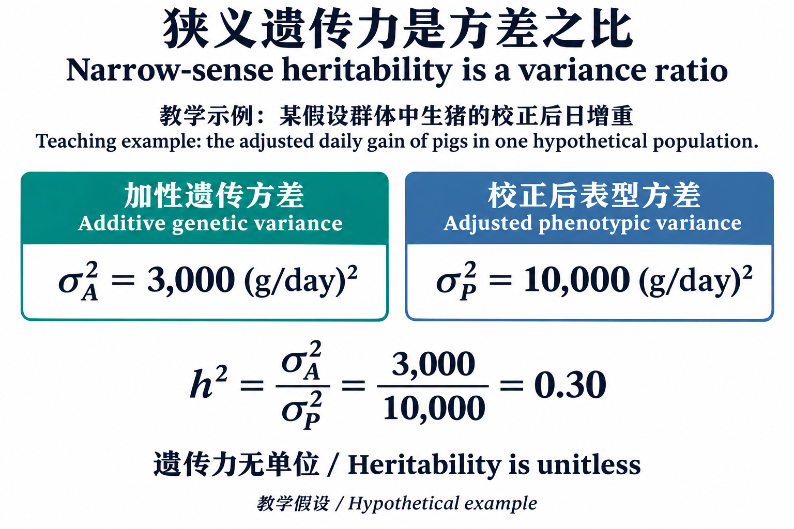
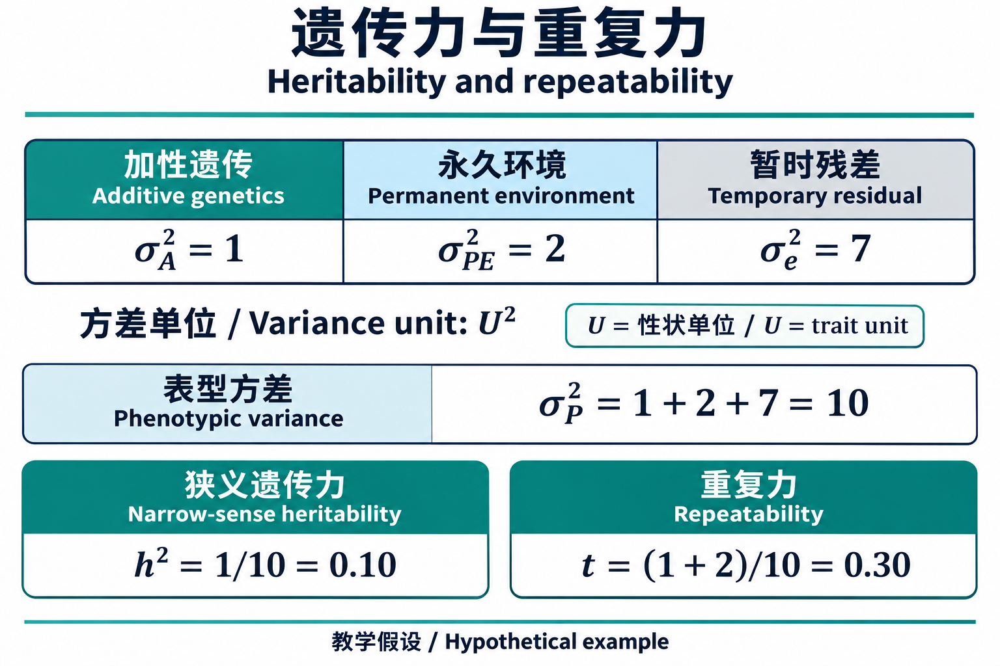

# 04-0｜遗传参数与相关性 / Genetic parameters and correlations

[目录 / Contents](00-目录.md) · [上一章 / Previous](03-0-统计基础.md) · [下一章 / Next](05-0-家系系谱与近交.md)

看到遗传力是 0.30，我先问分子、分母是什么，比例说的是哪一个群体和哪一种性状。  
When I see heritability of 0.30, I start by asking what is in the numerator and denominator and which population and trait the ratio describes.

重复力里多出来的永久环境、遗传相关里换成了加性遗传量，这些区别只看数值和字段名很难发现。  
Repeatability adds permanent environment, and genetic correlation is computed on additive genetic effects, differences a field name and value alone can easily hide.

> **我的笔记｜遗传力属于群体和性状，不属于某一头猪。**  
> **My note | Heritability describes a trait in a population, not an individual pig.**

## 01 · 遗传力在回答什么 / What heritability describes

**狭义遗传力** $h^2$ 是指定群体与环境中，加性遗传方差占表型方差的比例。  
**Narrow-sense heritability**, $h^2$, is the proportion of phenotypic variance attributable to additive genetic variance in a specified population and environment.

$$
h^2=\frac{\sigma_A^2}{\sigma_P^2}
$$

它不是某头动物“有多少百分比由基因决定”。  
It is not the percentage of one animal's performance determined by genes.

假设校正系统环境后，日增重表型方差为 10,000，加性遗传方差为 3,000。  
Suppose adjusted daily-gain phenotypic variance is 10,000 and additive genetic variance is 3,000.

两者单位均为 $(g/day)^2$，因此 $h^2=0.30$。  
Both use units of $(g/day)^2$, giving $h^2=0.30$.

这个结果不表示优秀猪有 30% 概率生出优秀后代。  
This result does not mean a good pig has a 30% chance of producing good offspring.

**广义遗传力** $H^2=\sigma_G^2/\sigma_P^2$ 还包括非加性遗传变异，不能与 $h^2$ 互换。  
**Broad-sense heritability**, $H^2=\sigma_G^2/\sigma_P^2$, includes non-additive genetic variation and is not interchangeable with $h^2$.

育种值主要关注加性部分，因为显性与互作组合可能在后代中重排。  
Breeding values focus on additive effects because dominance and interaction combinations may be rearranged in offspring.

**图 04-0A**　在这个日增重教学例子中，用加性遗传方差 $3{,}000$ 除以校正后的表型方差 $10{,}000$，得到狭义遗传力 $h^2=0.30$。  
**Figure 04-0A**　In this daily-gain example, dividing the additive genetic variance of $3{,}000$ by the adjusted phenotypic variance of $10{,}000$ gives narrow-sense heritability $h^2=0.30$.

这个比例描述特定群体和环境中的变异，分子和分母的 $(\mathrm{g/day})^2$ 单位在相除时抵消。  
This ratio describes variation in a specified population and environment, and the units of $(\mathrm{g/day})^2$ cancel in the division.

---

## 02 · 高低分别意味着什么 / What high and low values mean

- 其他条件相同时，遗传力越高，自身表现通常提供越多育种值信息。  
  Other things equal, higher heritability makes own performance more informative about breeding value.

- 遗传力较低时，通常更需要亲属、重复记录或基因组信息。  
  Lower heritability generally increases the need for relatives, repeated records, or genomic information.

- 低遗传力不表示不能改良。  
  Low heritability does not make improvement impossible.

- 高遗传力也不表示管理不重要。  
  High heritability does not make management irrelevant.

猪的繁殖性状常比生长和部分胴体性状遗传力低，但历史教材数值不能直接作为当前猪群参数。  
Pig reproductive traits often have lower heritabilities than growth and some carcass traits, but historical values should not automatically become parameters for a current herd.

群体、环境、测量方法和模型都会影响参数估计。  
Population, environment, measurement methods, and model specification affect parameter estimates.

---

## 03 · 重复力看同一动物的稳定性 / Repeatability concerns within-animal consistency

简单重复力模型把记录拆成加性遗传、永久环境与暂时残差。  
A simple repeatability model separates additive genetics, permanent environment, and temporary residual effects.

**重复力** $t$ 描述同一动物不同次记录的相关程度。  
**Repeatability**, $t$, describes the correlation between an animal's repeated records.

$$
t=\frac{\sigma_A^2+\sigma_{PE}^2}
{\sigma_A^2+\sigma_{PE}^2+\sigma_e^2}
$$

其中 $PE$ 表示永久环境，即持续影响同一动物多次表现的非遗传因素。  
Here $PE$ means permanent environment, or non-genetic influences persisting across an animal's records.

假设加性、永久环境和残差方差依次为 1、2、7，则 $h^2=0.10$、$t=0.30$。  
If additive, permanent-environmental, and residual variances are 1, 2, and 7, then $h^2=0.10$ and $t=0.30$.

在这个简化模型中，$t\ge h^2$。  
In this simplified model, $t\ge h^2$.

若不同胎次被定义为不同性状，就需要更一般的模型。  
Treating different parities as different traits requires a more general model.

稳定的非遗传影响也会提高重复力，所以一直表现好不等于全是遗传优势。  
Persistent non-genetic influences can increase repeatability, so consistently good performance is not entirely genetic.

**图 04-0B**　在这个简化模型中，三项方差加起来是 $10\,U^2$，其中 $U$ 表示性状的计量单位。  
**Figure 04-0B**　In this simplified model, the three variances sum to $10\,U^2$, where $U$ is the unit of the trait.

狭义遗传力的分子只计入加性遗传方差，而同一个体的重复记录还共享永久环境效应，因此重复力把这项方差也计入分子。  
The numerator of narrow-sense heritability includes only additive genetic variance, while repeated records from the same animal also share permanent environmental effects, so repeatability includes that variance in its numerator.

---

## 04 · 三种相关别混用 / Distinguish three correlations

- **表型相关**看两项实际表现是否一起变化。  
  **Phenotypic correlation** concerns co-variation in observed performances.

- **遗传相关**看两个性状的加性遗传作用是否一起变化。  
  **Genetic correlation** concerns co-variation in the additive genetic effects of two traits.

- **残差相关**看模型扣除已解释部分后，剩余部分是否一起变化。  
  **Residual correlation** concerns co-variation in components remaining after modeled effects.

表型上相关，不保证遗传上同方向相关。  
A phenotypic association does not establish a genetic association in the same direction.

$$
r_A=\frac{\operatorname{Cov}(A_1,A_2)}{\sigma_{A_1}\sigma_{A_2}}
$$

假设两个性状的加性遗传标准差为 10 和 2，遗传协方差为 −10，则 $r_A=-0.5$。  
If additive genetic standard deviations are 10 and 2 with genetic covariance −10, then $r_A=-0.5$.

选择使性状 1 增大时，可能连带使性状 2 减小。  
Selection increasing trait 1 may also decrease trait 2.

这种变化是否有利，取决于两个性状各自的目标方向。  
Whether that change is favorable depends on the desired direction for each trait.

**正相关不天然有利，负相关也不天然不利。**  
**Positive correlation is not inherently favorable, nor negative correlation inherently unfavorable.**

---

## 05 · 换环境，排名可能改变 / Rankings may change with the environment

**基因型与环境互作**指遗传类型在不同环境中表现出不同的优势，甚至发生排名改变。  
**Genotype-by-environment interaction** means genetic types have different advantages across environments, potentially changing rankings.

计算机类比是分布变化：测定站中的排序未必能原样迁移到另一生产环境。  
A computing analogy is distribution shift, since test-station rankings may not transfer unchanged to another production environment.

本章所有数值参数均为教学假设。  
All numerical parameters in this chapter are hypothetical teaching values.

---

## 我的核对笔记 / My Verification Notes

在加性遗传、永久环境和暂时残差方差为 1、2、7 的例子中，总方差为 10，遗传力和重复力分别是 $1/10=0.10$ 与 $3/10=0.30$。  
With additive genetic, permanent-environmental, and temporary-residual variances of 1, 2, and 7, the total is 10, giving heritability $1/10=0.10$ and repeatability $3/10=0.30$.

我把这两个比例记在模型和群体说明旁边，因为它们描述群体中的变异和同一个体记录间的联系，不能拆解单头猪的表现。  
I record both ratios alongside the model and population because they describe population variation and links between repeated records, and do not partition one pig’s performance.

假设日增重与背膘的遗传相关是 $+0.4$，单选高增重可能使背膘随之增加，而希望降背膘时就需要把两个目标一起纳入决策。  
If daily gain and backfat have a genetic correlation of $+0.4$, selecting on gain alone may also increase backfat, so a goal of reducing backfat needs both traits in the decision.

## 延伸阅读 / Further reading

下面按原始阅读列表顺序提供本地详读，重复来源复用同一篇笔记以保持解释一致。  
Local readings follow the original source-list order, reusing a single note for repeated sources to keep explanations consistent.

- **[遗传力与遗传参数](04-1-遗传力与遗传参数详读.md)**。  
  **[Heritability and genetic parameters](04-1-遗传力与遗传参数详读.md)**.

- **[遗传相关与环境互作](04-2-遗传相关与环境互作详读.md)**。  
  **[Genetic correlation and environmental interaction](04-2-遗传相关与环境互作详读.md)**.

- **[重复力与永久环境](02-4-重复记录与永久环境详读.md)**。  
  **[Repeatability and permanent environment](02-4-重复记录与永久环境详读.md)**.

原始来源链接保留如下，无法直接读取的来源及实际使用的替代材料已在对应详读中说明。  
Original source links follow, with unavailable sources and the alternatives actually used identified in the corresponding notes.

- [Purdue：遗传参数及其用途](https://www.extension.purdue.edu/extmedia/NSIF/NSIF-FS3-W.html)。  
  [Purdue: genetic parameters](https://www.extension.purdue.edu/extmedia/NSIF/NSIF-FS3-W.html).

- [UNE：遗传相关与互作课程要点](https://jvanderw.une.edu.au/325TT)。  
  [UNE: correlations and interaction course outline](https://jvanderw.une.edu.au/325TT).

- [BLUPF90：重复力模型](https://masuday.github.io/blupf90_tutorial/mrode_c05ex051_repeatability_model.html)。  
  [BLUPF90: repeatability models](https://masuday.github.io/blupf90_tutorial/mrode_c05ex051_repeatability_model.html).
