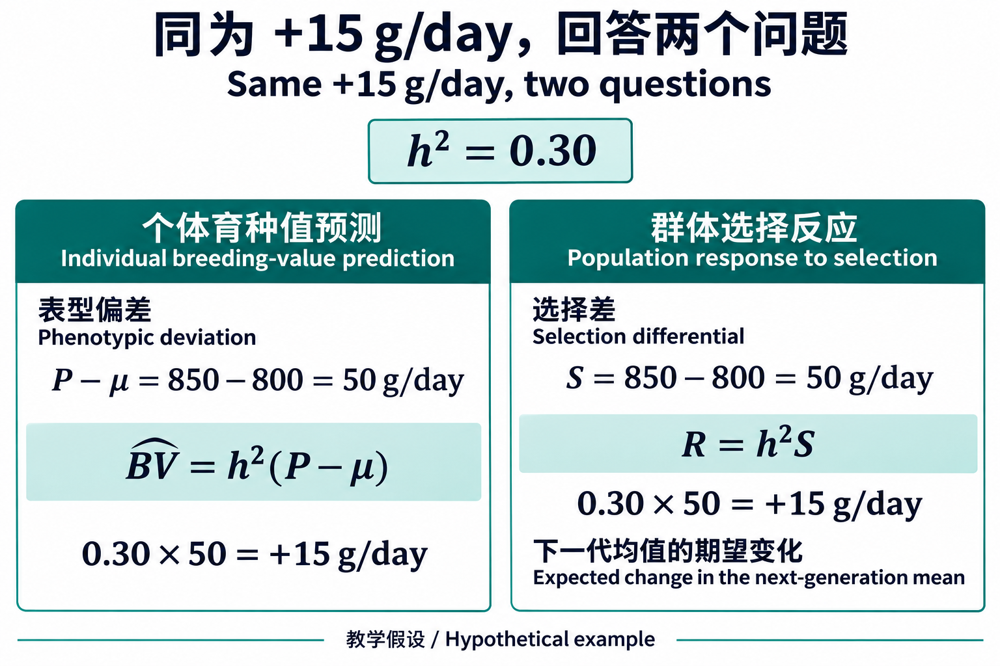

# 04-1｜遗传力与遗传参数 / Heritability and genetic parameters

[目录 / Contents](00-目录.md) · [返回主文 / Main chapter](04-0-遗传参数与相关性.md)

我把群体里的方差比和一头猪的预测结果分别记下来，这样同一个 $h^2$ 出现在两条公式里时，还能追到各自的对象。  
I record the population variance ratio separately from a prediction for one pig, so I can trace what each equation describes when both use $h^2$.

原始来源是 [Purdue／NSIF-FS3：Genetic Parameters and Their Use in Swine Breeding](https://www.extension.purdue.edu/extmedia/NSIF/NSIF-FS3-W.html)，原页标有 1991 年修订信息。  
The original source is [Purdue / NSIF-FS3: Genetic Parameters and Their Use in Swine Breeding](https://www.extension.purdue.edu/extmedia/NSIF/NSIF-FS3-W.html), with a 1991 revision notation.

本篇于 **2026-10-18** 核对来源，来源要点采用概括，教学数据与演算均为自拟。  
Sources were checked on **2026-10-18**, source points are summarized, and teaching data and calculations are original.

> **我想弄懂的事｜遗传力 0.3 到底是谁的 30%，又能用来算什么？**  
> **What I want to understand | What does heritability 0.3 mean, and what can it calculate?**

## 01 · 来源要点与阅读边界 / Source points and limits

原文围绕育种值、传递能力、遗传力与遗传相关组织解释，强调自身表现的信息价值随性状而变。  
The source organizes its explanation around breeding value, transmitting ability, heritability, and genetic correlation, emphasizing trait-dependent informativeness of own performance.

其历史参数表用于说明方法，本教程不把这些数值设为当前猪群默认参数。  
Its historical parameter tables illustrate methods and are not adopted here as defaults for a current herd.

原文关于增重与料重比的一处文字把相关方向写得与表格不一致，因此应结合定义、表格和公式核对，而不逐句照搬。  
One sentence about gain and feed conversion has a sign inconsistent with its table, so definitions, tables, and equations must be checked together rather than copied blindly.

## 02 · 先分清值与方差 / Distinguish values from variances

**育种值**是动物的加性遗传水平，**加性遗传方差**描述群体内这些水平的分散。  
A **breeding value** is an animal's additive genetic level, while **additive genetic variance** describes spread in these levels within a population.

均值和方差可以独立变化，所以平均生长更快的群体不必然有更高遗传力。  
Means and variances can change separately, so a faster-growing population does not necessarily have higher heritability.

狭义遗传力 $h^2$ 是指定模型、群体和环境下，加性遗传方差占表型方差的比例。  
Narrow-sense heritability $h^2$ is the ratio of additive genetic variance to phenotypic variance for a specified model, population, and environment.

$$
h^2=\sigma_A^2/\sigma_P^2
$$

## 03 · 从方差算到遗传力 / Calculate heritability from variances

假设校正固定条件后的日增重模型只有加性作用与独立残差，方差分别为 300、700 $(g/day)^2$。  
Suppose adjusted daily gain contains only additive genetics and independent residuals with variances 300 and 700 $(g/day)^2$.

$$
\sigma_P^2=300+700=1000,\qquad h^2=300/1000=0.30
$$

它不是“某头猪的 800 g/day 中，有 240 g/day 来自基因”，因为比例的分子与分母都是方差。  
This does not mean 240 g/day of one pig's 800 g/day comes from genes, because both numerator and denominator are variances.

若再有永久环境、同窝或其他随机分量，表型方差的分母也必须反映相应模型。  
Adding permanent-environmental, litter, or other random components requires their appropriate inclusion in phenotypic variance.

## 04 · 为什么控制环境会改变比例 / Why environmental control changes the ratio

假设两个管理组之间还存在方差为 1000 的系统差异，且与上述分量无关。  
Suppose management groups add systematic variance of 1000, uncorrelated with the components above.

混在一起的原始方差为 2000，用同一加性方差计算的比例变成 $300/2000=0.15$。  
The pooled raw variance becomes 2000, giving a ratio of $300/2000=0.15$ with the same additive variance.

正确建模管理组后得到 0.30，不表示猪的基因突然变好，而是比较条件和方差口径改变。  
Obtaining 0.30 after modeling management groups does not mean the pigs' genes suddenly improved, but that the comparison and variance definition changed.

这只是独立分量的教学分解，实际管理组与遗传来源纠缠时还要处理混杂。  
This is a teaching decomposition of independent components, while real entanglement of management and genetic sources requires addressing confounding.

## 05 · 用于单条记录的简化预测 / A simplified single-record predictor

在均值、方差已知且环境已校正等条件下，育种值的最佳线性预测可写成遗传力乘以表型偏差。  
With known mean and variances and adjusted environmental conditions, the best linear predictor of breeding value can be written as heritability times phenotypic deviation.

$$
\widehat{BV}=h^2(P-\mu)=0.3(850-800)=15\ \mathrm{g/day}
$$

观察偏差 50 并未全部归到遗传，剩余部分反映对环境和不确定性的处理。  
The observed deviation of 50 is not attributed entirely to genetics, reflecting the treatment of environment and uncertainty.

完整 BLUP 还利用亲属、固定效应和协方差，不能在任意报表上照搬“原始表现乘 0.3”。  
Full BLUP also uses relatives, fixed effects, and covariances, so “raw performance times 0.3” is not a general reporting rule.

## 06 · 用于选择反应的另一个问题 / A different use in selection response

在简单表型选择、两性选择结构匹配等假设下，下一代均值的期望改变为 $R=h^2S$。  
Under assumptions for simple phenotypic selection and a matching sex-selection structure, the expected next-generation mean change is $R=h^2S$.

若候选均值为 800、入选父母平均为 850，则选择差 $S=50$，期望反应为 $R=15$ g/day。  
If candidates average 800 and selected parents average 850, the selection differential is $S=50$ and expected response is $R=15$ g/day.

这里的 $R$ 是群体跨代反应，而上一节的 15 是一个动物的预测，数字相同不代表统计对象相同。  
Here $R$ is population response across generations, while the previous 15 predicts one animal, so matching numbers do not mean matching statistical targets.

更完整的进展解释见 [年度遗传进展](09-5-选择反应与年度遗传进展详读.md)。  
See [annual genetic progress](09-5-选择反应与年度遗传进展详读.md) for the fuller response framework.

**图 04-1A**　左图用一头猪校正后的表型偏差 50 g/day，预测这头猪的育种值为 +15 g/day。  
**Figure 04-1A**　The left panel uses one pig’s adjusted phenotypic deviation of 50 g/day to predict its breeding value of +15 g/day.

右图用入选父母均值相对候选均值的差 50 g/day，估计简单表型选择下下一代群体均值的期望变化为 +15 g/day。  
The right panel uses the 50 g/day difference between selected parents and the candidate mean to estimate an expected increase of +15 g/day in the next generation’s population mean under simple phenotypic selection.

## 07 · 低遗传力下，记录依然有用 / Records Remain Useful at Low Heritability

遇到低遗传力的性状，我会再看重复记录、亲属信息、基因组和模型设置各能补上哪些信息。  
When a trait has low heritability, I look at what repeated records, relatives, genomics, and model specification can each add.

性状的经济重要性还要结合育种目标判断，遗传力只是评估信息价值时的一项参数。  
A trait’s economic importance depends on the breeding objective, and heritability is one parameter for assessing the information available.
