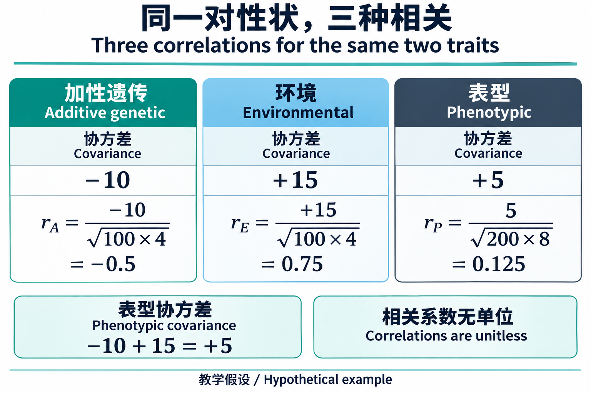
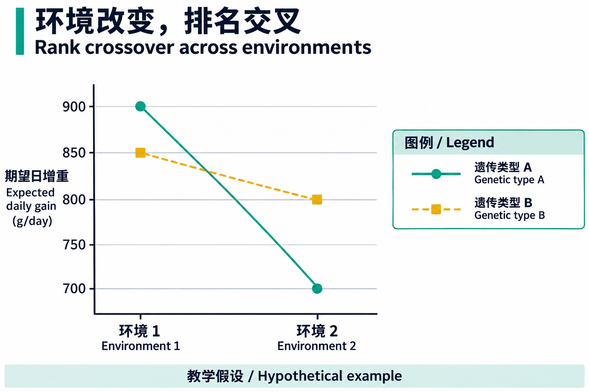

# 04-2｜遗传相关与环境互作 / Genetic correlation and environmental interaction

[目录 / Contents](00-目录.md) · [返回主文 / Main chapter](04-0-遗传参数与相关性.md)

我先把表型、加性遗传和环境分量各自放在一栏，再用一个小例子检查为什么相关的方向可能不同。  
I give observed phenotypes, additive genetic effects, and environmental components their own columns, then use a small example to see why their correlations can point in different directions.

原阅读是 [UNE 相关与互作课程提纲](https://jvanderw.une.edu.au/325TT)，直接读取未成功，检索缓存只提供部分课程主题。  
The original reading is the [UNE correlation and interaction outline](https://jvanderw.une.edu.au/325TT), whose direct retrieval failed, with only partial course topics available in search cache.

本篇实际用已读的 [Purdue 遗传相关说明](https://www.extension.purdue.edu/extmedia/NSIF/NSIF-FS3-W.html)和 [MU 互作术语](https://extension.missouri.edu/publications/g2030)支持解释，不声称复述未读 UNE 全文。  
This explanation is supported by the readable [Purdue genetic-correlation discussion](https://www.extension.purdue.edu/extmedia/NSIF/NSIF-FS3-W.html) and [MU interaction definition](https://extension.missouri.edu/publications/g2030), without claiming a full UNE summary.

本篇于 **2026-10-18** 核对来源，来源要点采用概括，教学数据与演算均为自拟。  
Sources were checked on **2026-10-18**, source points are summarized, and teaching data and calculations are original.

> **我想弄懂的事｜两项表现一起变好，为什么遗传方向还可能相反？**  
> **What I want to understand | Why can two performances improve together while their genetic association points in opposite directions?**

## 01 · 来源要点 / Source points

Purdue 将遗传相关与共同环境造成的相关区分，MU 用环境间优势变化解释基因型与环境互作。  
Purdue distinguishes genetic correlation from shared environmental association, while MU describes genotype-by-environment interaction through changing advantages across environments.

下面的协方差拆分与环境对比是原创教学例子，不是来源中的猪群估计。  
The covariance decomposition and environmental comparisons below are original teaching examples rather than herd estimates from the sources.

## 02 · 三种相关到底相关谁 / What is correlated in each case?

对两个性状，先假设校正后的表型为 $P_1=A_1+E_1$、$P_2=A_2+E_2$，且遗传与环境分量之间互不相关。  
For two traits, assume adjusted phenotypes $P_1=A_1+E_1$ and $P_2=A_2+E_2$, with genetic and environmental components uncorrelated.

- **表型相关 $r_P$**计算两项记录共同变化的程度。  
  **Phenotypic correlation $r_P$** measures joint variation in the observed traits.

- **加性遗传相关 $r_A$**计算两个真实加性遗传作用的共同变化。  
  **Additive genetic correlation $r_A$** measures joint variation in the two true additive effects.

- **环境相关 $r_E$**计算这里两个环境分量的共同变化，在此简化模型中由残差代表。  
  **Environmental correlation $r_E$** measures joint variation in the two environmental components, represented here by residuals.

真实模型若还有永久环境或母体等分量，环境相关与某个特定残差相关不能默认等同。  
With additional permanent-environmental or maternal components, environmental correlation cannot automatically be equated with one residual correlation.

## 03 · 同一组方差推导三种相关 / Derive three correlations

设两个性状加性遗传方差为 100、4，遗传协方差为 −10。  
Let the additive genetic variances be 100 and 4 and genetic covariance be −10.

$$
r_A=\frac{-10}{\sqrt{100}\sqrt{4}}=-0.5
$$

再设环境方差为 100、4，环境协方差为 +15。  
Let environmental variances be 100 and 4 and environmental covariance be +15.

$$
r_E=\frac{15}{\sqrt{100}\sqrt{4}}=0.75
$$

两个表型方差分别为 200、8，表型协方差为 $-10+15=5$。  
The phenotype variances become 200 and 8, with covariance $-10+15=5$.

$$
r_P=\frac{5}{\sqrt{200}\sqrt{8}}=0.125
$$

因此表型正相关 0.125 与遗传负相关 −0.5 可以同时成立，不能从前者直接读出后者。  
Thus positive phenotypic correlation 0.125 and negative genetic correlation −0.5 can coexist, and one cannot directly reveal the other.

这三个系数没有单位，但其协方差与方差的单位必须匹配，不能先把不同量随意标准化再相加。  
The correlations are unitless, but their covariances and variances require compatible units and cannot be arbitrarily standardized before addition.

**图 04-2A**　在遗传与环境分量互不相关的教学模型中，表型协方差等于遗传协方差与环境协方差之和，即 $-10+15=5$。  
**Figure 04-2A**　In this teaching model with uncorrelated genetic and environmental components, the phenotypic covariance is the sum of the genetic and environmental covariances, $-10+15=5$.

分别用对应的两个标准差归一化后，得到遗传相关 $-0.5$、环境相关 $0.75$ 和表型相关 $0.125$，三个系数均无单位。  
Dividing each covariance by the product of its corresponding standard deviations gives the genetic correlation $-0.5$, environmental correlation $0.75$, and phenotypic correlation $0.125$, all unitless.

若两个性状的计量单位为 $U_1$ 和 $U_2$，协方差单位为 $U_1U_2$，各性状方差的单位分别为 $U_1^2$ 和 $U_2^2$。  
If the two traits are measured in $U_1$ and $U_2$, their covariance is in $U_1U_2$ and their variances are in $U_1^2$ and $U_2^2$, respectively.

## 04 · 正负不是好坏标签 / Sign is not desirability

如果一个目标是增加日增重、另一个目标是降低 FCR，那么负遗传相关可能有利于同时改良。  
If the goals are higher daily gain and lower FCR, a negative genetic correlation can favor joint improvement.

若两个性状都希望增加，负遗传相关则可能造成取舍，仍需考虑经济权重和可利用变异。  
If both traits should increase, a negative genetic correlation can create a trade-off, subject to economic weights and available variation.

相关不是每头动物必须遵守的精确等式，所以可能找到两项都优于平均水平的个体。  
Correlation is not an exact equation obeyed by every animal, so individuals can be above average for both traits.

## 05 · 环境互作何时改变排名 / When environmental interaction changes rankings

假设遗传类型 A、B 在环境 1 的期望增重为 900、850，在环境 2 为 700、800 g/day。  
Suppose genetic types A and B have expected gains of 900 and 850 in Environment 1 and 700 and 800 g/day in Environment 2.

环境 1 中 A 优于 B 50，环境 2 中 A 低于 B 100，构成期望排名交叉的教学例子。  
A exceeds B by 50 in Environment 1 but trails by 100 in Environment 2, illustrating crossover in expected rankings.

**基因型与环境互作 G×E**还包括优势幅度变化，即使没有排名交叉也可能存在。  
**Genotype-by-environment interaction (G×E)** also includes changes in advantage magnitude and can exist without rank reversal.

观察到两批猪排名不同还可能来自抽样误差或管理混杂，需要足够重复和模型才能判断真实互作。  
Different observed batch rankings may instead reflect sampling error or management confounding, so replication and modeling are needed to establish interaction.

把同一性状在两个环境中的表现视为两个性状，可以估计跨环境遗传相关，但不能用两个批次的均值代替。  
Modeling the same trait in two environments as two traits allows cross-environment genetic correlation estimation, but two batch means cannot replace that analysis.

**图 04-2B**　环境 1 中，遗传类型 A 的期望日增重比 B 高 50 g/day，到了环境 2，A 比 B 低 100 g/day。  
**Figure 04-2B**　In Environment 1, expected daily gain is 50 g/day higher for genetic type A than for B, and in Environment 2 it is 100 g/day lower for A than for B.

横轴表示两个离散环境，读图时直接比较各环境刻度上的两种类型。  
The horizontal axis shows two discrete environments, so compare the two genetic types directly at each environment tick.

## 06 · 两列 EBV 的相关该怎么解释 / Interpreting Correlation Between Two EBV Columns

直接算两列 EBV 的相关时，我会把它记为这批预测值之间的相关，它会受准确度、共同信息、筛选和预测误差影响。  
When I correlate two EBV columns directly, I label the result as a correlation of these predictions, which can be influenced by accuracy, shared information, selection, and prediction errors.

要估计总体遗传相关，则需要用合适的模型估计两个性状的加性遗传协方差及相应方差。  
Estimating population genetic correlation requires a suitable model for the additive genetic covariance and corresponding variances of the two traits.
