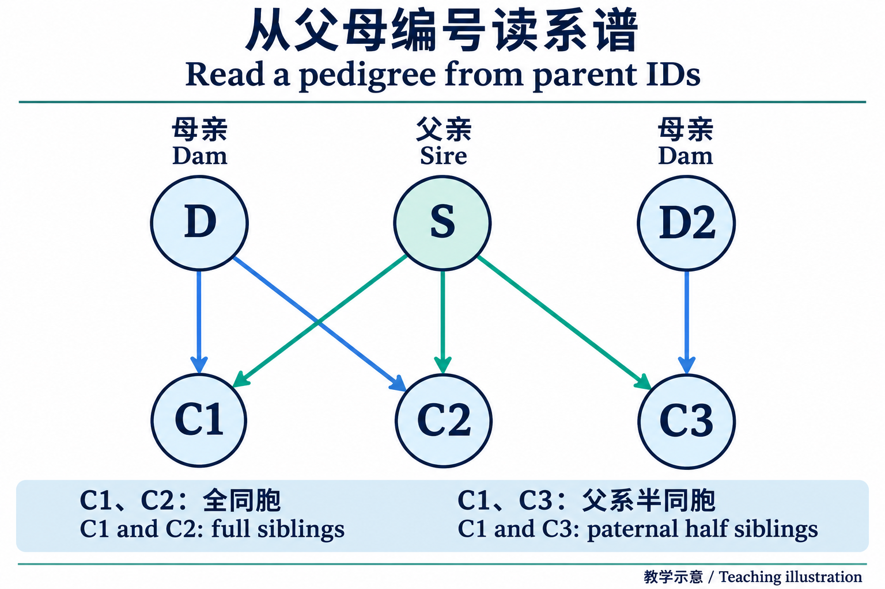

# 05-0｜家系、系谱与近交 / Families, pedigrees, and inbreeding

[目录 / Contents](00-目录.md) · [上一章 / Previous](04-0-遗传参数与相关性.md) · [下一章 / Next](06-0-育种值与准确度.md)

系谱先从我熟悉的外键开始，一头猪的一行记录通过父号和母号指向同一张动物表。  
I start with familiar foreign keys in a pedigree, where each animal row points back into the same table through sire and dam IDs.

这些链接还能组成动物之间的加性亲缘矩阵，我想弄清楚矩阵里的一格，跟后代自己的近交系数怎么接上。  
Those links also define an additive relationship matrix, and I want to see how a cell in that matrix connects to the offspring’s own inbreeding coefficient.

> **我的笔记｜家系是动物分组，亲缘关系是动物间联系，近交系数是个体内的量。**  
> **My note | Families group animals, relationships connect animals, and inbreeding coefficients describe individuals.**

## 01 · 谁和谁是一家 / Defining families

- **家系**是一组具有指定亲缘关系的动物。  
  A **family** groups animals by a specified relationship.

- **系谱**记录谁是谁的父母。  
  A **pedigree** records parentage.

- **全同胞**同父同母。  
  **Full siblings** share both parents.

- **父系半同胞**同父异母。  
  **Paternal half siblings** share a sire but have different dams.

- **母系半同胞**同母异父。  
  **Maternal half siblings** share a dam but have different sires.

- **同窝**指同一次分娩的仔猪，是出生批次概念。  
  A **litter** consists of piglets from one farrowing event and describes a birth group.

同窝记录不能代替可靠的父母身份。  
Litter membership does not replace reliable parentage information.

---

## 02 · 用数据库理解系谱 / A database view of pedigrees

最小系谱可以存成 `animal_id, sire_id, dam_id` 三列。  
A minimal pedigree can use three columns: `animal_id, sire_id, dam_id`.

其中 sire 是父亲，dam 是母亲，父母编号指向同一动物表。  
Sire means father and dam means mother, with their IDs referencing the same animal table.

下面是假设系谱，0 表示未知父母。  
In the hypothetical pedigree below, zero represents an unknown parent.

```csv
animal_id,sire_id,dam_id
S,0,0
D,0,0
C1,S,D
C2,S,D
D2,0,0
C3,S,D2
```

- C1 与 C2 是全同胞。  
  C1 and C2 are full siblings.

- C1 与 C3 是父系半同胞。  
  C1 and C3 are paternal half siblings.



**图 05-0A**　C1 和 C2 的父母都是 S 与 D，因此是全同胞。  
**Figure 05-0A**　C1 and C2 both have S and D as parents, so they are full siblings.

C1 和 C3 共享父亲 S，母亲分别是 D 和 D2，因此是父系半同胞。  
C1 and C3 share sire S and have different dams, D and D2, making them paternal half siblings.

未知父亲不是一头被所有相关记录共享的真实公猪。  
An unknown sire is not one real boar shared by all records using that code.

系谱是有向无环图，动物不能成为自己的祖先。  
A pedigree is a directed acyclic graph, so an animal cannot be its own ancestor.

父母出生时间应早于后代。  
Parents must be born before their offspring.

未知祖先通常相对某个基准作处理，不代表生物学上绝无亲缘。  
Missing ancestry is treated relative to a base, not as proof of biological unrelatedness.

---

## 03 · A 矩阵把关系排成表 / A arranges relationships into a matrix

假设基础祖先彼此无关且不近交，常见加性亲缘关系如下。  
Under unrelated, non-inbred founders, common additive relationships are as follows.

- **亲子：0.5。**  
  **Parent–offspring: 0.5.**

- **全同胞：期望为 0.5。**  
  **Full siblings: an expected 0.5.**

- **半同胞：0.25。**  
  **Half siblings: 0.25.**

- **祖孙：0.25。**  
  **Grandparent–grandchild: 0.25.**

这些数值衡量相对基准的加性遗传联系，不是 DNA 序列相同的百分比。  
These values quantify additive genetic connections relative to a base, not percentages of identical DNA sequence.

将所有两两关系排成矩阵，就得到 **A**。  
Arranging all pairwise relationships gives the **A matrix**.

按 S、D、C1 的顺序，矩阵如下。  
In the order S, D, C1, the matrix is shown below.

$$
\mathbf A=\begin{bmatrix}
1&0&0.5\\
0&1&0.5\\
0.5&0.5&1
\end{bmatrix}
$$

A 可以类比为样本联系图，但其数值必须服从生物学结构。  
A resembles a sample-connection graph, but its values must follow biological structure.

---

## 04 · 近交不是患病概率 / Inbreeding is not a disease probability

**近交系数** $F_i$ 是个体同一常染色体位点的两个等位基因拷贝相对基准同祖同源的概率。  
The **inbreeding coefficient**, $F_i$, is the probability that the two allele copies at an autosomal locus are identical by descent relative to the base.

A 的对角元为 $A_{ii}=1+F_i$。  
The diagonal element is $A_{ii}=1+F_i$.

父母关系越近，子代近交风险通常越高，但 F 不是患病概率。  
More-related parents generally imply greater offspring inbreeding, but F is not a probability of illness.

$$
F_{\text{offspring}}=\frac{A_{\text{sire,dam}}}{2}
=\phi_{\text{sire,dam}}
$$

其中 $\phi$ 是**亲缘共祖系数**，英文为 kinship 或 coancestry。  
Here $\phi$ is **kinship**, also called coancestry.

在没有其他亲缘背景时，全同胞配对子代的 $F=0.25$。  
With no additional background relationship, full-sib mating gives offspring $F=0.25$.

相同条件下，半同胞配对子代的 $F=0.125$。  
Under the same assumptions, half-sib mating gives offspring $F=0.125$.

引用“亲缘系数”前，要先确认资料指的是 A 元素还是 $\phi$。  
Before using a “relationship coefficient,” establish whether it denotes an A-matrix element or $\phi$.

---

## 05 · 家系均值为什么不够 / Why family means are incomplete

一个家系表现好，可能来自遗传，也可能来自同窝、同栏或相同管理。  
A good family average may reflect genetics, a shared litter or pen, or management.

只按家系均值选择，会漏掉家系内部的优秀个体，也可能把共享环境当作遗传。  
Selecting solely by family mean can miss outstanding individuals within families and mistake shared environment for inheritance.

动物模型通过系谱联系和环境结构，综合利用家系信息。  
Animal models combine pedigree connections with environmental structure to use family information.

---

## 我的核对笔记 / My Verification Notes

在 S、D、D2 彼此无关且不近交的教学系谱中，C1 与 C2 的 A 元素是 0.5，C1 与 C3 的 A 元素是 0.25。  
In the teaching pedigree with unrelated, non-inbred founders S, D, and D2, the A entries are 0.5 for C1 and C2 and 0.25 for C1 and C3.

若拟配父母的 A 元素是 0.25，那么子代的 $F=0.25/2=0.125$，表示相对系谱基准的同祖同源概率。  
If the proposed parents have an A entry of 0.25, their offspring has $F=0.25/2=0.125$, the probability of identity by descent relative to the pedigree base.

所以看到报表写着「亲缘 0.25」时，我先找列定义和基准，再决定能不能把这个数字用于选配计算。  
When a report shows “relationship 0.25,” I look up the field definition and base before using that number in a mating calculation.

## 延伸阅读 / Further reading

下面按原始阅读列表顺序提供本地详读，重复来源复用同一篇笔记以保持解释一致。  
Local readings follow the original source-list order, reusing a single note for repeated sources to keep explanations consistent.

- **[家系、同胞与系谱术语](05-1-家系同胞与系谱术语详读.md)**。  
  **[Families, siblings, and pedigree terms](05-1-家系同胞与系谱术语详读.md)**.

- **[亲缘、共祖与近交计算](05-2-亲缘共祖与近交计算详读.md)**。  
  **[Relationship, kinship, and inbreeding calculations](05-2-亲缘共祖与近交计算详读.md)**.

- **[动物模型与系谱信息](05-3-动物模型与系谱信息详读.md)**。  
  **[Animal models and pedigree information](05-3-动物模型与系谱信息详读.md)**.

原始来源链接保留如下，无法直接读取的来源及实际使用的替代材料已在对应详读中说明。  
Original source links follow, with unavailable sources and the alternatives actually used identified in the corresponding notes.

- [MU Extension：家系与同胞术语](https://extension.missouri.edu/publications/g2030)。  
  [MU Extension: family and sibling terms](https://extension.missouri.edu/publications/g2030).

- [近交原理](https://extension.missouri.edu/publications/g2911)。  
  [inbreeding principles](https://extension.missouri.edu/publications/g2911).

- [BLUPF90：动物模型与系谱](https://masuday.github.io/blupf90_tutorial/quicktour_mixed.html)。  
  [BLUPF90: animal models and pedigrees](https://masuday.github.io/blupf90_tutorial/quicktour_mixed.html).
