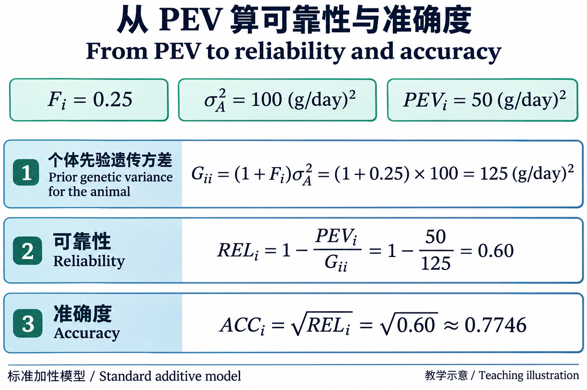

# 06-3｜PEV、可靠性与输出字段 / PEV, reliability, and output fields

[目录 / Contents](00-目录.md) · [返回主文 / Main chapter](06-0-育种值与准确度.md)

软件列名可以叫 acc，解读之前我会找字段字典，再用预测误差方差到可靠性、准确度的例子来对照。  
A software column may be named acc, so I look up its definition before comparing it with a worked example from prediction error variance to reliability and accuracy.

原始来源是 [Masuda：Approximation of accuracy and reliability](https://masuday.github.io/blupf90_tutorial/largescale_reliability.html)，本篇也对应第 07 章的可靠性计算条目。  
The original source is [Masuda: Approximation of accuracy and reliability](https://masuday.github.io/blupf90_tutorial/largescale_reliability.html), also serving the reliability-calculation entry in Chapter 07.

本篇于 **2026-10-18** 核对来源，来源要点采用概括，教学数据与演算均为自拟。  
Sources were checked on **2026-10-18**, source points are summarized, and teaching data and calculations are original.

> **我想弄懂的事｜一列叫 acc 的数字，怎样确认它到底是 ACC 还是 REL？**  
> **What I want to understand | How do you establish whether a column named acc contains ACC or REL?**

## 01 · 原页最值得注意的地方 / The most important source detail

原文示例结果列名写作“acc”，但正文说明其默认示例值为可靠性，选项可改变输出尺度。  
The example output header says “acc,” but the text identifies its default example values as reliability, with an option changing the output scale.

原页还区分精确矩阵计算和大规模近似，因此字段含义与算法来源都应保留。  
The page also distinguishes direct matrix calculations from large-scale approximations, so both field meaning and algorithm provenance must be retained.

## 02 · PEV 的单位和方向 / PEV units and direction

设真实育种值为 $a_i$、预测值为 $\hat a_i$，预测误差写作 $\varepsilon_i=\hat a_i-a_i$。  
Let true breeding value be $a_i$, prediction be $\hat a_i$, and prediction error be $\varepsilon_i=\hat a_i-a_i$.

**预测误差方差 PEV**是模型下这项误差的方差，不是 EBV 在动物之间的样本方差。  
**Prediction error variance (PEV)** is the model-based variance of this error, not the sample variance of EBVs among animals.

EBV 以 g/day 计量时，PEV 的单位为 $(g/day)^2$，$\sqrt{PEV}$ 才回到 g/day。  
With EBVs in g/day, PEV has units $(g/day)^2$, while $\sqrt{PEV}$ returns to g/day.

## 03 · 从 PEV 算 REL 与 ACC / Calculate REL and ACC from PEV

在适用的标准加性模型中，用动物自身的先验遗传方差 $G_{ii}=(1+F_i)\sigma_A^2$ 作分母。  
In the applicable standard additive model, use the animal's prior genetic variance $G_{ii}=(1+F_i)\sigma_A^2$ as denominator.

$$
REL_i=1-\frac{PEV_i}{G_{ii}},\qquad ACC_i=\sqrt{REL_i}
$$

假设 $F_i=0.25$、$\sigma_A^2=100$、$PEV_i=50$，则 $G_{ii}=125$。  
If $F_i=0.25$, $\sigma_A^2=100$, and $PEV_i=50$, then $G_{ii}=125$.

$$
REL_i=1-50/125=0.60,\qquad ACC_i=\sqrt{0.60}\approx0.7746
$$

错误地忽略 $F_i$ 会算成 $1-50/100=0.50$，所以必须核对系统分母定义。  
Ignoring $F_i$ would incorrectly give $1-50/100=0.50$, demonstrating why system denominator conventions matter.

不是每个软件都采用完全相同的基准、近似和近交处理，不能只把公式硬套到现成列上。  
Software can differ in bases, approximations, and inbreeding treatment, so the formula must not be imposed blindly on an existing column.

**图 06-3A**　在本例的标准加性模型中，先用 $F_i=0.25$ 得到个体先验遗传方差 $G_{ii}=125\,(\mathrm{g/day})^2$，再求得可靠性 $0.60$ 和准确度约 $0.7746$。  
**Figure 06-3A**　Under the example’s standard additive model, $F_i=0.25$ gives an individual prior genetic variance of $G_{ii}=125\,(\mathrm{g/day})^2$, then a reliability of $0.60$ and accuracy of about $0.7746$.

预测误差方差与遗传方差都用性状单位的平方，可靠性与准确度均无单位。  
Prediction error variance and genetic variance both use squared trait units, and reliability and accuracy are unitless.

## 04 · 为什么不能直接取方程左边的对角数 / Why a coefficient diagonal is not PEV

设单性状方程已乘以残差方差，系数矩阵记为 $C$，其右下块含 $Z'Z+\lambda A^{-1}$。  
Let $C$ be the coefficient matrix for single-trait equations scaled by residual variance, with bottom-right block $Z'Z+\lambda A^{-1}$.

预测误差来自**整个系数矩阵的逆的对应随机效应块**，不是原系数矩阵的对角线。  
Prediction errors come from the **corresponding random-effect block of the inverse of the whole coefficient matrix**, not the original coefficient diagonal.

$$
PEV=\sigma_e^2(C^{-1})_{aa}
$$

还要保留这里的 $\sigma_e^2$ 尺度因子，而一般加权或多性状方程的尺度应按其定义处理。  
The $\sigma_e^2$ scale factor must be retained here, while weighted or multi-trait equations require their own scaling conventions.

## 05 · 一列 0.64 的两种解释 / Two interpretations of 0.64

假设某输出写着 `animal=P1, ebv=30, acc=0.64`，只看这一行无法确定尺度。  
Suppose an output says `animal=P1, ebv=30, acc=0.64`, which alone does not establish its scale.

- 若元数据确认 `acc` 存 REL，则准确度为 $\sqrt{0.64}=0.8$。  
  If metadata confirm `acc` stores REL, accuracy is $\sqrt{0.64}=0.8$.

- 若元数据确认 `acc` 存 ACC，则可靠性为 $0.64^2=0.4096$。  
  If metadata confirm `acc` stores ACC, reliability is $0.64^2=0.4096$.

- 若显示的是百分数，还要先把 64 转为 0.64，而不能直接平方 64。  
  If values are percentages, convert 64 to 0.64 before squaring rather than squaring 64 directly.

核对顺序应是软件与版本、运行选项、文件说明、尺度、性状与动物编号，最后才是计算。  
Check software and version, run options, file documentation, scale, trait, and animal ID before calculating.

## 06 · 近似可靠性为何需要说明 / Why approximate reliability needs labeling

大规模方程显式求逆代价很高，原页介绍基于有效信息或后代信息的近似方法。  
Explicit inversion of large systems is costly, and the source introduces approximations based on effective information or progeny information.

同样叫 REL 的两列可能来自不同近似，不应默认最后几位差异有生物学意义。  
Two REL columns can come from different approximations, so differences in their last digits are not automatically biologically meaningful.

出现负值或大于 1 的值时，先检查定义、尺度、近似和数值问题，不能直接截断后称为已验证准确度。  
For values below zero or above one, inspect definitions, scales, approximation, and numerical issues rather than clipping them and calling the result validated accuracy.

## 07 · 同一个 EBV 可以对应不同准确度 / The Same EBV Can Have Different Accuracies

EBV 都是 30 的动物可能有不同的记录和亲属信息，我会继续找预测误差、可靠性或准确度的定义和数据。  
Animals with EBV of 30 can have different records and information from relatives, so I look up the definitions and data for prediction error, reliability, or accuracy.

系统只导出 EBV 时，这个点估计不足以反推出 ACC。  
If the system exports only EBVs, the point estimate alone is insufficient to recover ACC.
