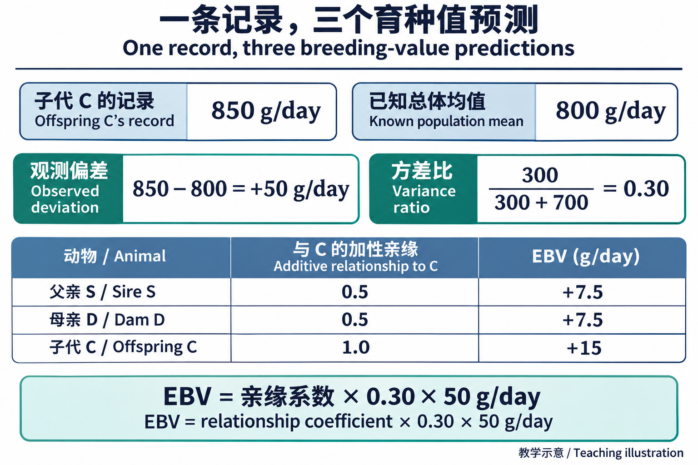

# 07-0｜从手算到 BLUP / From hand calculations to BLUP

[目录 / Contents](00-目录.md) · [上一章 / Previous](06-0-育种值与准确度.md) · [下一章 / Next](08-0-基因组与三类BLUP.md)

我理解一段陌生计算时会先缩小输入，所以这里先把 BLUP 缩到一条记录、两个亲本和一个子代。  
When I need to understand an unfamiliar calculation, I make the inputs small, so I start with BLUP for one record, two parents, and one offspring.

先算一次，再只换子代记录重算，能看出结果从哪一步改变，也能看出亲缘信息是怎么进来的。  
Calculating it once and then changing only the offspring’s record shows which step changes the output and how relationship information enters the calculation.

> **我的笔记｜BLUP 综合利用信息，不把全部表现差异都当作遗传差异。**  
> **My note | BLUP combines information without attributing all performance differences to genetics.**

## 01 · 先算一个最简单的预测 / Start with a simple predictor

下面的简化模型只用一条自身记录，并假设均值与方差参数已知。  
The simplified model below uses one own record and assumes known mean and variance parameters.

动物需来自适用群体，性状还需校正系统环境影响。  
The animal must belong to the relevant population, with systematic environmental effects accounted for.

在这些条件下，可用“遗传力 × 表型偏差”预测育种值。  
Under these conditions, predict breeding value as “heritability × phenotypic deviation.”

$$
\widehat{BV}_i=h^2(P_i-\mu)
$$

假设均值为 800、个体为 850 g/day、$h^2=0.30$，则预测为 **+15 g/day**。  
With mean 800, own record 850 g/day, and $h^2=0.30$, the prediction is **+15 g/day**.

沿用单记录模型，若个体记录换成 860 g/day、均值仍为 800 g/day、遗传力仍为 0.30，表型偏差就是 +60 g/day。  
In the same single-record model, changing the record to 860 g/day with a mean of 800 g/day and heritability of 0.30 gives a phenotypic deviation of +60 g/day.

这里估计育种值为 $0.30(860-800)=+18$ g/day，这个代入只用来核对公式如何随输入变化。  
This gives an estimated breeding value of $0.30(860-800)=+18$ g/day and shows how that equation responds to an input change.

观察优势是 +50，但模型只将其中一部分预测为遗传优势。  
The observed advantage is +50, but only part is predicted to be genetic.

把偏差向基准拉回叫**收缩**。  
This movement of a deviation toward the base is called **shrinkage**.

一般情况下，$h^2$ 不能作为通用系数乘到所有原始记录上。  
In general, $h^2$ is not a universal multiplier for raw records.

---

## 02 · 为什么要用 BLUP / Why use BLUP?

实际数据包含不同场区、批次、性别、日龄、亲属与重复测量。  
Real data include different farms, batches, sexes, ages, relatives, and repeated measurements.

**BLUP**是最佳线性无偏预测。  
**BLUP** means best linear unbiased prediction.

它在指定模型与协方差假设下，联合估计固定效应并预测随机效应。  
Under specified model and covariance assumptions, it jointly estimates fixed effects and predicts random effects.

“最佳”限于其理论条件，不能保证错误数据或模型仍给出正确结果。  
“Best” applies within its theoretical conditions and does not protect against incorrect data or models.

---

## 03 · 把动物模型读成数据流 / Read the animal model as a data flow

$$
\mathbf y=\mathbf X\mathbf b+\mathbf Z\mathbf a+\mathbf e,\qquad
\operatorname{Var}(\mathbf a)=\mathbf K\sigma_A^2,\quad
\operatorname{Var}(\mathbf e)=\mathbf I\sigma_e^2
$$

- $y$ 是表型向量，即所有观测记录。  
  $y$ is the phenotype vector containing the observed records.

- $b$ 是固定效应，例如批次、性别分类效应及日龄回归系数。  
  $b$ holds fixed effects, such as batch and sex classifications or an age-regression coefficient.

- $a$ 是动物的加性遗传随机效应，其预测值就是 EBV。  
  $a$ holds additive genetic random effects, whose predictions are EBVs.

- $e$ 是残差。  
  $e$ holds residuals.

- $K$ 是动物关系矩阵，系谱模型中 $K=A$。  
  $K$ is the animal relationship matrix, with $K=A$ in a pedigree model.

- 粗体 $I$ 是单位矩阵，不是第 01 章的上位互作。  
  Bold $I$ is the identity matrix, not the epistasis term in Chapter 01.

### X、Z 像映射表 / X and Z resemble mapping tables

**X**把每条记录映射到对应的固定效应。  
**X** maps each record to its fixed effects.

**Z**把每条记录映射到被测动物。  
**Z** maps each record to the measured animal.

可以把它们类比为数据库关联后的指示列。  
Think of them as indicator columns after database joins.

一头动物有多条记录时，Z 的多行可以指向同一个动物。  
Several rows of Z can refer to one animal when it has repeated records.

没有自身记录的祖先仍可通过亲缘关系获得预测。  
Ancestors without own records can still receive predictions through relationships.

### 固定与随机 / Fixed and random effects

“固定”不表示数值永远不变，“随机”也不表示随意填数。  
“Fixed” does not mean permanently constant, and “random” does not mean arbitrary.

固定效应估计指定水平的差异。  
Fixed effects estimate differences among specified levels.

随机效应按群体分布和协方差结构建模，信息不足时发生收缩。  
Random effects use population distributions and covariance structures, producing shrinkage when information is limited.

同窝、永久环境或母体作用可能需要扩展模型，不能都塞进遗传效应。  
Litter, permanent-environmental, and maternal effects may require model extensions rather than being absorbed into genetics.

---

## 04 · 方差参数控制信息权重 / Variance parameters control weighting

只有加性与独立残差时，$h^2=\sigma_A^2/(\sigma_A^2+\sigma_e^2)$。  
With only additive genetics and independent residuals, $h^2=\sigma_A^2/(\sigma_A^2+\sigma_e^2)$.

残差相对越大，单条记录提供的遗传证据越弱。  
Relatively larger residual variance weakens the genetic evidence in one record.

- **REML**是限制最大似然，可用于估计方差组分。  
  **REML** is restricted maximum likelihood and can estimate variance components.

- **BLUP**利用这些组分预测育种值。  
  **BLUP** uses those components to predict breeding values.

一个软件流程可以执行两项任务，但它们不是同一个统计问题。  
One software pipeline may perform both tasks, but they are different statistical problems.

---

## 05 · 跟着算一次微型 BLUP / Work through a tiny BLUP

### 第一步：列清假设 / Step 1: State the assumptions

以下完全是假设教学模型。  
The following is a wholly hypothetical teaching model.

- S、D 是彼此无关且不近交的父母，C 是它们的子代。  
  S and D are unrelated, non-inbred parents of C.

- 只有 C 有一条日增重记录，为 850 g/day。  
  Only C has a daily-gain record, which is 850 g/day.

- 总体均值**已知为 800 g/day**。  
  The population mean is **known to be 800 g/day**.

- 加性遗传方差为 $\sigma_A^2=300$，残差方差为 $\sigma_e^2=700$。  
  Additive genetic variance is $\sigma_A^2=300$, and residual variance is $\sigma_e^2=700$.

- 两项方差单位均为 $(g/day)^2$。  
  Both variances have units of $(g/day)^2$.

- 模型没有额外环境效应，也不需要估计未知均值。  
  The model has no additional environmental effects and does not estimate an unknown mean.

### 第二步：建立关系和映射 / Step 2: Define relationships and mapping

动物顺序为 S、D、C，Z 仅指向有记录的 C。  
The animal order is S, D, C, and Z refers only to the recorded animal C.

$$
\mathbf A=\begin{bmatrix}1&0&0.5\\0&1&0.5\\0.5&0.5&1\end{bmatrix},
\qquad \mathbf Z=\begin{bmatrix}0&0&1\end{bmatrix}
$$

### 第三步：代入计算 / Step 3: Calculate the predictions

均值已知时，BLUP 可写成“遗传与观测的协方差 × 观测方差的逆 × 观测偏差”。  
With a known mean, BLUP is “genetic–observation covariance × inverse observation variance × observed deviation.”

这里只有一条观测，不需要复杂矩阵求逆。  
There is only one observation, so no complicated matrix inversion is needed.

$$
\widehat{\mathbf a}
=\mathbf A\mathbf Z'\sigma_A^2
\left(\mathbf Z\mathbf A\mathbf Z'\sigma_A^2+\sigma_e^2\right)^{-1}(850-800)
=\begin{bmatrix}0.5\\0.5\\1\end{bmatrix}\frac{300}{1000}\,50
=\begin{bmatrix}7.5\\7.5\\15\end{bmatrix}\;g/day
$$

- C 的 EBV 是 **+15 g/day**。  
  C's EBV is **+15 g/day**.

- S、D 虽没有自身记录，也各获得 **+7.5 g/day** 的预测。  
  S and D each receive **+7.5 g/day** despite having no own records.

三个预测使用同一条记录，不能再当作三条独立证据重复相加。  
All three predictions use the same record and must not be added again as independent evidence.



**图 07-0A**　在已知总体均值和方差的教学模型中，子代 C 的一条日增重记录给出 C 的估计育种值 +15 g/day，父母 S 和 D 各为 +7.5 g/day。  
**Figure 07-0A**　Under the teaching model with known mean and variances, C’s one daily gain record gives an EBV of +15 g/day for C and +7.5 g/day each for its parents S and D.

三个预测共享这一条记录，图中的亲缘系数具体指 A 矩阵中对应动物与 C 的元素。  
All three predictions share this one record, and the relationship coefficients shown are the A-matrix entries for each animal paired with C.

### 第四步：计算本例的不确定性 / Step 4: Calculate uncertainty in this example

C 的预测误差方差为 $PEV=300-300^2/1000=210$。  
C's prediction error variance is $PEV=300-300^2/1000=210$.

其可靠性为 $REL=1-210/300=0.30$。  
Its reliability is $REL=1-210/300=0.30$.

其准确度为 $ACC=\sqrt{0.30}\approx0.548$。  
Its accuracy is $ACC=\sqrt{0.30}\approx0.548$.

这是均值与方差已知的特例，不能作为生产准确度的通用捷径。  
This known-mean, known-variance case is not a general shortcut for production accuracy.

### 第五步：只改一条输入再复算 / Step 5: Change One Input and Recalculate

我保留同一系谱、均值和方差，只把 C 的一条记录从 850 改成 900 g/day，这样就能检查预测是怎样随观测偏差改变的。  
I keep the pedigree, mean, and variances fixed and change C’s one record from 850 to 900 g/day, so I can check how the predictions follow the observed deviation.

总体均值仍是 800 g/day，遗传方差和残差方差仍为 300 和 700 $(\mathrm{g/day})^2$，S、D 互不相关且不近交。  
The population mean is still 800 g/day, genetic and residual variances are still 300 and 700 $(\mathrm{g/day})^2$, and S and D are unrelated and non-inbred.

偏差变为 +100 g/day 后，S、D、C 的预测依次是 +15、+15、+30 g/day。  
With the deviation now +100 g/day, the predictions for S, D, and C are +15, +15, and +30 g/day.

模型与信息结构保持相同，所以本例中 C 的预测误差方差、可靠性和准确度仍是原来的值。  
The model and information structure are unchanged, so C’s prediction error variance, reliability, and accuracy keep their original values in this example.

这段标准库代码在内存中复算两次条件已知的教学模型。  
This standard-library code reproduces both runs of the known-parameter teaching model in memory.

```python
from math import sqrt

def tiny_blup(child_record):
    # Known mean 800; additive variance 300; residual variance 700.
    # S and D are unrelated, non-inbred parents of C; only C is recorded.
    deviation = child_record - 800
    shrinkage = 300 / (300 + 700)
    return tuple(k * shrinkage * deviation for k in (0.5, 0.5, 1.0))

print('EBV(S,D,C) at 850:', tiny_blup(850))
print('EBV(S,D,C) at 900:', tiny_blup(900))
pev = 300 - 300**2 / (300 + 700)
rel = 1 - pev / 300
print(f'PEV(C)={pev:.2f}, REL(C)={rel:.2f}, ACC(C)={sqrt(rel):.3f}')
```

基础 R 版沿用一条子代记录和同一组已知参数，输出顺序仍为父亲 S、母亲 D 和子代 C。  
The base R version uses the same offspring observation and known parameters, with outputs ordered as sire S, dam D, and offspring C.

```r
population_mean <- 800
additive_var <- 300
residual_var <- 700
observation_var <- additive_var + residual_var

tiny_blup <- function(child_record) {
  # Only C is recorded; S and D are unrelated and non-inbred.
  deviation <- child_record - population_mean
  shrinkage <- additive_var / observation_var
  c(S = 0.5, D = 0.5, C = 1) * shrinkage * deviation
}

for (record in c(850, 900)) {
  values <- paste(sprintf("%.1f", tiny_blup(record)), collapse = ", ")
  cat(sprintf("EBV(S,D,C) at %d: (%s)\n", record, values))
}

pev <- additive_var - additive_var^2 / observation_var
rel <- 1 - pev / additive_var
acc <- sqrt(rel)

cat(sprintf("PEV(C)=%.2f, REL(C)=%.2f, ACC(C)=%.3f\n", pev, rel, acc))
```

两次输入和不确定性指标的复算输出如下。  
The reproduced output shows both inputs and the uncertainty measures.

```text
EBV(S,D,C) at 850: (7.5, 7.5, 15.0)
EBV(S,D,C) at 900: (15.0, 15.0, 30.0)
PEV(C)=210.00, REL(C)=0.30, ACC(C)=0.548
```

实际评估还要核对环境效应、信息结构与方差参数。  
An actual evaluation also requires checks of environmental effects, information structure, and variance parameters.

---

## 06 · 进阶：混合模型方程 / Further detail: mixed model equations

固定效应需从数据估计时，在独立同方差残差假设下可使用下面的标准方程。  
When fixed effects need estimation, the standard equations below apply under independent, equal-residual-variance assumptions.

$$
\begin{bmatrix}
X'X&X'Z\\
Z'X&Z'Z+\lambda K^{-1}
\end{bmatrix}
\begin{bmatrix}\hat b\\\hat a\end{bmatrix}
=
\begin{bmatrix}X'y\\Z'y\end{bmatrix},\qquad
\lambda=\frac{\sigma_e^2}{\sigma_A^2}
$$

- 撇号表示**转置**。  
  A prime denotes **transpose**.

- $\lambda$ 是残差方差与遗传方差之比。  
  $\lambda$ is the residual-to-genetic variance ratio.

- $\lambda K^{-1}$ 可理解为带亲缘结构的约束，类似正则化。  
  $\lambda K^{-1}$ resembles a relationship-structured constraint, similar to regularization.

这个约束来自遗传协方差模型，不能为了排名好看而任意调整。  
The constraint comes from the genetic covariance model and should not be altered to manufacture attractive rankings.

实际程序通常解线性方程组，而不显式形成整个大矩阵的逆。  
Programs generally solve linear systems instead of explicitly inverting a whole large matrix.

只有一条记录且均值未知时，不能像前面的特例那样区分总体均值与个体优势。  
With only one record and an unknown mean, population level and individual advantage cannot be separated as in the earlier special case.

### 单性状与多性状 / Single-trait and multi-trait models

**单性状模型**一次分析一个性状。  
A **single-trait model** analyzes one trait.

**多性状模型**联合分析多个性状，并利用遗传协方差与残差协方差。  
A **multi-trait model** jointly analyzes several traits using genetic and residual covariances.

例如，体重与背膘可以共同提供信息。  
For example, weight and backfat can contribute information jointly.

两个 EBV 列表算完再求相关，不能代替多性状模型。  
Correlating two completed EBV lists does not replace a multi-trait model.

对两个性状，遗传协方差矩阵的对角线是方差，非对角线是协方差。  
For two traits, a genetic covariance matrix has variances on the diagonal and their covariance off the diagonal.

$$
\Sigma_A=\begin{bmatrix}
\sigma_{A_1}^2&\sigma_{A_1,A_2}\\
\sigma_{A_1,A_2}&\sigma_{A_2}^2
\end{bmatrix}
$$

这里的性状间联系，要与 A、G、H 描述的动物间联系分开理解。  
Distinguish these between-trait connections from the between-animal relationships described by A, G, and H.

---

## 07 · 正式评估按什么顺序做 / Steps in a formal evaluation

- **1｜明确性状与目标。**  
  **1 | Define traits and objectives.**

- **2｜核对身份、单位、缺失与系谱。**  
  **2 | Check identity, units, missingness, and pedigree.**

- **3｜定义同期群与其他效应。**  
  **3 | Define contemporary groups and other effects.**

- **4｜估计或验证方差组分。**  
  **4 | Estimate or validate variance components.**

- **5｜构建关系与模型。**  
  **5 | Construct relationships and the model.**

- **6｜求解方程。**  
  **6 | Solve the equations.**

- **7｜输出 EBV 和可获得的准确度。**  
  **7 | Report EBVs and available accuracies.**

- **8｜检查基准、偏差、验证结果与趋势。**  
  **8 | Check bases, bias, validation results, and trends.**

成功输出一个数字，不能替代这些检查。  
Producing a number does not replace these checks.

本章微型例题为自拟，不来自生产评估。  
The tiny example is original teaching material, not a production evaluation.

---

## 我的核对笔记 / My Verification Notes

把固定效应、动物随机效应和残差分开之后，我会在每次复算时记录模型、动物顺序和参数口径。  
After separating fixed effects, animal random effects, and residuals, I record the model, animal order, and parameter definitions for each reproduction of the calculation.

最小例子能查出单位和方向错误，运行真实评估还要看记录质量、模型设定、方差估计和对目标群体的验证。  
A minimal example can catch unit and direction errors, while actual evaluations also require record quality, model specification, variance estimation, and validation on the target population.

## 延伸阅读 / Further reading

下面按原始阅读列表顺序提供本地详读，重复来源复用同一篇笔记以保持解释一致。  
Local readings follow the original source-list order, reusing a single note for repeated sources to keep explanations consistent.

- **[混合模型与动物模型](05-3-动物模型与系谱信息详读.md)**。  
  **[Mixed models and animal models](05-3-动物模型与系谱信息详读.md)**.

- **[混合模型方程逐步推导](07-2-混合模型方程逐步推导详读.md)**。  
  **[Mixed model equations step by step](07-2-混合模型方程逐步推导详读.md)**.

- **[REML 与方差组分](07-3-REML与方差组分详读.md)**。  
  **[REML and variance components](07-3-REML与方差组分详读.md)**.

- **[可靠性计算与 PEV](06-3-PEV可靠性与输出字段详读.md)**。  
  **[Reliability calculations and PEV](06-3-PEV可靠性与输出字段详读.md)**.

- **[多性状评估与信息借用](07-5-多性状评估与信息借用详读.md)**。  
  **[Multi-trait evaluation and information borrowing](07-5-多性状评估与信息借用详读.md)**.

原始来源链接保留如下，无法直接读取的来源及实际使用的替代材料已在对应详读中说明。  
Original source links follow, with unavailable sources and the alternatives actually used identified in the corresponding notes.

- [BLUPF90：混合模型与动物模型](https://masuday.github.io/blupf90_tutorial/quicktour_mixed.html)。  
  [BLUPF90: mixed and animal models](https://masuday.github.io/blupf90_tutorial/quicktour_mixed.html).

- [UGA：混合模型方程讲义](https://nce.ads.uga.edu/wiki/lib/exe/fetch.php?media=blupf90_day1_uf2022.pdf)。  
  [UGA: mixed model equations](https://nce.ads.uga.edu/wiki/lib/exe/fetch.php?media=blupf90_day1_uf2022.pdf).

- [参考资料：BLUPF90：REML](https://masuday.github.io/blupf90_tutorial/vc_aireml.html)。  
  [BLUPF90: REML](https://masuday.github.io/blupf90_tutorial/vc_aireml.html).

- [可靠性计算](https://masuday.github.io/blupf90_tutorial/largescale_reliability.html)。  
  [reliability calculations](https://masuday.github.io/blupf90_tutorial/largescale_reliability.html).

- [多性状分析原理](https://breedplan.une.edu.au/the-breedplan-advantages/the-breedplan-advantage-multi-trait-analysis/)。  
  [multi-trait analysis](https://breedplan.une.edu.au/the-breedplan-advantages/the-breedplan-advantage-multi-trait-analysis/).
