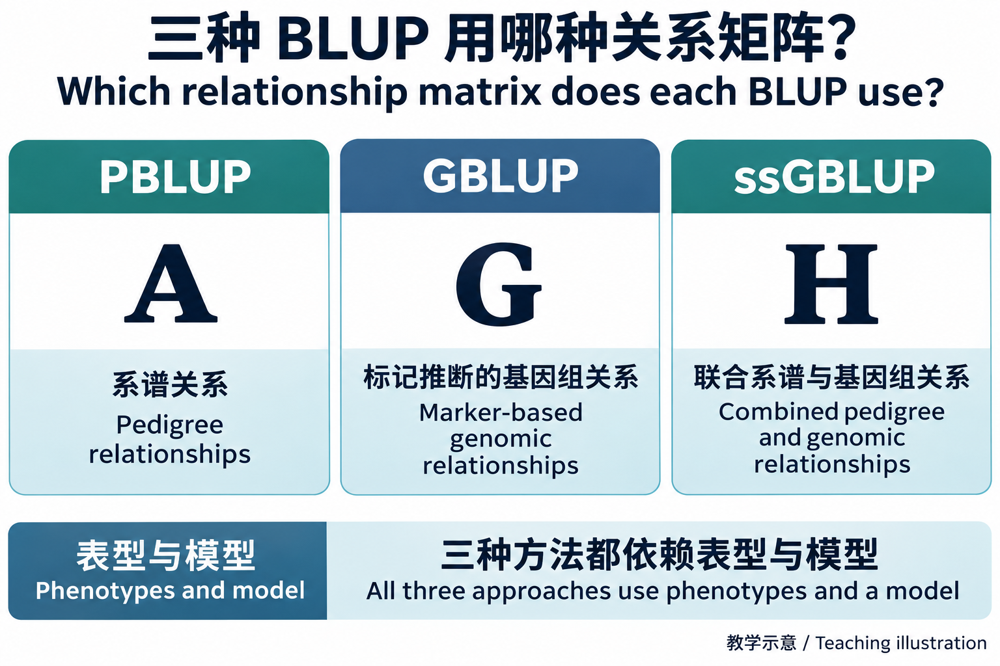

# 08-0｜基因组与三类 BLUP / Genomics and three BLUP approaches

[目录 / Contents](00-目录.md) · [上一章 / Previous](07-0-育种值计算与BLUP.md) · [下一章 / Next](09-0-选择选配与遗传进展.md)

从系谱走到基因组后，我先问系统多拿到了什么信息、哪些动物有分型、这些文件怎么按身份对上。  
When moving from pedigree to genomic information, I first ask what the system has gained, which animals are genotyped, and how IDs link the files.

A、G、H 这三个字母容易背，真正要弄懂的是各自描述什么关系、在模型里用到哪些数据。  
The names A, G, and H are easy to memorize, so I work out the relationships each represents and which data the model uses.

> **我的笔记｜系谱告诉你平均亲缘关系，基因组能补充实际继承差异。**  
> **My note | Pedigrees describe expected relationships, while genomics can add information about realized inheritance.**

## 01 · SNP 不是好坏评分 / SNP codes are not merit scores

**SNP**是单核苷酸多态性，即某个 DNA 位置在群体中存在不同碱基版本。  
A **SNP**, or single nucleotide polymorphism, is a DNA position with alternative nucleotide versions in a population.

常见二等位标记用 0、1、2 表示某个等位基因的拷贝数。  
Biallelic marker genotypes are often coded 0, 1, or 2 for allele-copy counts.

0、1、2 不代表差、中、好，标记也不一定是因果突变。  
These codes do not mean poor, medium, and good, and the marker need not be a causal mutation.

---

## 02 · 三类 BLUP 的区别 / Comparing the three approaches

### PBLUP：使用系谱 / PBLUP: pedigree information

**PBLUP 使用 A**，把父母身份与平均亲缘联系用于评估。  
**PBLUP uses A**, incorporating parentage and expected relationships into evaluation.

如果全同胞没有自身或可区分的后代信息，且模型信息完全对称，它们可能得到相同 EBV。  
Full siblings may receive identical EBVs when they lack own or distinguishing progeny information and their model information is symmetric.

相同 EBV 不代表它们的真实遗传能力完全相同。  
Identical EBVs do not imply identical true genetic merit.

### GBLUP：使用基因组 / GBLUP: genomic information

**GBLUP 使用 G**，通过标记描述相对参考群体的实际遗传联系。  
**GBLUP uses G**, describing realized genetic relationships relative to a reference population through markers.

它能帮助区分全同胞继承组合的差异。  
It can help distinguish inherited differences among full siblings.

G 依赖标记、等位基因频率与标定，不是简单的 DNA 相同百分比。  
G depends on markers, allele frequencies, and scaling, rather than being a simple percentage of matching DNA.

### ssGBLUP：统一评估 / ssGBLUP: integrated evaluation

**ssGBLUP**是单步基因组 BLUP，联合使用系谱、表型与部分动物的基因型。  
**ssGBLUP**, or single-step genomic BLUP, integrates pedigrees, phenotypes, and genotypes available for some animals.

组合关系矩阵常记为 **H**。  
The combined relationship matrix is commonly called **H**.

简单平均两个独立系统的 EBV，不能称为单步法。  
Averaging EBVs from two independent systems is not single-step evaluation.

**图 08-0A**　三种方法的关系矩阵依次是系谱矩阵 A、基因组矩阵 G 和联合关系矩阵 H，评估同时需要表型与模型。  
**Figure 08-0A**　The three methods use pedigree matrix A, genomic matrix G, and combined relationship matrix H, respectively, and evaluation also uses phenotypes and a model.

---

## 03 · H 如何组合信息 / How H combines information

$A_{22}$ 是已分型动物在 A 中的子矩阵。  
$A_{22}$ is the submatrix of A for genotyped animals.

按相同动物顺序，示意公式把基因组关系信息嵌回整个群体。  
With consistent animal ordering, the schematic formula embeds genomic relationships into the whole population.

$$
H^{-1}=A^{-1}+\begin{bmatrix}
0&0\\0&G^{-1}-A_{22}^{-1}
\end{bmatrix}
$$

实践中需要兼容的尺度、调和与稳定化处理，不能随意拼接 A 和 G。  
Practical use requires compatible scaling, tuning, and stabilization rather than arbitrary splicing of A and G.

---

## 04 · 芯片不能替代表型 / Genotypes do not replace phenotypes

基因组预测需要参考群体提供“基因型—表现”的联系。  
Genomic prediction needs reference data connecting genotypes to performance.

目标群体与参考群体的距离、分型错误、样本身份、标记缺失和模型都会影响结果。  
Relatedness to the reference population, genotype errors, sample identity, marker missingness, and model choice affect results.

仅有芯片文件，不能保证任何品种和性状都能准确预测。  
A genotype file alone does not guarantee accurate prediction for every breed and trait.

---

## 05 · 收敛不等于预测准确 / Convergence does not establish predictive accuracy

**方程收敛**说明数值求解达到设定标准。  
**Convergence** establishes that numerical solving met a specified criterion.

**预测能力**还需要独立验证。  
**Predictive ability** still needs independent validation.

按历史时间验证时，只能使用预测时点可获得的表型、系谱和分型信息。  
Historical time-based validation must use phenotypes, pedigrees, and genotypes available at the prediction date.

随机拆分亲属可能适合某些目标，但不能自动代表对未来或陌生群体的预测能力。  
Randomly splitting relatives may suit some objectives but does not automatically represent prediction for future or unfamiliar populations.

本章介绍通用方法，不代表某个本地程序已实现全部能力。  
This chapter describes general methods, not verified capabilities of a particular local program.

---

## 我的核对笔记 / My Verification Notes

我把质控后的动物清单、矩阵顺序和评估版本连在一起保存，单看方程有没有收敛只能核对数值求解。  
I keep the post-QC animal list, matrix order, and evaluation version together, since convergence checks only numerical solving.

要判断预测是否有用，我会先说清楚要预测哪一批动物，以及在那个时点能用到哪些表型、系谱和基因型。  
To judge whether predictions are useful, I first specify the target animals and which phenotypes, pedigrees, and genotypes are available at that point in time.

## 延伸阅读 / Further reading

下面按原始阅读列表顺序提供本地详读，重复来源复用同一篇笔记以保持解释一致。  
Local readings follow the original source-list order, reusing a single note for repeated sources to keep explanations consistent.

- **[单步关系矩阵 H](08-1-单步关系矩阵H详读.md)**。  
  **[The single-step relationship matrix H](08-1-单步关系矩阵H详读.md)**.

- **[基因组质控与样本身份](08-2-基因组质控与样本身份详读.md)**。  
  **[Genomic quality control and sample identity](08-2-基因组质控与样本身份详读.md)**.

- **[参考群体与基因组选择](08-3-参考群体与基因组选择详读.md)**。  
  **[Reference populations and genomic selection](08-3-参考群体与基因组选择详读.md)**.

原始来源链接保留如下，无法直接读取的来源及实际使用的替代材料已在对应详读中说明。  
Original source links follow, with unavailable sources and the alternatives actually used identified in the corresponding notes.

- [BLUPF90：单步关系公式](https://nce.ads.uga.edu/wiki/doku.php?id=undoc%3Ablupf90)。  
  [BLUPF90: single-step relationship equations](https://nce.ads.uga.edu/wiki/doku.php?id=undoc%3Ablupf90).

- [基因组质控](https://masuday.github.io/blupf90_tutorial/genomic_qc.html)。  
  [genomic quality control](https://masuday.github.io/blupf90_tutorial/genomic_qc.html).

- [BREEDPLAN：基因组入门](https://breedplan.une.edu.au/media/eonfbbw1/genomicsintro.pdf)。  
  [BREEDPLAN: introduction to genomics](https://breedplan.une.edu.au/media/eonfbbw1/genomicsintro.pdf).
