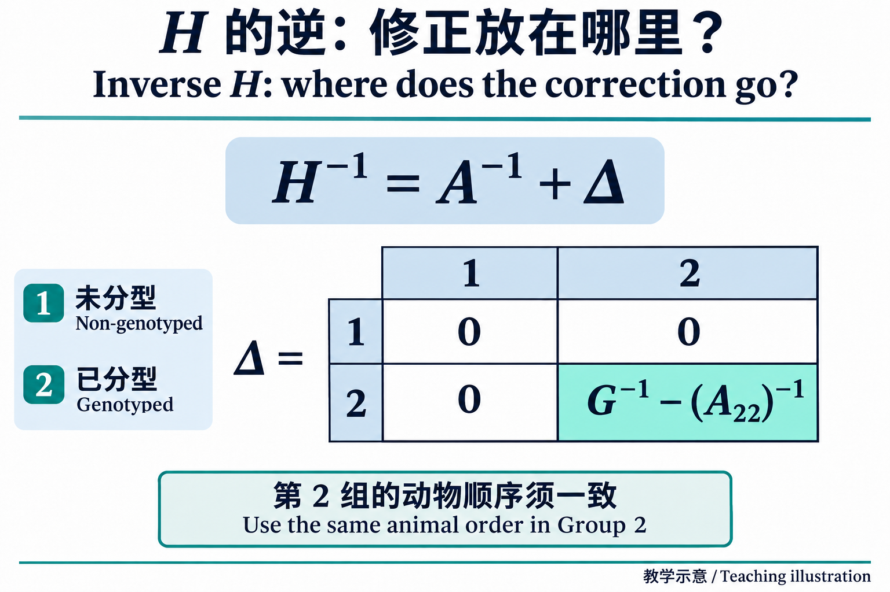

# 08-1｜单步关系矩阵 H / The single-step relationship matrix H

[目录 / Contents](00-目录.md) · [返回主文 / Main chapter](08-0-基因组与三类BLUP.md)

看到 H 的逆矩阵时，我先对齐已分型动物的身份，再检查修正项到底只加到哪一个矩阵块。  
When reading inverse H, I align the genotyped animal IDs first, then check exactly which matrix block receives the correction.

原阅读是 [UGA 单步关系公式](https://nce.ads.uga.edu/wiki/doku.php?id=undoc%3Ablupf90)，本次未能直接读取，实际依据为 [Masuda 单步教程](https://masuday.github.io/blupf90_tutorial/quicktour_ssgblup.html)。  
The original reading is the [UGA single-step equations](https://nce.ads.uga.edu/wiki/doku.php?id=undoc%3Ablupf90), which could not be retrieved directly, so the retrieved reference is [Masuda's single-step tutorial](https://masuday.github.io/blupf90_tutorial/quicktour_ssgblup.html).

本篇于 **2026-10-18** 核对来源，来源要点采用概括，教学数据与演算均为自拟。  
Sources were checked on **2026-10-18**, source points are summarized, and teaching data and calculations are original.

> **我想弄懂的事｜只有一部分猪分型，怎样与未分型猪一起评估？**  
> **What I want to understand | How are genotyped and non-genotyped pigs evaluated together?**

## 01 · 已读替代来源的要点 / Points from the retrieved alternative

作者教程使用“single-step genomic BLUP”，把系谱、表型和部分动物基因型放入同一模型。  
The author tutorial uses “single-step genomic BLUP” to combine pedigrees, phenotypes, and genotypes for some animals in one model.

它说明 H 的逆如何由 A、G 和已分型子集构成，下面用原创矩阵逐项解释。  
It explains the construction of the inverse of H from A, G, and the genotyped subset, unpacked below with original matrices.

## 02 · 先统一动物顺序 / Align animal ordering first

令第 1 组为未分型动物，第 2 组为已分型动物，把 A 按这两组拆成四块。  
Let Group 1 contain non-genotyped animals and Group 2 genotyped animals, partitioning A into four blocks.

$$
A=\begin{bmatrix}A_{11}&A_{12}\\A_{21}&A_{22}\end{bmatrix}
$$

$A_{22}$ 只包含已分型动物，但它来自完整系谱关系，而不只是已分型动物之间能看到的父母表。  
$A_{22}$ contains only genotyped animals but derives from the full pedigree relationships rather than only parentage visible within the genotyped subset.

G 也必须采用第 2 组的同一动物顺序，否则数值正确但身份错位仍会出错。  
G must use exactly the same animal order as Group 2, or correct numbers attached to wrong identities still produce errors.

## 03 · H 逆的公式 / The inverse-H equation

$$
H^{-1}=A^{-1}+\begin{bmatrix}
0&0\\0&G^{-1}-A_{22}^{-1}
\end{bmatrix}
$$

这个结构保留全群系谱框架，再在分型子集加入基因组与原系谱信息之间的修正。  
This structure retains the whole-population pedigree framework and adds a correction between genomic and pedigree information in the genotyped subset.

减去 $A_{22}^{-1}$ 是为了在这一协方差构造中替换相应信息，而不是把同一系谱关系再完整加一遍。  
Subtracting $A_{22}^{-1}$ replaces the corresponding information in this covariance construction rather than adding the same pedigree relationships again.

公式中的逆是矩阵逆，不能把每个元素分别取倒数。  
The inverses are matrix inverses, not reciprocals of individual entries.

**图 08-1A**　在 $H^{-1}=A^{-1}+\Delta$ 中，修正矩阵 $\Delta$ 的三个块为零，右下角已分型动物块为 $G^{-1}-(A_{22})^{-1}$。  
**Figure 08-1A**　In $H^{-1}=A^{-1}+\Delta$, three blocks of $\Delta$ are zero and the lower-right block for genotyped animals is $G^{-1}-(A_{22})^{-1}$.

计算这个块时，$G$ 和 $A_{22}$ 的动物顺序必须一致，并分别做矩阵求逆。  
To compute this block, put $G$ and $A_{22}$ in the same animal order and invert each as a matrix.

## 04 · 一个三动物数值例子 / A three-animal numerical example

沿用父母 S、D 与子代 C 的 A，但假设只有 D、C 分型，顺序为 S｜D、C。  
Use the A matrix for parents S and D and offspring C, assuming only D and C are genotyped, ordered S | D, C.

$$
A=\begin{bmatrix}1&0&0.5\\0&1&0.5\\0.5&0.5&1\end{bmatrix},
\quad A^{-1}=\begin{bmatrix}1.5&0.5&-1\\0.5&1.5&-1\\-1&-1&2\end{bmatrix}
$$

从 A 抽取 D、C 的行列，再求逆得到下式。  
Selecting the D and C rows and columns of A and then inverting gives the following.

$$
A_{22}=\begin{bmatrix}1&0.5\\0.5&1\end{bmatrix},
\quad A_{22}^{-1}=\begin{bmatrix}4/3&-2/3\\-2/3&4/3\end{bmatrix}
$$

这与 $A^{-1}$ 的右下块 $\begin{bmatrix}1.5&-1\\-1&2\end{bmatrix}$ 不同，说明“先取子矩阵再求逆”不等于“先求逆再取子矩阵”。  
This differs from the lower-right block $\begin{bmatrix}1.5&-1\\-1&2\end{bmatrix}$ of $A^{-1}$, showing that subsetting before inversion differs from subsetting after inversion.

再人为给出一个用于演算的兼容尺度正定 G，不把它当作真实 SNP 估计。  
Now specify a positive-definite G on a compatible illustrative scale for calculation rather than claiming an actual SNP estimate.

$$
G=\begin{bmatrix}1&0.2\\0.2&1\end{bmatrix},
\quad G^{-1}=\begin{bmatrix}25/24&-5/24\\-5/24&25/24\end{bmatrix}
$$

$$
G^{-1}-A_{22}^{-1}=\frac1{24}\begin{bmatrix}-7&11\\11&-7\end{bmatrix}
$$

将修正加入 D、C 的位置，得到完整三动物矩阵。  
Adding the correction in the D and C positions gives the full three-animal matrix.

$$
H^{-1}=\begin{bmatrix}
3/2&1/2&-1\\
1/2&29/24&-13/24\\
-1&-13/24&41/24
\end{bmatrix}
$$

修正矩阵的对角元为负不表示负遗传方差，因为它是两个逆矩阵之差，并不是独立的协方差矩阵。  
Negative diagonal entries in the correction do not imply negative genetic variance because this is a difference of inverses, not a standalone covariance matrix.

## 05 · 实际 G 为什么需要标定与稳定化 / Why G needs tuning and stabilization

G 依赖标记编码、等位基因频率与参考群体，A 则依赖系谱基础假设，两者尺度不能只凭名字默认一致。  
G depends on marker coding, allele frequencies, and reference population, while A depends on pedigree-base assumptions, so matching scales cannot be assumed from their names.

**标定或调和**调整参考水平与尺度，**稳定化**帮助处理矩阵近奇异等数值问题。  
**Tuning** adjusts reference level and scale, while **stabilization** helps address numerical problems such as near-singular matrices.

**奇异**表示矩阵不存在通常意义的逆，小型示例或高度重复的基因型都可能暴露这种问题。  
**Singular** means a matrix lacks an ordinary inverse, which can occur in tiny examples or highly redundant genotypes.

具体调和、混合和权重必须依据软件版本与评估设计，不把本篇 G 直接当作生产设置。  
Actual tuning, blending, and weighting depend on software version and evaluation design, and this example G is not a production setting.

## 06 · 在模型里核对 H 和共同信息 / Check H and Shared Information in the Model

看到同一头猪同时有系谱和基因组 EBV，我会查是否使用了含 H 的联合模型，以及共享信息在里面怎样处理。  
When a pig has both pedigree and genomic EBVs, I check whether a joint model using H was fitted and how it handled shared information.

两套独立 EBV 的平均只是一种结果汇总，单步法的关键在联合模型里的关系协方差构造。  
Averaging two separate EBVs summarizes the outputs, while single-step evaluation relies on how relationship covariance is built in the joint model.
