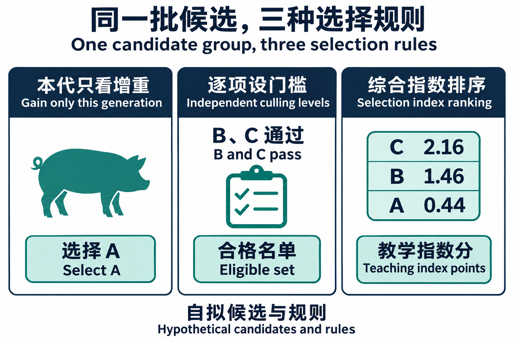

# 09-1｜多性状选择：先定目标，再分配选择压力 / Multi-trait selection: objectives and emphasis

[目录 / Contents](00-目录.md) · [第09章 / Chapter 09](09-0-选择选配与遗传进展.md) · [下一篇 / Next](09-2-综合选择指数详读.md)

我用同一批候选猪分别跑单性状排序、逐项门槛和综合指数，这样每次只变规则，结果好对照。  
I apply single-trait ranking, individual thresholds, and an index to the same candidates, so the comparison changes only the rule.

> **我想弄懂的事｜一头猪不可能每个指标都最好，你如何决定留谁？**  
> **What I want to understand | If no pig leads every trait, how do you choose parents?**

**主来源：**[Purdue／NSIF-FS10](https://www.extension.purdue.edu/extmedia/NSIF/NSIF-10/NSIF-FS10.html)，作者为 Stewart、Neal 与 Irvin，网页标有 1999 年版本信息。  
**Principal source:** [Purdue / NSIF-FS10](https://www.extension.purdue.edu/extmedia/NSIF/NSIF-10/NSIF-FS10.html), by Stewart, Neal, and Irvin, with a 1999 edition notation.

本笔记于 2026-10-17 核对，原文对象是猪，历史权重不作为当前推荐值。  
This note was checked on 2026-10-17 and concerns pigs, without treating historical weights as current recommendations.

## 01 · 原文短摘与要点 / Short excerpt and source summary

> **短摘译意：目标与选择依据不是同一回事。**  
> **Short excerpt: “the objective and criterion are not the same.”**

摘录位于原文 Background 部分，以下为概括而非逐字翻译。  
The excerpt is from Background, and the following is a summary rather than a full translation.

- **育种目标**描述最终要改良什么，**选择依据**描述用什么信息选动物。  
  The **objective** states what to improve, while the **criterion** states what information selects animals.

- **轮回选择**按代轮换重点性状。  
  **Tandem selection** rotates the focal trait across generations.

- **独立淘汰门槛**要求每个指定性状过关。  
  **Independent culling levels** require passing every specified trait threshold.

- **指数选择**把多性状信息汇成一个综合排序。  
  **Index selection** combines multi-trait information into an overall ranking.

原文提醒，单项改良最快不一定意味着综合目标改良最多。  
The source cautions that the fastest single-trait improvement need not maximize the overall objective.

---

## 02 · 教学解释：为什么不能只看一个指标 / Teaching explanation: beyond one metric

下面用自拟候选集比较三种规则，避免把抽象方法混在一起。  
The original candidate set below compares three rules without conflating the methods.

所有 EBV 假设来自同一可比评估，三项依次为 ADG、背膘 BF 与产活仔数 NBA。  
All EBVs are assumed comparable, listed as ADG, backfat BF, and number born alive NBA.

- **甲：+40 g/day、+0.8 mm、+0.1 头/窝。**  
  **A: +40 g/day, +0.8 mm, and +0.1 piglets/litter.**

- **乙：+30 g/day、+0.2 mm、+0.4 头/窝。**  
  **B: +30 g/day, +0.2 mm, and +0.4 piglets/litter.**

- **丙：+20 g/day、−0.3 mm、+0.6 头/窝。**  
  **C: +20 g/day, −0.3 mm, and +0.6 piglets/litter.**

### 规则一：本代只看增重 / Rule 1: select only on gain this generation

甲的增重 EBV 最高，所以这个规则选择甲。  
A has the highest growth EBV, so this rule selects A.

这条规则没有直接使用背膘和繁殖信息，不等于证明它们不重要。  
The rule ignores backfat and reproduction directly, without establishing that they are unimportant.

### 规则二：每项都要过线 / Rule 2: require every threshold

假设门槛为 ADG ≥ 20、BF ≤ 0.5、NBA ≥ 0.3，单位沿用上文。  
Suppose thresholds are ADG ≥ 20, BF ≤ 0.5, and NBA ≥ 0.3, using the units above.

乙和丙通过，甲因背膘与繁殖指标未达标而被排除。  
B and C pass, while A fails the backfat and reproduction thresholds.

这一步只定义合格集合，尚未决定在乙、丙之间留谁。  
This defines the eligible set without yet choosing between B and C.

### 规则三：按综合指数排序 / Rule 3: rank by an index

假设教学指数如下，其单位仅为自定义指数分，不代表实际利润。  
The hypothetical teaching index below uses arbitrary index points, not actual profit.

$$
J=0.03\,EBV_{ADG}-1.2\,EBV_{BF}+2\,EBV_{NBA}
$$

- 甲得 $1.2-0.96+0.2=0.44$ 分。  
  A scores $1.2-0.96+0.2=0.44$ points.

- 乙得 $0.9-0.24+0.8=1.46$ 分。  
  B scores $0.9-0.24+0.8=1.46$ points.

- 丙得 $0.6+0.36+1.2=2.16$ 分。  
  C scores $0.6+0.36+1.2=2.16$ points.

丙在这组权重下排名最高，但更换目标或权重可能改变结论。  
C ranks highest under these weights, but another objective or weighting can change the result.

**图 09-1A**　同一组自拟候选中，本代只看增重时选甲，逐项设门槛时乙和丙进入合格名单，按当前教学指数排序时丙、乙、甲依次得 2.16、1.46、0.44 分。  
**Figure 09-1A**　For the same hypothetical candidates, selection on gain alone picks A, independent culling levels admit B and C, and the teaching index ranks C, B, and A at 2.16, 1.46, and 0.44 points.

三栏是分别应用于同一候选集的三种规则，门槛规则在本例只给出合格名单。  
The panels apply three separate rules to the same candidates, and the threshold rule produces an eligible set in this example.

---

## 03 · 补充原理：相关与信息来源 / Supporting principles: correlations and information

[Purdue 遗传参数资料](https://www.extension.purdue.edu/extmedia/NSIF/NSIF-FS3-W.html)解释，遗传相关决定一个性状变化时另一个性状可能怎样变化。  
[Purdue's genetic-parameter resource](https://www.extension.purdue.edu/extmedia/NSIF/NSIF-FS3-W.html) explains that genetic correlations influence correlated changes in other traits.

相关的正负号描述方向，是否有利还要看目标方向。  
The sign describes direction, while desirability depends on the objective.

[遗传价值估计资料](https://www.extension.purdue.edu/extmedia/NSIF/NSIF-FS8.html)说明，亲属和相关性状的信息可以参与遗传预测。  
The [genetic-merit resource](https://www.extension.purdue.edu/extmedia/NSIF/NSIF-FS8.html) explains how relatives and correlated traits contribute information to genetic prediction.

因此不能把自己未直接测到某性状，等同于该性状没有可用信息。  
Not measuring a trait on a candidate does not imply that no information about it is available.

---

## 04 · 用筛选程序理解 / A filtering analogy

可以把独立门槛看作 `eligible = rule1 AND rule2 AND rule3`。  
Think of independent thresholds as `eligible = rule1 AND rule2 AND rule3`.

指数则像对候选集执行 `ORDER BY score`，前者定义资格，后者定义排序。  
An index resembles `ORDER BY score`, with eligibility and ranking serving different purposes.

若两项门槛通过率都为 50%，只有在独立等条件成立时，联合通过率才是 25%。  
Two 50% pass rates produce a 25% joint pass rate only under conditions such as independence.

一般应使用条件概率，而不是机械连乘两个边际通过率。  
In general, use conditional probabilities rather than blindly multiplying marginal pass rates.

$$
P(A\cap B)=P(A)\,P(B\mid A)
$$

这个程序类比说明规则结构，不表示动物之间或性状之间真的独立。  
This programming analogy explains rule structure without assuming independent animals or traits.

## 05 · 先定资格条件，再读指数排名 / Establish Eligibility Before Reading Index Rankings

若丙在不能用别的指标补偿的健康或结构条件上不合格，我会先按资格规则处理，再在合格动物中应用指数排序。  
If C fails a health or structural requirement that other traits cannot compensate for, I apply the eligibility rule first and then rank eligible animals by index.

这里的示例、计算和程序类比均由本教程自拟，不是 Purdue 的案例或生产建议。  
These examples, calculations, and programming analogies are original teaching material, not Purdue cases or production recommendations.
