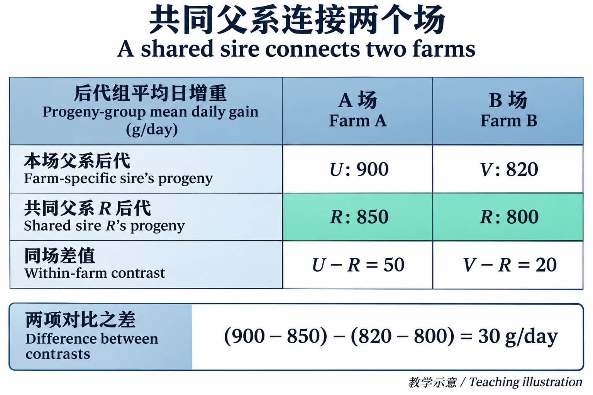
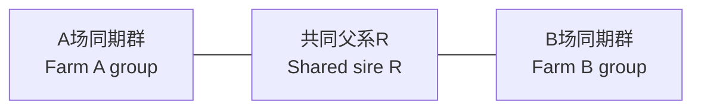

# 09-4｜遗传联系：让不同组之间有一座桥 / Connectedness: a bridge between groups

[目录 / Contents](00-目录.md) · [第09章 / Chapter 09](09-0-选择选配与遗传进展.md) · [上一篇 / Previous](09-3-同期群与公平比较详读.md) · [下一篇 / Next](09-5-选择反应与年度遗传进展详读.md)

两个场的均值放在同一张表里，我会追数据里有没有共同父系这一类联系，能否帮我们区分场区和遗传差异。  
When two farm means appear in one table, I look for connections such as a shared sire that can help separate farm differences from genetic differences.

> **我想弄懂的事｜如果不同场使用完全不同的父系，怎样分开场区优势与遗传优势？**  
> **What I want to understand | If farms use entirely different sires, how can farm and genetic advantages be separated?**

**主来源：**[Making Performance Data More Effective](https://breedplan.une.edu.au/getting-started/making-performance-data-more-effective/)，核对日期为 2026-10-17。  
**Principal source:** [Making Performance Data More Effective](https://breedplan.une.edu.au/getting-started/making-performance-data-more-effective/), checked on 2026-10-17.

该文针对肉牛，本篇另外提供独立的猪群教学例子。  
The source concerns beef cattle, with original pig-group examples provided separately here.

## 01 · 原文短摘与要点 / Short excerpt and source summary

> **短摘译意：共同父系连接同期群。**  
> **Short excerpt: “common sires link contemporary groups”.**

这句话摘自原文 Creating Genetic Linkage 部分。  
This wording is from Creating Genetic Linkage.

原文强调两件事：组内保持可比，组间建立遗传联系。  
The source emphasizes within-group comparability and genetic links between groups.

共同父系可连接场内、跨场和跨年份的记录。  
Shared sires can connect records within herds, across herds, and across years.

文中“至少两个父系”的要求，针对其系统中后代记录对父本 EBV 的贡献。  
Its requirement for at least two sires concerns progeny-record contributions to sire EBVs in that system.

这不是所有物种和模型通用的充分条件。  
It is not a universal sufficient condition for every species and model.

---

## 02 · 教学反例：完全重合的两种解释 / Teaching counterexample: indistinguishable explanations

假设 A 场只养 U 的后代，B 场只养 V 的后代。  
Suppose farm A contains only U's offspring and farm B only V's offspring.

两场的日增重均值分别为 900 与 800 g/day。  
Their mean daily gains are 900 and 800 g/day.

差异可能来自父系、场区或两者共同作用，单凭这两个均值不能分解。  
The difference may reflect sire, farm, or both, and those two means alone cannot separate them.

用简化模型表达，场效应与父系效应完全重合。  
In a simplified model, farm and sire effects are perfectly confounded.

$$
\bar y_A=\mu+g_A+s_U,\qquad
\bar y_B=\mu+g_B+s_V
$$

给 $g_A$ 加 20、同时给 $s_U$ 减 20，A 场的预测均值不变。  
Adding 20 to $g_A$ and subtracting 20 from $s_U$ leaves farm A's predicted mean unchanged.

这就是多种参数解释可以产生同样观测的例子。  
This illustrates different parameter explanations producing the same observations.

系谱或基因组信息能提供额外结构，但不能自动替代合理的数据设计。  
Pedigree or genomic information adds structure without automatically replacing sound data design.

---

## 03 · 加一个共同父系 / Add a shared sire

以下全部为假设后代组均值，并假设配偶组成与测定条件已合理平衡。  
All values below are hypothetical progeny-group means, assuming reasonably balanced mates and testing conditions.

- A 场中，U 的后代为 **900**，共同父系 R 的后代为 **850**。  
  In farm A, U's offspring average **900**, and shared sire R's offspring average **850**.

- B 场中，V 的后代为 **820**，R 的后代为 **800**。  
  In farm B, V's offspring average **820**, and R's offspring average **800**.

同场比较得到 U−R = 50、V−R = 20，单位均为 g/day。  
Within-farm comparisons give U−R = 50 and V−R = 20, both in g/day.

在这个加性环境简化例子中，两项相减得到相对差异 **30 g/day**。  
In this simplified additive-environment example, subtracting the contrasts gives a relative difference of **30 g/day**.

$$
(900-850)-(820-800)=30
$$

这里比较的是后代组对比，不是已计算完成的公猪 EBV。  
This is a progeny-group contrast, not a completed sire EBV.

实际还需要亲缘、母本、样本量、方差与收缩等处理。  
Actual evaluation also requires relationships, dams, sample sizes, variances, and shrinkage.

共同 R 提供桥梁，但一个共同父系不自动保证高准确度。  
Shared R provides a bridge, but one shared sire does not automatically guarantee high accuracy.

**图 09-4A**　两场都以共同父系 R 的后代均值作同场参照，得到 U−R = 50 g/day、V−R = 20 g/day。  
**Figure 09-4A**　Both farms use the mean of shared sire R’s progeny as the within-farm reference, giving U−R = 50 g/day and V−R = 20 g/day.

在配偶和测定条件合理平衡的加性教学模型中，两项同场对比的差是 30 g/day，比较对象是后代组。  
In the additive teaching model with reasonably balanced mates and testing conditions, the difference of 30 g/day is a comparison of progeny groups.

---

## 04 · 补充原理：图能说明什么 / Supporting principle: what a graph shows

[Purdue 跨场评估资料的 Connectedness 部分](https://www.extension.purdue.edu/extmedia/NSIF/NSIF-FS13.html)解释，亲缘信息可连接不同组的评估。  
The [Connectedness section of Purdue's across-herd evaluation resource](https://www.extension.purdue.edu/extmedia/NSIF/NSIF-FS13.html) explains linking group evaluations through relationships.

可以把组当节点，把共同父系或其他有效亲缘信息当连接。  
Think of groups as nodes and shared sires or other informative relationships as connections.

图中连通只表示存在路径，不等于统计联系足够强或预测已经可靠。  
Graph connectivity establishes a path, not sufficient statistical connectedness or reliable prediction.

### 一个自拟数据检查清单 / An original data-review checklist

- 查看每组涉及多少父系，以及后代是否只来自一个家系。  
  Review how many sires occur in each group and whether records come from only one family.

- 查看共同父系是否分布在真实可比的时间窗口。  
  Review whether shared sires occur in genuinely comparable time windows.

- 查看记录是否集中在少数父系，或缺少关键中间年份。  
  Review concentration in a few sires and missing intermediate years.

- 同时保留每条边的后代数量，而不只记录有或没有联系。  
  Retain progeny counts for each connection rather than only its presence or absence.

这个清单用于发现问题，不是正式统计联系指标或统一最低样本量标准。  
This checklist detects problems rather than defining a formal connectedness statistic or universal minimum sample size.

---

## 05 · 记录多，也要确认真的提交了 / More records must actually reach evaluation

[BREEDPLAN 记录完整性说明](https://breedplan.une.edu.au/products/completeness-of-performance/)区分记录覆盖情况与单个动物 EBV 的准确度。  
[BREEDPLAN's completeness explanation](https://breedplan.une.edu.au/products/completeness-of-performance/) distinguishes recording coverage from an individual animal's EBV accuracy.

它还帮助核对已采集的信息是否进入评估系统。  
It also helps check whether collected information reached the evaluation system.

本教程建议分别核对应测动物、已测动物、已上传记录和实际纳入评估记录。  
This tutorial recommends reconciling eligible animals, measured animals, uploaded records, and records actually included in evaluation.

这些数量不同，不应把某一个计数当作整个链条已完成。  
These counts differ, and one count does not establish completion of the whole chain.

## 06 · 跨场比较先查有没有可用的联系 / Check Connectedness Before Comparing Farms

两场各有一万条记录时，我也会先找有没有共同父系或其他可用的遗传联系。  
Even if both farms have ten thousand records, I first look for a shared sire or another usable genetic link.

如果数据结构把场区和遗传差异混在一起，继续增加同样结构的记录也无法从中把两者分开。  
If the design confounds farm and genetic differences, collecting more records with the same structure still cannot separate them.
