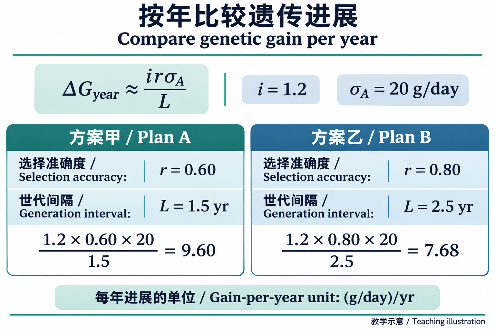

# 09-5｜选择反应：每代改良与每年改良 / Selection response: per generation versus per year

[目录 / Contents](00-目录.md) · [第09章 / Chapter 09](09-0-选择选配与遗传进展.md) · [上一篇 / Previous](09-4-遗传联系与数据记录详读.md)

我把两种方案拆成准确度、世代间隔和年进展几列，先用同一单位算，再看多等一段时间值不值。  
I put accuracy, generation interval, and annual gain in separate columns for both plans, calculate on the same scale, and then judge the value of waiting longer.

> **我想弄懂的事｜预测更准但等待更久，最终每年的改良一定更多吗？**  
> **What I want to understand | If prediction improves but takes longer, must annual genetic progress increase?**

**原始入口：**[UNE 数量遗传学课程提纲](https://jvanderw.une.edu.au/325TT)，本次访问未成功取得全文。  
**Original entry point:** [UNE quantitative-genetics course outline](https://jvanderw.une.edu.au/325TT), whose full text could not be directly retrieved this time.

因此本篇不是该提纲的全文摘要，正文依据已读取的 [UNE 讲义](https://jvanderw.une.edu.au/lect01.pdf)与 [Purdue／NSIF-FS9](https://extension.purdue.edu/extmedia/NSIF/NSIF-FS9.pdf)。  
This is therefore not a full-text summary of that outline, and its exposition uses the readable [UNE lecture](https://jvanderw.une.edu.au/lect01.pdf) and [Purdue / NSIF-FS9](https://extension.purdue.edu/extmedia/NSIF/NSIF-FS9.pdf).

核对日期为 2026-10-17，以下教学参数全部为假设。  
The check date is 2026-10-17, and all teaching parameters below are hypothetical.

## 01 · 可核对的短摘与要点 / Verified excerpt and source summary

> **短摘译意：依据准确的育种值进行选择。**  
> **Short excerpt: “Select based on accurate breeding values”.**

该短摘来自 UNE 讲义 PDF 第 20 页，而非未读取成功的提纲网页。  
This excerpt is from UNE lecture PDF page 20, not the outline that could not be retrieved.

讲义 PDF 第 6 页把选择反应联系到强度、准确度、遗传标准差与世代间隔。  
PDF page 6 relates response to intensity, accuracy, genetic standard deviation, and generation interval.

[NSIF-FS9 的 PDF 第 4 页](https://extension.purdue.edu/extmedia/NSIF/NSIF-FS9.pdf#page=4)将每代反应进一步换算为每年进展。  
[NSIF-FS9 PDF page 4](https://extension.purdue.edu/extmedia/NSIF/NSIF-FS9.pdf#page=4) converts response per generation into annual progress.

“挑得更好”和“更快产生替代后代”是不同的改进方向。  
Choosing better parents and producing replacement offspring sooner are different improvement routes.

---

## 02 · 补充概念：S 和 R 不一样 / Supporting concepts: S differs from R

[Bruce Walsh 的选择反应课程 PDF 第 2—3 页](https://si.biostat.washington.edu/sites/default/files/modules/IntroQG-seattle-2018-Lecture04.pdf#page=2)区分亲代选择差与后代选择反应。  
[PDF pages 2–3 of Bruce Walsh's selection-response lecture](https://si.biostat.washington.edu/sites/default/files/modules/IntroQG-seattle-2018-Lecture04.pdf#page=2) distinguish parental selection differential from offspring response.

- **选择差 S**是入选亲本均值相对原群体均值的偏离。  
  The **selection differential S** is the selected-parent mean minus the original population mean.

- **选择反应 R**是选择造成的下一代群体均值变化。  
  The **selection response R** is the next-generation mean change caused by selection.

在简单加性、表型选择等条件下，可使用狭义遗传力的育种者方程。  
Under simple additive and phenotypic-selection assumptions, the breeder's equation uses narrow-sense heritability.

$$
R=h^2S
$$

雌雄两性选择不同时，需要按适用模型合并双方贡献，而不能只代入父本的选择差。  
When selection differs between the sexes, combine contributions under the appropriate model rather than inserting only the sire differential.

### 自拟手算例子 / Original hand-calculation example

假设原群体均值为 800 g/day，入选亲本的适用综合均值为 850 g/day。  
Suppose the original mean is 800 g/day and the appropriate combined selected-parent mean is 850 g/day.

选择差是 $S=850-800=50$ g/day。  
The selection differential is $S=850-800=50$ g/day.

若 $h^2=0.30$，则预期每代反应为 $R=0.30\times50=15$ g/day。  
If $h^2=0.30$, expected response per generation is $R=0.30\times50=15$ g/day.

这不是每年 15，也不是每一头后代都增加 15。  
This is neither 15 per year nor a guaranteed increase of 15 for every offspring.

---

## 03 · 更一般的四个因素 / Four more general factors

在简单单性状近似下，年度反应常写为下面的形式。  
Under a simple single-trait approximation, annual response is often written as follows.

$$
\Delta G_{year}\approx\frac{i\,r\,\sigma_A}{L}
$$

- **i 是选择强度**，描述按某种标准选出的群体有多优秀。  
  **i is selection intensity**, describing the standardized superiority of the selected group.

- **r 是选择标准与真实育种值的相关**，不是两个性状的遗传相关。  
  **r is the correlation between the selection criterion and true breeding value**, not a genetic correlation between traits.

- **$\sigma_A$ 是加性遗传标准差**，不是表型标准差，也不是遗传方差。  
  **$\sigma_A$ is additive genetic standard deviation**, not phenotypic standard deviation or genetic variance.

- **L 是世代间隔**，即产生替代后代时父母的平均年龄。  
  **L is generation interval**, the average parental age at birth of replacement offspring.

选择强度是无量纲量，不是把保留 10% 直接写成 $i=0.10$。  
Selection intensity is dimensionless, and retaining 10% does not mean $i=0.10$.

如果性状单位是 g/day，年度反应单位就是 **g/day 每年**。  
If the trait is measured in g/day, annual response is measured in **g/day per year**.

### 不要把 r 当成遗传力 / Do not confuse r with heritability

在只用自身表型选择的简单模型中，$r=h=\sqrt{h^2}$，而不是 $r=h^2$。  
In the simple own-phenotype selection model, $r=h=\sqrt{h^2}$ rather than $r=h^2$.

若改用 EBV 或综合信息，准确度应按实际选择标准与信息结构确定。  
With EBVs or combined information, accuracy depends on the actual criterion and information structure.

---

## 04 · 两个方案比较：更准不一定更快 / Comparing plans: more accurate may not mean faster

假设两方案的 $i=1.2$、$\sigma_A=20$ g/day，但准确度与等待时间不同。  
Suppose both plans have $i=1.2$ and $\sigma_A=20$ g/day, but differ in accuracy and waiting time.

- **方案甲：$r=0.60$、$L=1.5$ 年，年度进展为 9.6 (g/day)/年。**  
  **Plan A: $r=0.60$ and $L=1.5$ years give annual progress of 9.6 (g/day)/year.**

- **方案乙：$r=0.80$、$L=2.5$ 年，年度进展为 7.68 (g/day)/年。**  
  **Plan B: $r=0.80$ and $L=2.5$ years give annual progress of 7.68 (g/day)/year.**

$$
\Delta G_A=\frac{1.2\times0.60\times20}{1.5}=9.6,\qquad
\Delta G_B=\frac{1.2\times0.80\times20}{2.5}=7.68
$$

乙每次选择更准，但等待更久，因此本例中的年度进展较少。  
B selects more accurately each time but waits longer, so its annual response is lower in this example.

这个比较只说明权衡，不能证明现实中应该一律选最年轻的动物。  
This illustrates a trade-off rather than proving that the youngest animals should always be selected.

成熟度、繁殖能力、健康与预测是否适用，仍需满足实际条件。  
Maturity, reproductive ability, health, and prediction applicability must still meet practical requirements.

**图 09-5A**　两种方案共用选择强度 1.2 和加性遗传标准差 20 g/day，本例的年进展分别为 9.60 和 7.68 (g/day)/年。  
**Figure 09-5A**　Both plans use a selection intensity of 1.2 and an additive genetic standard deviation of 20 g/day, giving 9.60 and 7.68 (g/day)/year, respectively.

方案乙的准确度更高，较长的世代间隔使本例的年进展低于方案甲。  
Plan B has higher accuracy, and its longer generation interval results in a lower annual gain than Plan A in this example.

---

## 05 · 父母两条路径怎么合并 / Combining sire and dam paths

UNE 讲义的双路径形式允许父母拥有不同的选择强度、准确度和世代间隔。  
The UNE lecture's two-path form allows different sire and dam intensities, accuracies, and generation intervals.

在简化两性加性模型下，可写为下面的形式。  
In a simplified two-sex additive model, it can be written as follows.

$$
\Delta G_{year}\approx
\frac{(i_mr_m+i_fr_f)\sigma_A}{L_m+L_f}
$$

假设父系 $i_m=1.4,r_m=0.7,L_m=1$，母系 $i_f=0.8,r_f=0.5,L_f=2$。  
Suppose the sire path has $i_m=1.4,r_m=0.7,L_m=1$, and the dam path has $i_f=0.8,r_f=0.5,L_f=2$.

当 $\sigma_A=20$ g/day 时，结果为 $(0.98+0.40)\times20/3=9.2$ g/day 每年。  
With $\sigma_A=20$ g/day, the result is $(0.98+0.40)\times20/3=9.2$ g/day per year.

这里的两条路径是教学简化，复杂育种结构可能需要更多路径或模拟。  
These two paths are a teaching simplification, and complex breeding structures may require additional paths or simulation.

## 06 · 预测值如何接受检查 / Checking the prediction

先固定性状定义、评估基准、出生年份与比较范围，再追踪后续实际遗传趋势。  
Fix the trait definition, evaluation base, birth years, and comparison scope before tracking subsequent genetic trends.

生产均值还受管理影响，不能单凭生产增长宣称实现了预测遗传进展。  
Production means also reflect management, so production growth alone does not establish the predicted genetic response.

原文框架提供比较方案的思路，而本篇计算不构成实际猪群的收益承诺。  
The source framework supports comparison of plans, while these calculations make no performance promise for a real pig population.
